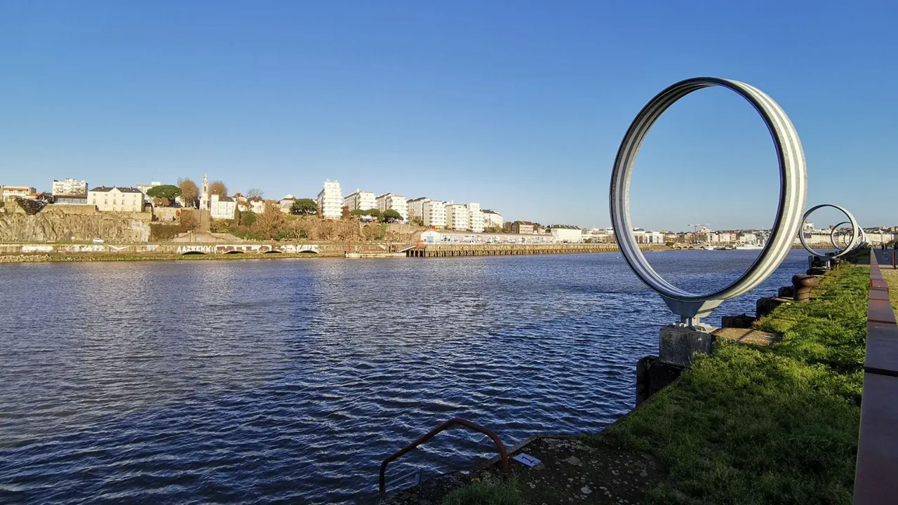

Pour cette balade, il est recommandé de faire le trajet aller ou retour entre Nantes et Bouaye en train. Cela vous permettra de gagner du temps et de profiter pleinement de votre balade.

Ce trajet de 21 km entre Nantes et le lac de Grand lieu vous invite à découvrir différents sites incontournables présents sur le chemin. À Nantes vous pourrez ainsi découvrir le Mémorial de l’abolition de l’esclavage ainsi que la partie ouest de [l’ile](/post/balade-incontournable-lile-de-nantes) avec les machines et les anneaux de Buren. Vous vous baladerez ensuite dans les petites rues colorées de [Trentemoult](/post/trentemoult-un-village-pittoresque) et découvrirez le Pendule de Signer. La balade vous mènera ensuite jusqu’à la maison du Lac de Grand lieu à Bouaye.  Pour les plus courageux une liaison en aller-retour de 9 km entre Bouaye et Pierre-Aigüe à St-Aignan de Grand-lieu vous permettra d’obtenir un point de vue unique sur le Lac.

- **Distance :** 21km
- **Durée :** 1h23
- **Niveau :** habitué

[Découvrez la balade à vélo sur l'île de Nantes](/post/balade-incontournable-lile-de-nantes)

[En savoir plus sur Trentemoult et ses rues colorées](/post/trentemoult-un-village-pittoresque)

[Voir ici toutes nos balades à vélo et articles de blog](/fr/blog)

En savoir plus sur cet itinéraire (**lien** [**Geovelo**](https://www.geovelo.fr/nantes/route?b=47.241235,-1.492630,47.110928,-1.750376&from=-1.553060,47.218110&to=-1.691920,47.132790)) :

<https://www.geovelo.fr/nantes/route?b=47.241235,-1.492630,47.110928,-1.750376&from=-1.553060,47.218110&to=-1.691920,47.132790>

[Voir le parcours sur Google Maps](https://www.google.fr/maps/dir/Nantes/La+Maison+du+Lac+de+Grand-Lieu,+Rue+du+Lac,+Bouaye/@47.1709235,-1.6851729,12z/data=!3m1!4b1!4m14!4m13!1m5!1m1!1s0x4805ee81f0a8aead:0x40d37521e0ded30!2m2!1d-1.553621!2d47.218371!1m5!1m1!1s0x48059596ac0a474d:0x88e3a2e2868cb5c3!2m2!1d-1.6969116!2d47.1386447!3e1)
