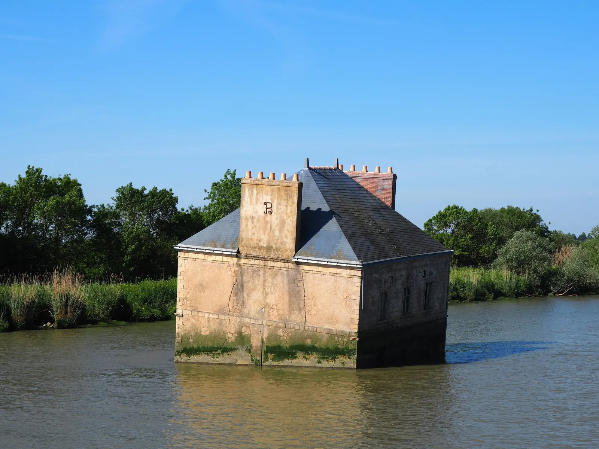
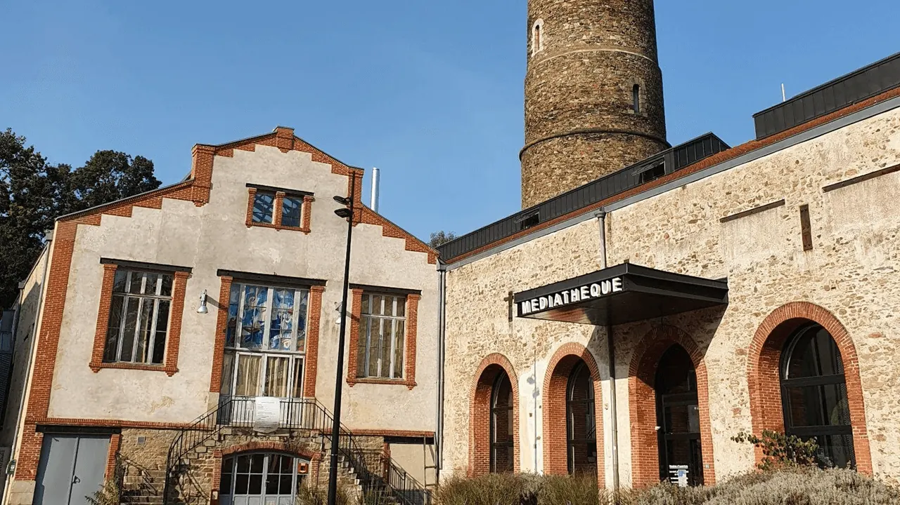

Cette boucle entre [Indre](/post/balade-incontournable-la-loire-a-velo-de-nantes-a-indre) et Couëron vous fera découvrir les deux rives de la Loire sur cette portion. Au départ d’Indre vous longerez d’abord la Loire jusqu’à Couëron où vous découvrirez la tour à plomb un des bâtiments qui témoigne du passé de la ville. En vous arrêtant sur le quai Émile Paraf vous pourrez également observer la Maison dans la Loire. Vous empruntez ensuite le bac de Couëron pour arriver dans la ville, Le Pellerin. Vous pourrez alors faire un détour jusqu’au Canal de la Martinière pour y découvrir l’œuvre Misconceivable d’Erwin Wurm. Vous partirez ensuite sur le chemin retour, cette fois le long de la rive sud, jusqu’à Indret où vous prendrez le bac du même nom pour compléter le circuit.

- **Distance :** 16 km
- **Durée :** 1h10
- **Niveau :** débutant

[Découvrez la balade à vélo jusqu'à Indre](/post/balade-incontournable-la-loire-a-velo-de-nantes-a-indre)

[Voir ici toutes nos balades à vélo et articles de blog](/fr/blog)

En savoir plus sur cet itinéraire (**lien** [**Geovelo**](https://www.geovelo.fr/nantes/route?b=47.221218,-1.666418,47.188185,-1.731793&from=-1.671120,47.198570&to=-1.727310,47.210860)) :

<https://www.geovelo.fr/nantes/route?b=47.221218,-1.666418,47.188185,-1.731793&from=-1.671120,47.198570&to=-1.727310,47.210860>

[Voir le parcours sur Google Maps](https://www.google.fr/maps/dir/Indre/Cou%C3%ABron/@47.206009,-1.7183218,14z/data=!3m1!4b1!4m14!4m13!1m5!1m1!1s0x4805949c35e37fc7:0x40d37521e0def60!2m2!1d-1.6717693!2d47.1996412!1m5!1m1!1s0x48059158824ec0d9:0x46b1050dff64a67f!2m2!1d-1.72885!2d47.210999!3e1)
