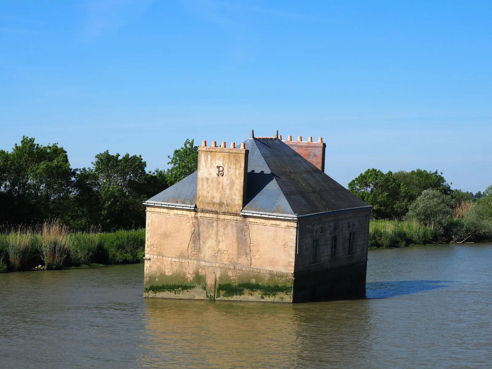
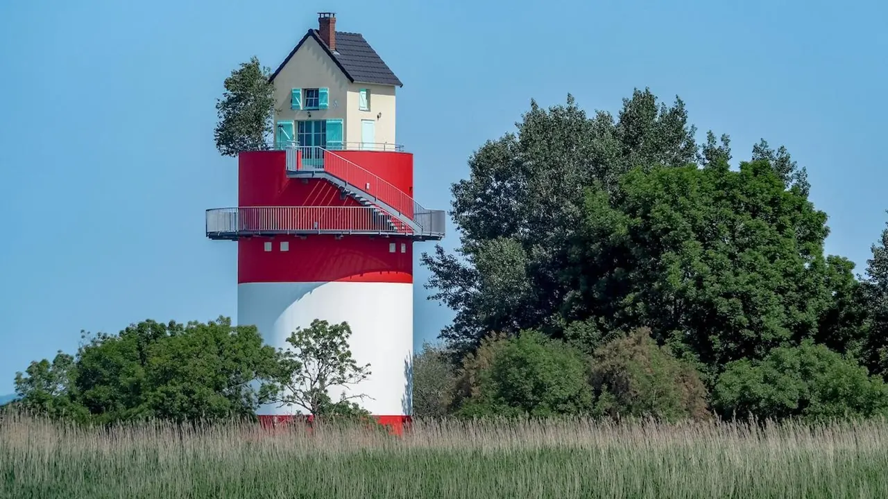

De Nantes à Cordemais cet itinéraire un peu plus complexe que les précédents vous permettra de découvrir deux œuvres hors du commun placé le long de l’estuaire. À [Couëron](/post/balade-incontournable-la-balade-des-2-bacs) vous découvrirez la maison dans la Loire et à Cordemais c’est la villa cheminée qui vous surprendra. Entre ses deux maisons extraordinaires vous parcourez les marais notamment à Couëron et découvrirez une nature reposante.

- **Distance :** 43km
- **Durée :** 3h
- **Niveau :** habitué

[Découvrez la balade à vélo entre Indre et Couëron](/post/balade-incontournable-la-balade-des-2-bacs)

[Voir ici toutes nos balades à vélo et articles de blog](/fr/blog)

En savoir plus sur cet itinéraire (**lien** [**Geovelo**](https://www.geovelo.fr/nantes/route?b=47.335618,-1.529753,47.147628,-1.902056&from=-1.553060,47.218110&to=-1.878790,47.290030)) :

<https://www.geovelo.fr/nantes/route?b=47.335618,-1.529753,47.147628,-1.902056&from=-1.553060,47.218110&to=-1.878790,47.290030>

[Voir le parcours sur Google Maps](https://www.google.fr:443/maps/dir/Nantes/Cordemais/@47.2430361,-1.855551,11z/data=!4m15!4m14!1m5!1m1!1s0x4805ee81f0a8aead:0x40d37521e0ded30!2m2!1d-1.553621!2d47.218371!1m5!1m1!1s0x480584bf68d47e33:0x7b6d75b675d17628!2m2!1d-1.876729!2d47.291429!3e1!5i1)
