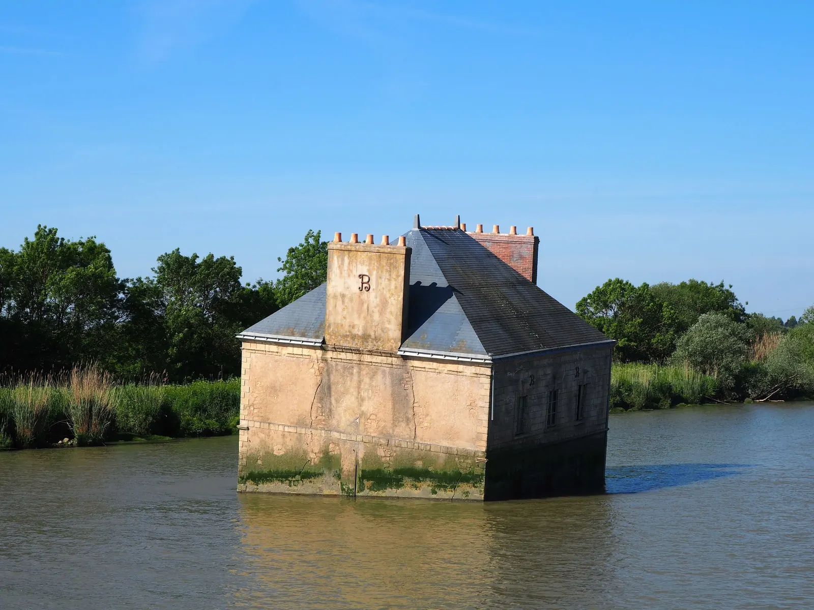
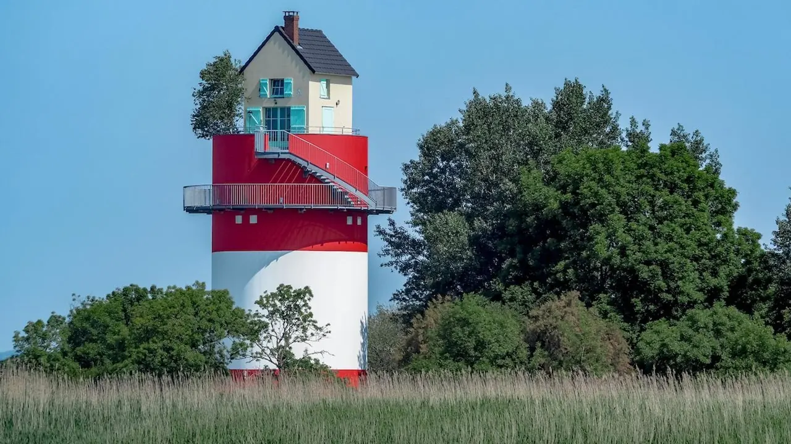

De notre boutique du centre de Nantes jusqu'à Cordemais, comptez 46 km en suivant la Loire vers l'estuaire. Le relief est plat, mais la distance en fait une vraie sortie à la journée, pour des cyclistes qui ont déjà un peu l'habitude. En chemin, deux œuvres du parcours Estuaire : la Maison dans la Loire à Couëron et la Villa Cheminée à Cordemais.

- **Distance :** 46 km aller
- **Durée :** une journée
- **Niveau :** modéré (plat, mais long)
- **Dénivelé :** faible
- **Départ :** boutique Bike'N Tour, 27 quai de Versailles, Nantes (tram ligne 2, arrêt Saint-Mihiel)
- **Arrivée :** la Villa Cheminée, au bord de la Loire à Cordemais
- **Retour :** en TER depuis la gare de Cordemais, ou à vélo par le même itinéraire

## Le parcours

### La sortie de Nantes vers Indre

Depuis la boutique, rejoignez la Loire et suivez le balisage de la Loire à Vélo vers l'ouest, sur la rive nord (rive droite). Le long du quai de la Fosse, la circulation est très dense et les aménagements sont inégaux : roulez prudemment. Vous passez par Chantenay puis rejoignez Indre, sur de petites routes et des tronçons cyclables.

### Couëron et la Maison dans la Loire

À Couëron, arrêtez-vous sur les quais, près de la Tour à Plomb. Depuis ces quais, on voit la Maison dans la Loire, posée dans le fleuve non loin de la tour.

### Les marais jusqu'à Saint-Étienne-de-Montluc

Après Couëron, prenez les petites routes du marais d'Audubon. Le paysage change complètement : roseaux, étiers, prairies humides et oiseaux. C'est la partie la plus sauvage de la balade, sur des routes partagées où l'on croise peu de voitures. Attention : en hiver et jusqu'en mars, le secteur entre Couëron et Saint-Étienne-de-Montluc peut être inondé. Il faut alors passer par la route communale, via l'Étang Bernard et la Marquellerais.

### L'arrivée à Cordemais

Vous traversez ensuite Saint-Étienne-de-Montluc puis arrivez à Cordemais. La Villa Cheminée se repère de loin dans ce paysage très plat, au bord du fleuve, face à la centrale électrique dont elle reproduit l'une des cheminées.

### La variante par la rive sud et le bac

Vous pouvez aussi partir par la rive sud : Rezé et Trentemoult, Bouguenais, puis Le Pellerin, où le bac de Loire, gratuit, vous dépose à Couëron. Vous découvrez ainsi d'autres œuvres de l'Estuaire en chemin. Comptez quelques kilomètres de plus et vérifiez les horaires du bac avant de partir.

## À voir en chemin

- **La Tour à Plomb de Couëron :** cette haute tour de briques rappelle le passé industriel de la ville, au bord de l'eau.
- **La Maison dans la Loire :** imaginée par Jean-Luc Courcoult, fondateur de Royal de Luxe, une maison penchée dont les fondations semblent enlisées dans la vase du fleuve.
- **Le marais d'Audubon :** roselières, étiers et oiseaux, entre Couëron et Saint-Étienne-de-Montluc.
- **La Villa Cheminée :** œuvre de Tatzu Nishi, une petite maison perchée sur une tour de 15 mètres, copie d'une cheminée de la centrale voisine. Elle se visite gratuitement le dimanche après-midi, sauf vent fort, et se loue pour la nuit.
- **Le centre Terre d'Estuaire :** à Cordemais, pour comprendre la faune, la flore et l'histoire de l'estuaire.

## Infos pratiques

**Rentrer en train.** Les gares de Couëron, Saint-Étienne-de-Montluc et Cordemais sont sur la ligne TER Aléop Nantes – Saint-Nazaire, qui accepte les vélos selon les places disponibles. La gare de Cordemais est à l'écart du bourg, à environ 2,5 km au nord-est : prévoyez ce petit supplément depuis la Villa Cheminée. Si vous êtes fatigué en route, Couëron et Saint-Étienne-de-Montluc permettent de raccourcir la balade.

**Faire une pause.** Les bourgs de Couëron, Saint-Étienne-de-Montluc et Cordemais ont des commerces. Dans les marais, il n'y a rien : partez avec de l'eau et de quoi grignoter.

**Quand partir ?** De la fin du printemps au début de l'automne, quand les marais sont praticables et les journées longues. Pour monter sur la Villa Cheminée, visez un dimanche et vérifiez les conditions d'ouverture sur le site du Voyage à Nantes.

## Quel vélo choisir ?

46 km à l'aller, c'est une belle distance : le [vélo électrique](/fr/location-velo-electrique-voyage) rend la journée beaucoup plus confortable, surtout si vous rentrez aussi à vélo ou si le vent souffle de l'ouest. Les cyclistes habitués seront très bien sur notre [vélo de voyage](/fr/location-velo-de-voyage). Pour d'autres idées dans l'estuaire, voyez [nos idées de balades](/fr/idees-de-balades).

## Questions fréquentes

### La balade Nantes – Cordemais est-elle difficile ?

Le parcours est plat, mais 46 km demandent une journée et un peu d'habitude. Si vous n'avez pas l'habitude des longues sorties, prévoyez le retour en train ou choisissez un vélo électrique.

### Peut-on visiter la Villa Cheminée ?

Oui, la visite est gratuite le dimanche après-midi, sauf en cas de vent fort ou de forte chaleur. Le reste de la semaine, on peut l'admirer de l'extérieur, et il est possible d'y dormir sur réservation.

### Comment rentrer à Nantes depuis Cordemais ?

En TER depuis la gare de Cordemais, sur la ligne Nantes – Saint-Nazaire. Comptez environ 2,5 km entre le bourg et la gare.

Pour une version plus courte entre les deux rives, essayez [la balade des 2 bacs entre Indre et Couëron](/post/balade-incontournable-la-balade-des-2-bacs), et découvrez l'histoire de [la Villa Cheminée](/post/les-bords-de-loire-la-villa-cheminee).
