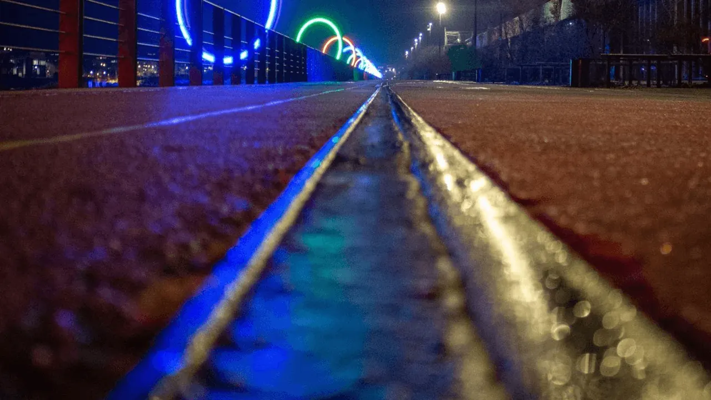

Cette boucle de 30 km part de notre boutique, descend la Loire par la rive nord jusqu'à Indre, traverse le fleuve en bac et revient par la rive sud. Elle reste accessible aux débutants et réunit en une sortie les grands repères de l'ouest nantais : Chantenay, Indre, Trentemoult et l'île de Nantes. C'est une très bonne façon de comprendre comment Nantes vit avec son fleuve.

- **Distance :** 30 km en boucle
- **Durée :** environ 2 h 15 de pédalage, une demi-journée ou une journée avec les pauses
- **Niveau :** débutant
- **Départ :** boutique Bike'N Tour, 27 quai de Versailles, Nantes (tram ligne 2, arrêt Saint-Mihiel)
- **Arrivée :** retour à la boutique
- **Boucle :** rive nord à l'aller, bac d'Indret, rive sud au retour

## Le parcours

### De la boutique à Indre par la rive nord

Depuis la boutique, rejoignez la Loire et suivez le balisage de la Loire à Vélo vers l'ouest. Le quai de la Fosse est très circulé : prenez votre temps. Vous longez ensuite Chantenay, au pied de la butte Sainte-Anne, où l'on aperçoit Lunar Tree, l'arbre blanc de Mrzyk et Moriceau accroché à la falaise. Petites routes et tronçons cyclables vous mènent ensuite à Haute-Indre puis à Basse-Indre.

### Le bac d'Indret

À Basse-Indre, embarquez avec vos vélos sur le bac d'Indret. La traversée est gratuite, courte, et offre une belle vue sur le fleuve. Les horaires varient selon les périodes : vérifiez-les sur le site du Département de Loire-Atlantique.

### Le retour par la rive sud

Sur la rive sud, vous suivez l'itinéraire commun à la Loire à Vélo et à la Vélodyssée, vers l'est. À La Montagne, quelques côtes et descentes demandent de l'attention. Vous passez ensuite par Bouguenais et le petit port Lavigne. Entre Port-Lavigne et la Roche-Ballue, le sol peut être meuble par endroits. Plus loin, la traversée de la zone portuaire de Cheviré se fait au milieu des poids lourds : restez vigilant.

### Trentemoult et l'île de Nantes

Vous arrivez à Trentemoult, l'ancien village de pêcheurs aux maisons colorées, sur la commune de Rezé. Rejoignez ensuite l'île de Nantes et sa pointe ouest, avec le quai des Antilles et les Machines de l'île. Il ne reste qu'à traverser le bras de la Madeleine pour rentrer vers le centre.

## Ce qu'il faut voir

- **Lunar Tree :** un arbre mort d'un blanc éclatant, haut de 12 mètres, installé en 2012 sur la falaise de la butte Sainte-Anne. On le voit bien depuis le square Maurice-Schwob ou depuis la pointe de l'île de Nantes.
- **Indre :** la commune réunit trois anciennes îles, Basse-Indre, Haute-Indre et Indret. Sur Indret, une fonderie royale de canons s'installe en 1777. Le site naval y est toujours actif.
- **Port Lavigne :** à Bouguenais, The Settlers de Sarah Sze installe des sculptures d'animaux dans les arbres.
- **Trentemoult :** ruelles étroites et façades colorées, face à la Loire. Nous lui avons consacré un article : [Trentemoult, un village pittoresque](/post/trentemoult-un-village-pittoresque). Le Pendule de Roman Signer y est suspendu à une ancienne centrale à béton.
- **Les Anneaux de Buren :** dix-huit anneaux qui cadrent la Loire sur le quai des Antilles, et s'illuminent à la nuit tombée.
- **Le Mémorial de l'abolition de l'esclavage :** inauguré en 2012 sur le quai de la Fosse, il rappelle le rôle de Nantes dans la traite atlantique. Une halte forte, à quelques minutes de la boutique.

## Infos pratiques

- **Quand partir :** d'avril à octobre, pendant l'ouverture de notre boutique. En fin de journée, terminez la boucle par l'île de Nantes pour voir les Anneaux s'allumer.
- **Où faire une pause :** Indre et Trentemoult sont les deux haltes naturelles. Le dimanche matin, le marché d'Indre anime le bourg.
- **Éviter le quai de la Fosse :** la gare de Chantenay, sur la ligne TER Nantes – Saint-Nazaire – Le Croisic, accepte les vélos selon les places disponibles. Elle permet de démarrer la boucle à l'ouest du centre.
- **Allonger la balade :** depuis Indre, enchaînez avec [la balade des 2 bacs](/post/balade-incontournable-la-balade-des-2-bacs) jusqu'à Couëron et Le Pellerin.

## Quel vélo choisir ?

Le parcours est plat, à l'exception de quelques côtes à La Montagne. Notre [vélo de voyage](/fr/location-velo-de-voyage) suffit largement. Le [vélo électrique](/fr/location-velo-electrique-voyage) rend la sortie plus confortable si vous ajoutez la boucle des 2 bacs. Vous préférez une visite commentée ? Notre [tour du panorama nantais](/fr/tour/tour-du-panorama-nantais) passe par l'île de Nantes, à vélo électrique et avec un guide. Les prix sont sur notre page [tarifs et réservation](/fr/nos-tarifs-reservation).

## Questions fréquentes

### Combien de temps faut-il pour faire la boucle Nantes – Indre à vélo ?

Comptez environ 2 h 15 de pédalage pour les 30 km. Avec la traversée en bac et les pauses à Indre et Trentemoult, prévoyez une demi-journée bien remplie.

### Faut-il payer le bac d'Indret ?

Non, le bac d'Indret est gratuit pour les piétons, les cyclistes et les voitures.

### La boucle est-elle adaptée aux enfants ?

Oui pour les enfants qui ont l'habitude de rouler. Restez vigilant sur le quai de la Fosse, à La Montagne et dans la zone portuaire de Cheviré.

Pour découvrir le centre de la boucle plus en détail, lisez notre article sur [l'île de Nantes à vélo](/post/balade-incontournable-lile-de-nantes).

[Voir l'itinéraire sur Geovelo](https://www.geovelo.fr/nantes/route?b=49.239765,2.495375,45.099604,-5.698796&from=-1.553060,47.218110&to=-1.671120,47.198570)

[Voir le parcours sur Google Maps](https://www.google.com/maps/dir/Nantes/Indre/@47.2071969,-1.6473337,13z/data=!3m1!4b1!4m14!4m13!1m5!1m1!1s0x4805ee81f0a8aead:0x40d37521e0ded30!2m2!1d-1.553621!2d47.218371!1m5!1m1!1s0x4805949c35e37fc7:0x40d37521e0def60!2m2!1d-1.6717693!2d47.1996412!3e1?hl=FR)

[À lire aussi : Nantes – Cordemais à vélo, jusqu'à la Villa Cheminée](/post/balade-incontournable-la-loire-a-velo-de-nantes-a-cordemais)
