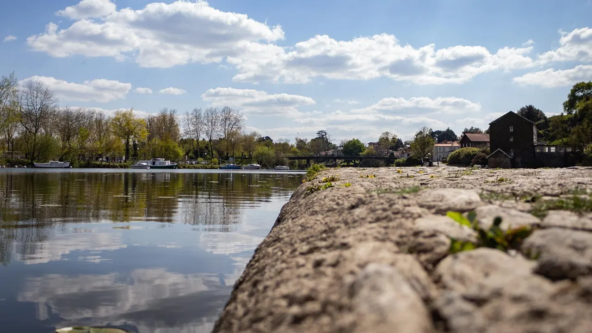

De Nantes à Clisson cette balade à vélo vous fera découvrir les bords de sèvre et ses magnifiques paysages. Entre la Chaussée des Moines à Vertou, les vignobles et la magnifique ville de Clisson, cet itinéraire regorge de lieux historiques et de paysages uniques. En s’appuyant sur les pistes cyclables Nantaises et les chemins de halage de [la Sèvre](/post/la-sevre-a-velo), le circuit vous permettra de longer une bonne partie de la rivière. Vous vous aventurerez ensuite dans les petites routes au cœur des domaines viticoles du vignoble Nantais.

Arrivé à Clisson il est possible de prendre un TER pour faire le chemin retour cela vous fera gagner du temps et vous permettra de profiter plus longtemps de la ville.

- **Distance :** 36 km
- **Durée :** 2h30
- **Niveau :** débutant

[Découvrez la balade à vélo sur les bords de Sèvre](/post/la-sevre-a-velo)

[Voir ici toutes nos balades à vélo et articles de blog](/fr/blog)

[Voir le parcours sur Google Maps](https://www.google.fr/maps/place/La+S%C3%A8vre+Nantaise/@47.1923134,-1.5503972,15z/data=!3m1!4b1!4m5!3m4!1s0x4805e94f12af4097:0x2534b8dbca382b16!8m2!3d47.1930753!4d-1.5414887)
