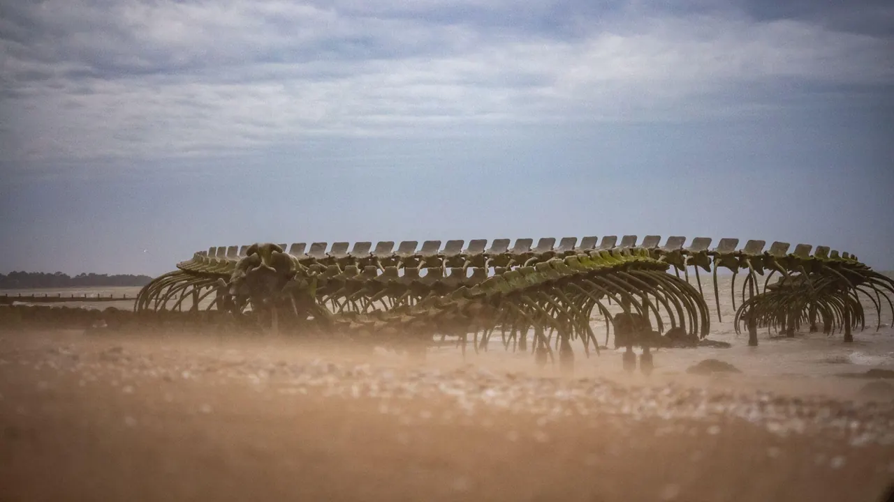

De notre boutique du centre de Nantes jusqu'à Saint-Brevin-les-Pins, il y a environ 63 km par la rive sud de la Loire, sur l'itinéraire commun à la Loire à Vélo et à la Vélodyssée. Le relief est très plat, mais la distance en fait une longue journée : elle convient aux cyclistes réguliers, ou à tous ceux qui la coupent en deux étapes. Au bout, l'océan et le Serpent d'océan, l'œuvre la plus spectaculaire du parcours Estuaire.

- **Distance :** environ 63 km aller
- **Durée :** une longue journée, ou deux jours avec une nuit à Paimbœuf ou Corsept
- **Niveau :** modéré (très plat, mais long)
- **Dénivelé :** quasi nul
- **Départ :** boutique Bike'N Tour, 27 quai de Versailles, Nantes (tram ligne 2, arrêt Saint-Mihiel)
- **Arrivée :** Saint-Brevin-les-Pins, plage de Mindin
- **Retour :** pas de gare à Saint-Brevin ; car Aléop ou navette vers Saint-Nazaire puis TER, ou retour à vélo

## Le parcours

### De Nantes à Trentemoult

Depuis la boutique, rejoignez l'île de Nantes et franchissez le bras sud de la Loire vers Rezé. Suivez le balisage Loire à Vélo et Vélodyssée (EuroVelo 6 et EuroVelo 1), direction Saint-Brevin. Vous passez par Trentemoult, l'ancien village de pêcheurs aux maisons colorées.

### De Bouguenais au Pellerin

Le parcours longe ensuite la rive sud par Bouguenais (port Lavigne), La Montagne et Saint-Jean-de-Boiseau, jusqu'au Pellerin. Cette première partie alterne pistes cyclables et petites routes partagées. Au Pellerin, ne prenez pas le bac vers Couëron : il vous ferait passer sur l'autre rive. Restez sur la rive sud.

### Le canal de la Martinière jusqu'à Paimbœuf

Après Le Pellerin, l'itinéraire suit le canal de la Martinière, un long trait d'eau entre la Loire, les marais et le bocage. C'est la partie la plus paisible de la balade, sur de petites routes rurales. Vous rejoignez ensuite Paimbœuf, ancien avant-port de Nantes, par une piste cyclable. Soyez vigilant aux traversées des routes départementales RD77 et RD77a.

### De Paimbœuf à Saint-Brevin-les-Pins

Les derniers kilomètres passent par Corsept, puis une piste cyclable mène à Mindin, à Saint-Brevin-les-Pins. Le fleuve s'élargit, le pont de Saint-Nazaire apparaît, et vous arrivez enfin face à l'océan.

## À voir en chemin

- **Le Pendule de Roman Signer (Trentemoult, Rezé) :** un pendule de 7 mètres suspendu à une ancienne centrale à béton, au bord du fleuve.
- **The Settlers de Sarah Sze (port Lavigne, Bouguenais) :** des sculptures d'animaux, ours, jaguar et singes, installées dans trois arbres.
- **Did I miss something de Jeppe Hein (Saint-Jean-de-Boiseau) :** asseyez-vous sur le banc, un jet d'eau de 20 mètres se déclenche.
- **Misconceivable d'Erwin Wurm (Le Pellerin) :** un voilier qui se plie au-dessus du canal de la Martinière, comme attiré par l'eau.
- **Le Jardin étoilé de Kinya Maruyama (Paimbœuf) :** un jardin en bord de Loire, construit avec des matériaux locaux d'après une constellation et les quatre points cardinaux, idéal pour contempler le fleuve.
- **Le Serpent d'océan de Huang Yong Ping (Saint-Brevin-les-Pins) :** un squelette de serpent de 130 mètres, installé en 2012 à la pointe du Nez-de-Chien. À marée haute, seules la tête et les vertèbres dépassent de l'eau.

## Infos pratiques

**Rentrer à Nantes.** Il n'y a pas de gare à Saint-Brevin-les-Pins. Le plus simple est de traverser l'estuaire jusqu'à Saint-Nazaire, puis de prendre le TER Aléop vers Nantes, qui accepte les vélos selon les places disponibles. Le pont de Saint-Nazaire est très fortement déconseillé à vélo. Pour le traverser :

- en été, une navette minibus payante transporte cyclistes et vélos d'une rive à l'autre (réservation auprès de l'office de tourisme de Saint-Brevin) ;
- toute l'année, la ligne de car Aléop 317 accepte quelques vélos, sur réservation au plus tard la veille.

Autre option : continuer le lendemain sur la Vélodyssée jusqu'à Pornic et rentrer en TER depuis Pornic. Vous pouvez aussi revenir à vélo, en deux jours.

**Faire une pause.** Entre Le Pellerin et Paimbœuf, les services sont rares : partez avec de l'eau et un pique-nique. Paimbœuf et Saint-Brevin ont des commerces et des hébergements, dont plusieurs labellisés Accueil Vélo.

**Quand partir ?** De mai à septembre pour les longues journées. Vérifiez l'horaire des marées si vous voulez voir le Serpent d'océan découvert.

## Quel vélo choisir ?

Pour 63 km d'un coup, le [vélo électrique](/fr/location-velo-electrique-voyage) est notre conseil : sa batterie se recharge à l'étape si vous dormez en route. En deux jours avec des sacoches, notre [vélo de voyage](/fr/location-velo-de-voyage) est parfait. Cette balade est aussi la première étape de [la Vélodyssée vers Pornic et la Vendée](/fr/itineraires-velo-depart-nantes/velodyssee).

## Questions fréquentes

### Peut-on faire Nantes – Saint-Brevin à vélo en une journée ?

Oui, si vous roulez régulièrement : comptez environ 4 heures de pédalage pour 63 km, plus les pauses. Sinon, coupez en deux avec une nuit à Paimbœuf ou Corsept.

### Le parcours est-il adapté aux débutants ?

Le relief est très plat, mais une bonne partie se fait sur des routes partagées avec les voitures, et la distance est longue. Pour des débutants, nous conseillons le vélo électrique ou deux jours de route.

### Peut-on traverser le pont de Saint-Nazaire à vélo ?

C'est très fortement déconseillé. Utilisez la navette vélos en été ou le car Aléop 317 sur réservation toute l'année.

Pour en savoir plus sur l'œuvre qui vous attend à l'arrivée, lisez notre article sur [le Serpent d'océan](/post/une-creature-mythique-aux-portes-de-lestuaire), puis poursuivez avec [Pornic à vélo](/post/pornic-a-velo).
