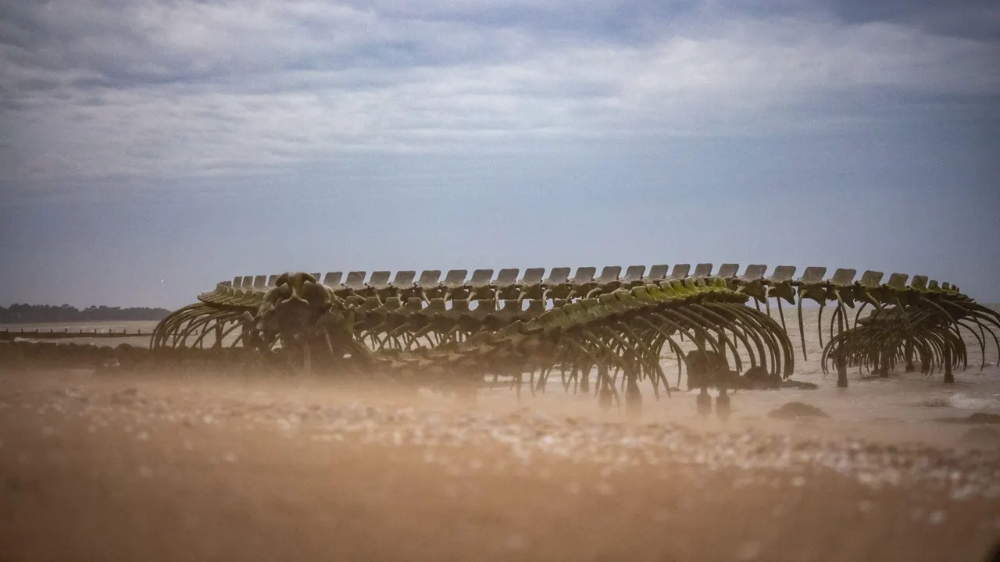

Long d’un peu plus de 63 km, cet itinéraire est la plus longue balade que nous présenterons dans cet article. Bien que 63 km puissent sembler compliqués à parcourir en une journée pour des personnes peu expérimentées, ce parcours est tout à fait faisable pour des débutants. Pour cette balade il est évidemment recommandé de faire le trajet aller ou retour entre Nantes et Saint-Nazaire en train.

Le long de cet itinéraire vous pourrez découvrir de nombreuses œuvres de l’estuaire telles que Misconceivable, le Jardin étoilé ou encore [le serpent de l’océan](/post/une-creature-mythique-aux-portes-de-lestuaire). Cette longue balade vous marquera par ses paysages et les découvertes que vous y ferez au fil de la Loire et du canal de la Basse Loire.

- **Distance :** 63 km
- **Durée :** 4h15
- **Niveau :** débutant

[En savoir plus sur le serpent de l'océan](/post/une-creature-mythique-aux-portes-de-lestuaire)

[Voir ici toutes nos balades à vélo et articles de blog](/fr/blog)

En savoir plus sur cet itinéraire **(lien** [**Geovelo**](https://www.geovelo.fr/nantes/route?b=47.415086,-1.506301,47.060170,-2.209143&from=-1.553060,47.218110&to=-2.165200,47.248400)**)** :

<https://www.geovelo.fr/nantes/route?b=47.415086,-1.506301,47.060170,-2.209143&from=-1.553060,47.218110&to=-2.165200,47.248400>

[Voir le parcours sur Google Maps](https://www.google.fr/maps/dir/Nantes/Saint-Brevin-les-Pins/@47.2219837,-2.1395239,10z/data=!3m1!4b1!4m14!4m13!1m5!1m1!1s0x4805ee81f0a8aead:0x40d37521e0ded30!2m2!1d-1.553621!2d47.218371!1m5!1m1!1s0x48056fc2e47bf511:0xe3a4151460ad2ff1!2m2!1d-2.165807!2d47.246659!3e1)
