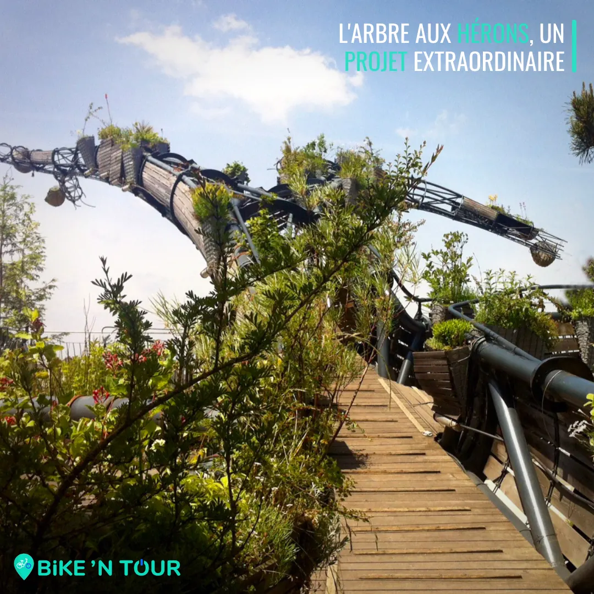
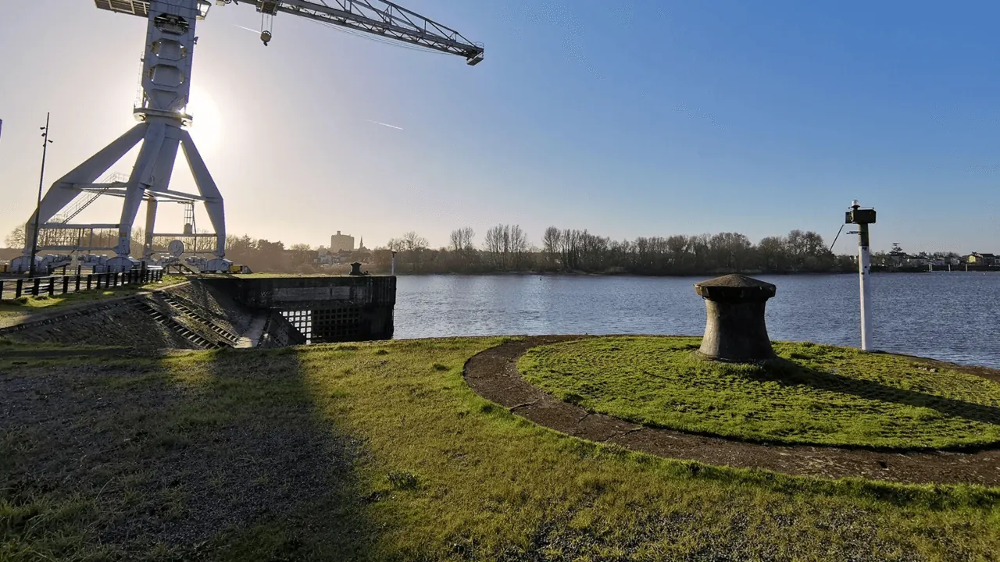

Plus courte cette balade vous fera découvrir ou redécouvrir cette île hors du commun, remplie d'œuvres d’arts et d’histoire. En partant de la nef des Machines vous longerez d’abord le bras nord de la Loire, celui de la Madeleine. Une fois arrivé à la pointe Est de l’île dans le parc de Beaulieu vous repartirez en direction de l’Ouest le long du bras de Pirmil. Vous arriverez alors au bout du quai Wilson ou vous vous retrouverez au pied d’un Titan de l’île, une des deux grues massives qui témoigne du passé industriel du lieu. Pour terminer votre balade, il vous suffira de remonter le quai des Antilles où vous découvrirez Les Anneaux, une des œuvres incontournables de la ville, et vous rejoindrez ensuite votre point de départ.

- **Distance :** 10,5km
- **Durée :** 1h
- **Niveau :** débutant

**Nouveauté** : L'Arbre aux Hérons, un projet qui a débuté en 2021 et qui devrait s'achever en 2027. Cette architecture sera située en face de la Galerie des Machines et s'élèvera à 35 mètres de haut et 50 mètres de diamètre. L'Arbre est une arche végétale où poussent plus de 130 espèces. Nous pourrons observer une trentaine d'animaux comme des colibris, un paresseux, des papillons, des oies sauvages, etc. Au sommet, un couple de hérons fera son nid. C'est une véritable cité dans le ciel. (**Voir ci-dessous une image d'un aperçu**).

[Voir ici toutes nos balades à vélo et articles de blog](/fr/blog)

[Voir le parcours sur Google Maps](https://www.google.fr/maps/place/%C3%8Ele+de+Nantes/@47.2041807,-1.5559768,15z/data=!3m1!4b1!4m5!3m4!1s0x4805eeb40b080c85:0xf0d37531cab1510!8m2!3d47.204167!4d-1.547222)
