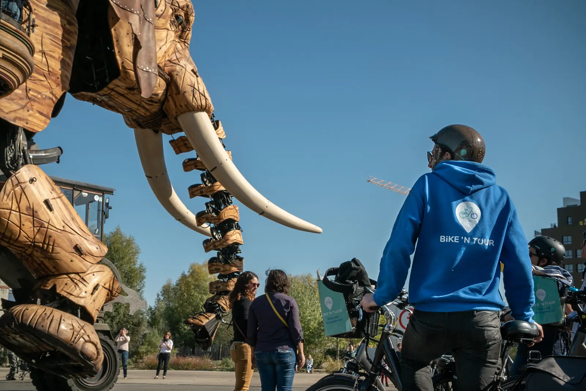
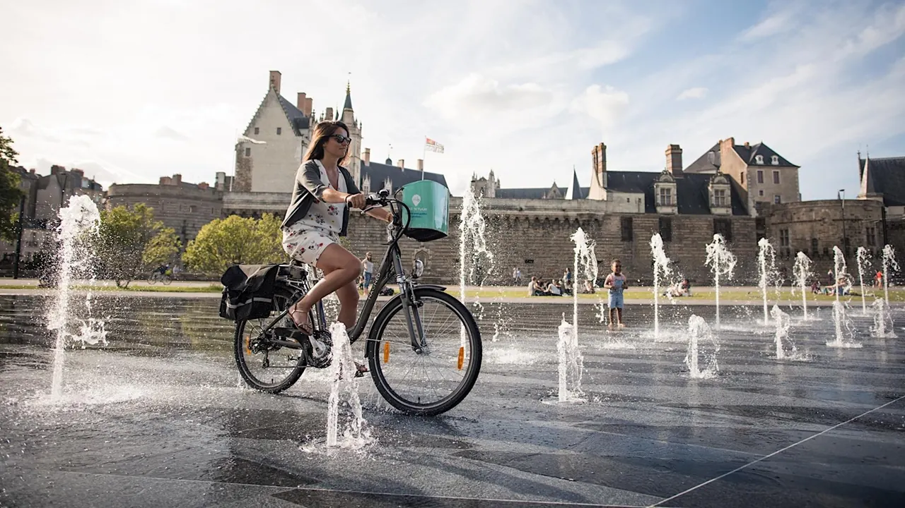

Wählen Sie für Ihre erste Radreise ab Nantes eine flache, gut ausgeschilderte Route, planen Sie Etappen von 40 bis 60 km und reisen Sie mit zwei Packtaschen leicht. Nantes ist ein idealer Ausgangspunkt: Mehrere große Radfernwege beginnen im Stadtzentrum, und mit dem Zug kommen Sie bequem zurück. So beraten wir unsere Kunden vor dem Start.

## Die Route wählen

Setzen Sie beim ersten Mal auf eine flache Strecke, größtenteils auf eigenen Radwegen, mit Bahnhöfen unterwegs. Hier unsere Vorschläge ab Nantes, von der kürzesten zur längsten.

### Für ein Wochenende

- **Der [Vignoble nantais](/fr/itineraires-velo-depart-nantes/vignoble-nantais)**: etwa 80 km als Runde an zwei Tagen, über die Sèvre nantaise, Clisson und die Muscadet-Hänge.
- **Nantes – Angers auf der Loire à Vélo**: etwa 110 km in zwei Etappen, Rückfahrt mit dem TER (Regionalzug) ab Angers.
- **Nantes – Pornic auf der Vélodyssée**: etwa 100 km an zwei Tagen, mit einer Übernachtung in Paimbœuf oder Corsept, dann mit dem Zug von Pornic nach Nantes.
- **Der [Canal de Nantes à Brest](/fr/itineraires-velo-depart-nantes/canal-nantes-brest) bis Redon**: zwei Tage auf den Treidelpfaden und mit dem Zug zurück.

### Für ein paar Tage oder eine Woche

- **Die [Loire à Vélo](/fr/itineraires-velo-depart-nantes/loire-a-velo)** bis Saumur: etwa 165 km in 3 bis 4 Tagen. Das ist unsere erste Empfehlung für eine erste mehrtägige Tour: flach, sehr gut ausgeschildert, mit Schlössern und Dörfern entlang der ganzen Strecke.
- **Die [Vélodyssée](/fr/itineraires-velo-depart-nantes/velodyssee)** bis Les Sables-d'Olonne: etwa 240 km in 4 bis 5 Tagen, von der Loire-Mündung bis an die Küste der Vendée.
- **Die [Régalante](/fr/itineraires-velo-depart-nantes/regalante)** bis zum Mont-Saint-Michel: 275 km in 9 Etappen, überwiegend auf autofreien Wegen und mit wenig Höhenmetern.

Alle unsere Routen werden auf der Seite [Radrouten ab Nantes](/fr/itineraires-velo-depart-nantes) ausführlich beschrieben.

## Die Etappen richtig bemessen

Das ist der häufigste Fehler bei der ersten Reise: zu weit fahren wollen. Einige Richtwerte:

- **Erwachsene mit durchschnittlicher Fitness:** 40 bis 60 km pro Tag auf flacher Strecke.
- **Mit Kindern:** 20 bis 30 km pro Tag.
- **Mit dem E-Bike:** Längere Etappen werden bequem, sofern Sie den Akku jeden Abend laden.

Planen Sie Zeit für Besichtigungen, Pausen und das Wetter ein. Gegenwind kann Sie stark bremsen, vor allem auf offenen Abschnitten. Suchen Sie für die Übernachtungen Unterkünfte mit dem Label Accueil Vélo: Diese bieten unter anderem einen Unterstand für die Fahrräder.

## Packen

### Die richtige Ausrüstung

- **Zwei wasserdichte Hinterradtaschen**: Sie werden am Gepäckträger befestigt und halten den Schwerpunkt niedrig. Wir verleihen Ortlieb-Packtaschen im Paar, 2 × 20 Liter.
- **Eine Lenkertasche**: für Handy, Papiere, Sonnencreme und einen Snack.
- **Kein Rucksack**: Er belastet den Rücken und lässt Sie schwitzen.

### Die Basisliste

- Regenkleidung, eine warme Schicht und schnell trocknende Kleidung.
- Helm, Sonnenbrille, Sonnencreme.
- Trinkflasche und Snacks.
- Kleiner Kulturbeutel und Erste-Hilfe-Set.
- Handy-Ladegerät und Powerbank.

Wiegen Sie Ihr Gepäck: Zwei Taschen mit 20 Litern reichen für ein paar Tage völlig aus. Bei Bike'N Tour sind Schloss, Pannenset, Pumpe, Gepäckträger und Beleuchtung bei jeder Miete inklusive.

## Das Fahrrad wählen

- **Das [Reiserad](/fr/location-velo-de-voyage)**: unser meistgefragtes Rad für die Loire à Vélo und die Vélodyssée. Aufrechte Sitzposition, 9 Gänge, hydraulische Scheibenbremsen und Gepäckträger für zwei Packtaschen.
- **Das [E-Bike](/fr/location-velo-electrique-voyage)**: ideal für lange Etappen, hügelige Routen und Paare mit unterschiedlicher Kondition. Rund 100 km Reichweite im Eco-Modus.
- **Das [Gravelbike](/fr/location-gravel-nantes)**: für den Vignoble nantais oder Treidelpfade mit wassergebundener Decke.

Wir stellen jedes Rad auf Ihre Größe ein und geben Ihnen vor dem Start unsere Routentipps. Sehen Sie sich unsere [Preise und Buchung](/fr/nos-tarifs-reservation) an.

## Mit dem Zug zurück

Die meisten Routen ab Nantes fährt man nur in eine Richtung. Der Zug ist die einfachste Lösung für die Rückfahrt:

- **TER Aléop (Pays de la Loire):** In der Saison ist die Reservierung eines Fahrradplatzes auf allen Linien Pflicht und kostenpflichtig (2026 von Mai bis Ende September). Reservieren Sie gleich beim Kauf Ihres Tickets.
- **TER BreizhGo (Bretagne):** In der Saison gilt dasselbe Prinzip, mit Pflichtreservierung gegen Gebühr. Praktisch für die Rückfahrt ab Rennes oder Saint-Malo.
- **TGV und Intercités:** Das Rad reist entweder auf einem reservierten, kostenpflichtigen Platz oder zerlegt in einer Hülle von maximal 90 × 120 cm.

Die Regeln ändern sich jedes Jahr: Prüfen Sie sie vor der Abreise auf veloabord.fr oder bei der SNCF, der französischen Staatsbahn. Eine andere Lösung: Auf den wichtigsten Routen können wir nach Kostenvoranschlag die Abholung der Räder am Zielort organisieren.

Zum Einrollen vor der großen Reise probieren Sie eine unserer [Tourenideen](/fr/idees-de-balades) für einen Tag, etwa [am Loire-Ufer bis Mauves-sur-Loire](/post/les-bords-de-loire-mauves-sur-loire). Und wer anders reisen möchte, liest unseren Artikel über [Slow Tourism](/post/le-slow-tourisme-voyager-plus-pour-polluer-moins).

## Häufige Fragen

### Welche Route eignet sich für die erste Radreise ab Nantes?

Die Loire à Vélo nach Angers oder Saumur: flach, sehr gut ausgeschildert und für die Rückfahrt mit dem Zug angebunden.

### Wie viele Kilometer pro Tag auf der ersten Radreise?

Rechnen Sie mit 40 bis 60 km pro Tag für Erwachsene und 20 bis 30 km mit Kindern. Planen Sie Zeit für Pausen und Besichtigungen ein.

### Kann man das Leihrad auch woanders als in Nantes zurückgeben?

Ja, auf Anfrage: Wir organisieren mit unseren Partnern die Abholung der Räder am Zielort, nach Kostenvoranschlag. Ansonsten können Sie mit dem Rad im Zug nach Nantes zurückfahren.
