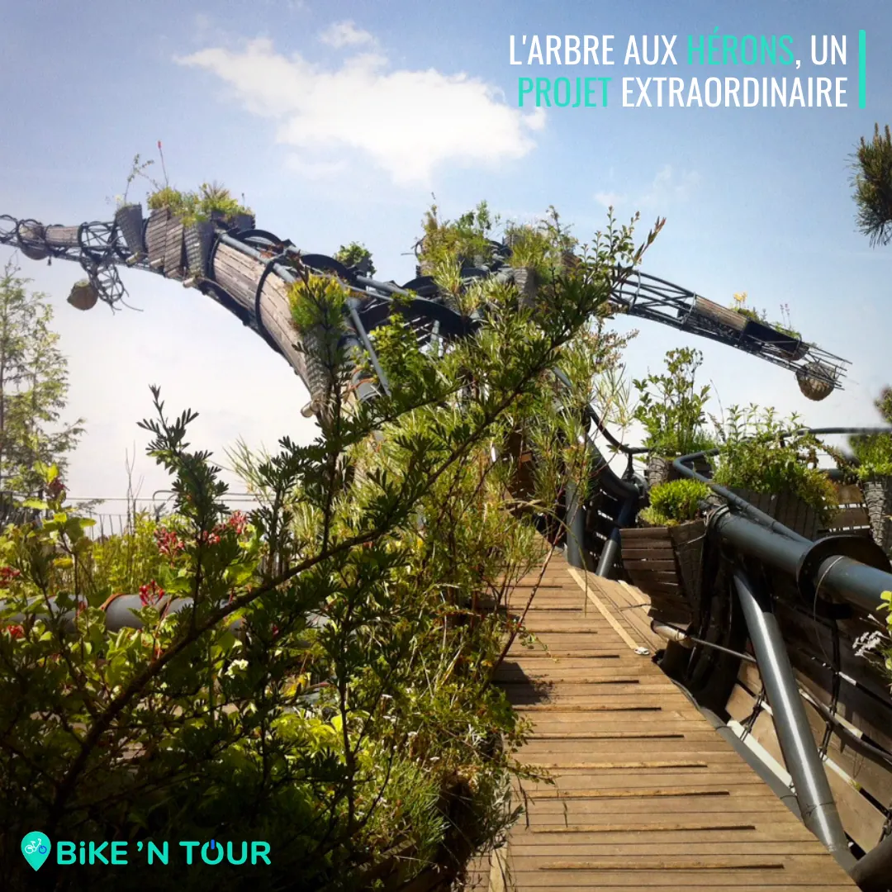

Die Radtour rund um die Île de Nantes ist eine flache, leichte Runde von 10,5 km, die Sie in einer Stunde reiner Fahrzeit schaffen. Sie folgt beiden Armen der Loire und verbindet die großen Wahrzeichen der Insel: die Machines de l'île, die Titan-Kräne, den Hangar à Bananes und die Anneaux von Buren. Die ideale Tour für einen ersten Radausflug in Nantes, allein, zu zweit oder mit der Familie.

- **Strecke:** 10,5 km als Rundtour
- **Dauer:** etwa 1 Stunde Fahrzeit, 2 bis 3 Stunden mit Stopps
- **Niveau:** Einsteiger, flaches Gelände
- **Start:** die Machines de l'île, Parc des Chantiers
- **Ziel:** zurück am Ausgangspunkt
- **Anfahrt:** Tramlinie 1, Haltestelle Chantiers navals, oder etwa zehn Minuten mit dem Rad von unserem Laden

## Die Route

Die Île de Nantes ist fast 5 km lang. Im Norden wird sie vom Madeleine-Arm der Loire begrenzt, im Süden vom Pirmil-Arm. Unsere Runde führt einmal komplett um die Insel, im Uhrzeigersinn.

### Von den Machines de l'île zur Ostspitze

Starten Sie im Parc des Chantiers vor den Nefs, den Hallen der ehemaligen Werften, in denen die Machines de l'île untergebracht sind. Fahren Sie dann am Madeleine-Arm entlang nach Osten. Gegenüber, am anderen Ufer, sehen Sie die Altstadt. Fahren Sie weiter bis zur Ostspitze der Insel, auf der Seite von Beaulieu, einem ab den 1960er-Jahren gebauten Viertel.

### Zurück am Pirmil-Arm

Kehren Sie über die Südseite der Insel um und folgen Sie dem Pirmil-Arm nach Westen. Gegenüber, am Südufer, liegt Rezé. Fahren Sie bis zum Ende des Quai Wilson an der Westspitze der Insel.

### Zum Schluss der Quai des Antilles

Fahren Sie zum Schluss den Quai des Antilles an der Loire entlang. Sie kommen am Hangar à Bananes und an den Anneaux vorbei, bevor Sie wieder den Parc des Chantiers erreichen. Teilen Sie sich auf den Kais den Platz mit Fußgängern und fahren Sie zu Stoßzeiten im Schritttempo.

## Sehenswertes unterwegs

### Die Machines de l'île

Die Machines de l'île in den Nefs der ehemaligen Werften sind das Werk von Pierre Orefice und François Delarozière. Der 12 Meter hohe Grand Éléphant spaziert hier mit seinen Passagieren umher. Das Carrousel des Mondes Marins und die Galerie des Machines runden den Besuch ab. Planen Sie Zeit ein, wenn Sie hineingehen möchten.

### Die Titan-Kräne

Zwei riesige Kräne erinnern an die industrielle Vergangenheit der Insel. Der graue steht am Ende des Quai Wilson. Der gelbe, der ältere der beiden, diente den Dubigeon-Werften. Wir haben ihnen einen Artikel gewidmet: [die Titanen von Nantes](/post/les-titans-de-nantes).

### Die Anneaux von Buren

Am Quai des Antilles, nahe dem Hangar à Bananes, rahmen achtzehn Ringe von Daniel Buren und Patrick Bouchain die Loire ein. Das dauerhafte Kunstwerk leuchtet bei Einbruch der Dunkelheit rot, blau und grün. Es liegt an der grünen Linie des [Voyage à Nantes](/post/le-voyage-a-nantes-2021-a-deja-commence).

### Und der Arbre aux Hérons?

Vielleicht haben Sie davon gehört: Im ehemaligen Steinbruch Misery am anderen Ufer sollte eine riesige begrünte Konstruktion entstehen, der Arbre aux Hérons (Reiherbaum). Nantes Métropole hat das Projekt im September 2022 wegen der steigenden Kosten aufgegeben. Seine Schöpfer haben diese Entscheidung angefochten. In der Galerie des Machines können Sie jedoch Prototypen sehen, darunter ein Modell von Stamm und Ästen im Maßstab 1:5 sowie einen Reiher mit 8 Metern Spannweite.

## Praktische Infos

- **Wann fahren:** Morgens sind die Kais ruhiger. Am späten Nachmittag ist das Licht über der Loire herrlich, und bei Einbruch der Dunkelheit gehen die Anneaux an.
- **Wo parken:** In der Nähe der Sehenswürdigkeiten gibt es Fahrradbügel. Schließen Sie mit dem mitgelieferten Schloss den Rahmen an, nicht nur das Laufrad.
- **Mehr erfahren:** Die Geschichte der Insel erzählen wir in unserem Artikel [eine Insel voller Geschichte](/post/une-ile-remplie-dhistoire-ile-de-nantes).

Von unserem Laden am Quai de Versailles 27 (Tram Linie 2, Haltestelle Saint-Mihiel) sind es mit dem Rad etwa zehn Minuten bis zur Insel: Fahren Sie über den Cours des 50-Otages nach Süden zur Loire. Der Laden ist von April bis Oktober geöffnet. Alle unsere Tipps finden Sie in unserem [Ratgeber zum Fahrradverleih in Nantes](/fr/guide-location-velo-nantes).

[Route auf Google Maps ansehen](https://www.google.fr/maps/place/%C3%8Ele+de+Nantes/@47.2041807,-1.5559768,15z/data=!3m1!4b1!4m5!3m4!1s0x4805eeb40b080c85:0xf0d37531cab1510!8m2!3d47.204167!4d-1.547222)

## Welches Fahrrad wählen?

Die Runde ist flach: Alle unsere Räder sind geeignet.

- **Das [Reiserad](/fr/location-velo-de-voyage)**: bequem, mit 9 Gängen und aufrechter Sitzposition. Für diese Strecke völlig ausreichend.
- **Das [E-Bike](/fr/location-velo-electrique-voyage)**: praktisch, wenn Sie die Tour nach Trentemoult oder an die Loire-Ufer verlängern oder mühelos fahren möchten.
- **Der [Kinderanhänger](/fr/location-accessoires-velo)**: perfekt, um die Kleinsten und das Picknick mitzunehmen.

Die Preise pro Tag, Wochenende oder Woche finden Sie auf unserer Seite [Preise und Buchung](/fr/nos-tarifs-reservation). Lieber mit Führung? Unsere [Panoramatour durch Nantes](/fr/tour/tour-du-panorama-nantais) führt über die Île de Nantes und zum Elefanten, mit dem E-Bike und einem ortskundigen Guide. Entdecken Sie auch unsere weiteren [Tourenideen](/fr/idees-de-balades).

## Häufige Fragen

### Wie lange dauert die Radtour rund um die Île de Nantes?

Rechnen Sie mit etwa einer Stunde für die 10,5 km ohne Halt. Mit Pausen an den Machines, den Titanen und den Anneaux sollten Sie eher zwei bis drei Stunden einplanen.

### Ist die Radtour rund um die Île de Nantes für Kinder geeignet?

Ja: Die Strecke ist flach und kurz. Bleiben Sie auf den Kais, die Sie mit Fußgängern teilen, aufmerksam. Wir verleihen Kinderräder, Kindersitze und einen Kinderanhänger.

### Ist der Arbre aux Hérons in Nantes zu sehen?

Nein: Nantes Métropole hat das Projekt im September 2022 aufgegeben. Prototypen, darunter ein Modell und ein mechanischer Reiher, sind in der Galerie des Machines de l'île ausgestellt.
