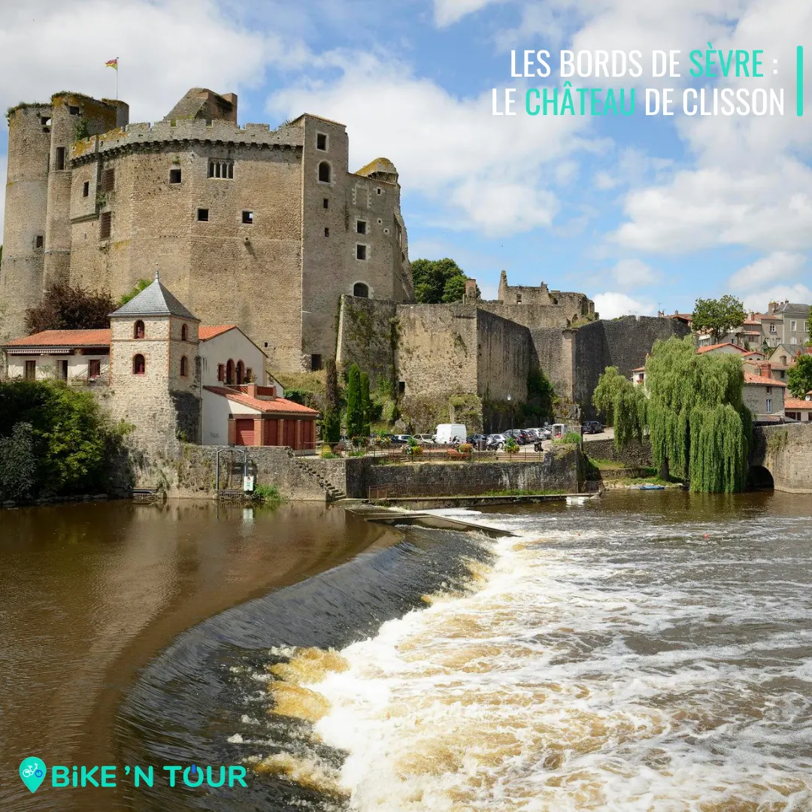
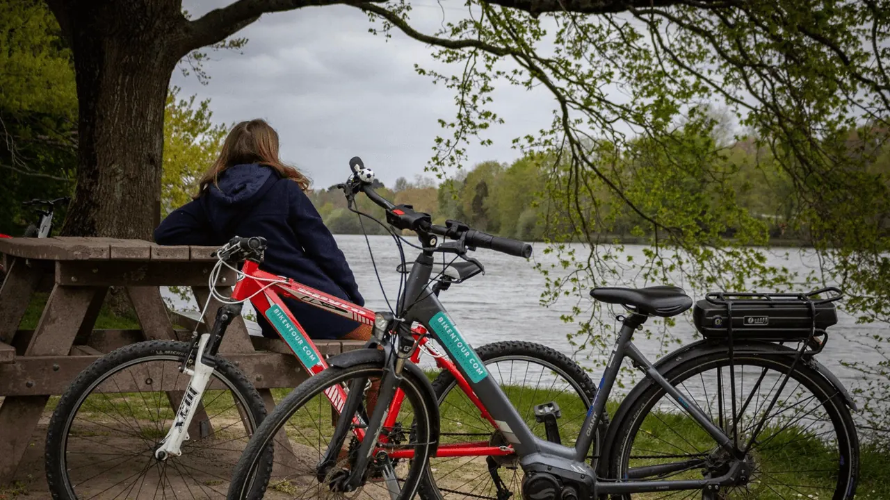
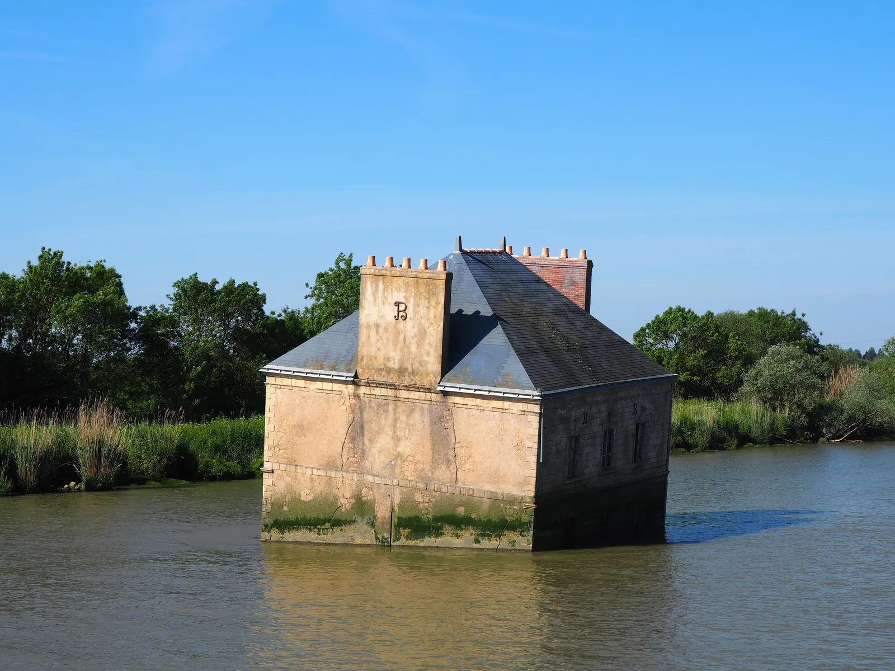
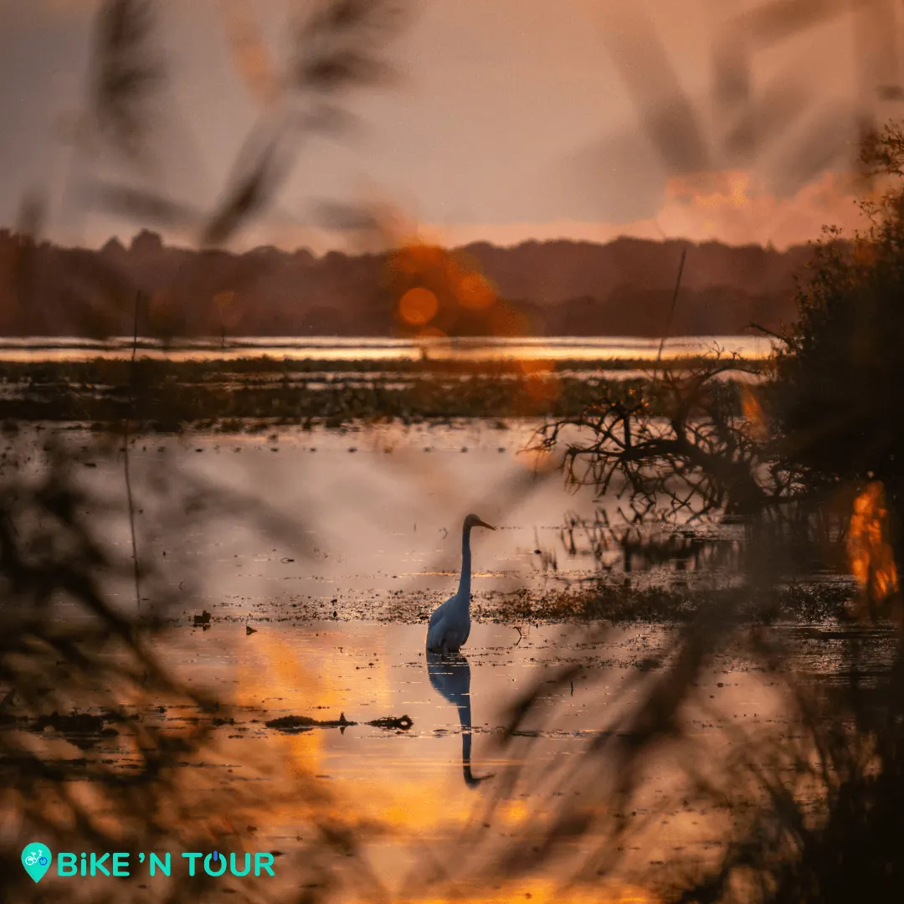

Hier sind unsere fünf Lieblingsradtouren ab unserem Laden im Zentrum von Nantes, von der kurzen Runde durch die Stadt bis zum Tagesausflug zur Loire-Mündung. Sie sind 10 bis 46 km lang, alle kaum hügelig, und bei den meisten können Sie mit dem Zug zurückfahren. Zu jeder Tour nennen wir Ihnen Strecke, Niveau und den besten Rückweg.

- **Strecke:** 10 bis 46 km je nach Tour
- **Dauer:** von einer Stunde bis zu einem ganzen Tag
- **Niveau:** leicht bis mittel
- **Start:** Laden von Bike'N Tour, Quai de Versailles 27, Nantes (Tram Linie 2, Haltestelle Saint-Mihiel)
- **Rückfahrt:** mit dem Rad oder mit dem TER (Regionalzug), je nach Tour

## 1. Die Sèvre nantaise bis Clisson

Diese Tour führt von Nantes nach Südosten am Ufer der Sèvre nantaise entlang. Sie kommen an der Chaussée des Moines in Vertou vorbei, einem beliebten Rastplatz am Wasser, und fahren dann auf kleinen Straßen in die Weinberge des Muscadet. Die Ankunft in Clisson ist der Höhepunkt: Die mittelalterliche Burg thront über der Sèvre, und der Park Garenne Lemot verleiht der Stadt italienisches Flair.

Dank der Rückfahrt mit dem TER ab Clisson können Sie die Stadt genießen, ohne auf die Uhr zu schauen. Den genauen Streckenverlauf finden Sie in unserem Artikel [die Sèvre nantaise mit dem Rad](/post/balade-incontournable-la-sevre-nantaise), die Flussufer in [die Sèvre mit dem Rad](/post/la-sevre-a-velo).

- **Strecke:** 37 km einfach
- **Dauer:** ein ganzer Tag
- **Niveau:** mittel
- **Rückfahrt:** mit dem TER ab Clisson (etwa 20 Minuten bis Nantes)

## 2. Die Erdre bis Sucé-sur-Erdre

Die Erdre, nach einem König Franz I. zugeschriebenen Ausspruch „der schönste Fluss Frankreichs“ genannt, lässt sich auf zwei Arten entdecken. In Nantes folgt eine kurze Runde beiden Ufern und quert den Fluss an der Brücke von La Jonelière: ideal für ein, zwei Stunden. Wer aus der Stadt hinaus möchte, fährt flussaufwärts bis Sucé-sur-Erdre, vorbei an Schlössern, schönen Herrenhäusern und Guinguettes (Ausflugslokalen) am Wasser.

In Sucé-sur-Erdre hält die Tram-Train nach Nantes, praktisch, wenn Sie nur die Hinfahrt mit dem Rad machen möchten. Alle unsere Tipps finden Sie im Artikel [die Erdre mit dem Rad](/post/balade-incontournable-lerdre-a-velo).

- **Strecke:** 18 km einfach bis Sucé-sur-Erdre
- **Dauer:** ein halber Tag
- **Niveau:** leicht
- **Rückfahrt:** mit dem Rad oder mit der Tram-Train ab Sucé-sur-Erdre

## 3. Die Loire à Vélo bis Cordemais

Richtung Westen folgt diese Tour auf dem Radweg Loire à Vélo der Loire bis zur Mündung. In Couëron scheint die Maison dans la Loire von Jean-Luc Courcoult im Fluss zu versinken. Danach durchqueren Sie auf sehr ruhigen Sträßchen die Marschen, zwischen Schilf und Vögeln, bis zur Villa Cheminée von Tatzu Nishi in Cordemais, einem Haus auf einem 15 Meter hohen Turm.

Die Strecke ist flach, aber 46 km brauchen einen richtigen Tag. Im Winter können die Straßen durch die Marschen überflutet sein. Alle Details finden Sie in unserem Artikel [Nantes – Cordemais mit dem Rad](/post/balade-incontournable-la-loire-a-velo-de-nantes-a-cordemais).

- **Strecke:** 46 km einfach
- **Dauer:** ein ganzer Tag
- **Niveau:** mittel
- **Rückfahrt:** mit dem TER ab Cordemais (Bahnhof etwa 2,5 km vom Ortskern)

## 4. Rund um die Île de Nantes

Die kürzeste Tour der Auswahl, ideal mit der Familie oder gegen Abend. Starten Sie an den Machines de l'île, die in den Nefs untergebracht sind, den ehemaligen Hallen der Werften, und folgen Sie zuerst dem Madeleine-Arm der Loire im Norden. An der Ostspitze der Insel, im Park von Beaulieu, fahren Sie am Pirmil-Arm entlang zurück nach Westen.

Am Ende des Quai Président-Wilson, an der Südwestspitze, kommen Sie am Fuß des grauen Krans vorbei, eines der beiden denkmalgeschützten Titan-Kräne, die an die Hafenvergangenheit der Insel erinnern. Fahren Sie zum Schluss den Quai des Antilles mit den Anneaux (Ringen) von Daniel Buren entlang, bevor Sie zum Ausgangspunkt zurückkehren. Die genaue Route finden Sie in [rund um die Île de Nantes mit dem Rad](/post/balade-incontournable-lile-de-nantes).

- **Strecke:** etwa 10 km als Runde
- **Dauer:** eine bis anderthalb Stunden
- **Niveau:** leicht
- **Rückfahrt:** Rundtour ab dem Zentrum von Nantes

## 5. Der See von Grand-Lieu

Diese Tour beginnt am Mémorial de l'abolition de l'esclavage (Gedenkstätte zur Abschaffung der Sklaverei) am Quai de la Fosse und durchquert dann den Westen der Île de Nantes mit ihren Anneaux. Anschließend fahren Sie durch die bunten Gassen von [Trentemoult](/post/trentemoult-un-village-pittoresque) und am Pendule von Roman Signer vorbei bis zur Maison du lac de Grand-Lieu in Bouaye.

Der See selbst ist schwer zugänglich: Man sieht ihn nur an wenigen Stellen. Wer motiviert ist, fährt weiter bis Pierre-Aigüe in Saint-Aignan-Grandlieu, einem der wenigen Orte, an denen man nah an den See herankommt. Die Rückfahrt ist mit dem TER ab Bouaye möglich. Mehr Details in [Nantes – See von Grand-Lieu mit dem Rad](/post/balade-incontournable-de-nantes-au-lac-de-grand-lieu).

- **Strecke:** 18 km einfach bis Bouaye
- **Dauer:** ein ganzer Tag
- **Niveau:** leicht
- **Rückfahrt:** mit dem TER ab Bouaye

## Praktische Infos

**Mit dem Zug zurück.** Clisson, Cordemais und Bouaye werden vom TER Aléop angefahren, Sucé-sur-Erdre von der Tram-Train. Fahrräder werden je nach freien Plätzen mitgenommen: Meiden Sie im Sommer und am Wochenende die Stoßzeiten.

**Pause machen.** Jede Tour führt durch Orte mit Geschäften. An der Erdre und der Loire öffnen in der warmen Jahreszeit Guinguettes. In den Marschen der Mündung gibt es dagegen nichts: Nehmen Sie Wasser mit.

**Wann fahren?** Von April bis Oktober, während unserer Saison. Der Frühling ist ideal für die Vögel am See von Grand-Lieu und an der Mündung, der Sommer für die Guinguettes und der September für die Weinberge zur Weinlese.

## Welches Fahrrad wählen?

Für die Île de Nantes, die Erdre und den See von Grand-Lieu reicht ein [Reiserad](/fr/location-velo-de-voyage), dazu [Kinderräder](/fr/location-velo-enfant), wenn Sie mit der Familie unterwegs sind. Für Clisson und Cordemais macht ein [E-Bike](/fr/location-velo-electrique-voyage) den Tag leichter, und ein [Gravelbike](/fr/location-gravel-nantes) fühlt sich auf den kleinen Straßen des [Vignoble nantais](/fr/itineraires-velo-depart-nantes/vignoble-nantais), des Weinbaugebiets um Nantes, wohl. Weitere Ideen finden Sie auf unserer Seite [Tourenideen](/fr/idees-de-balades).

## Häufige Fragen

### Welche Tour ab Nantes ist die leichteste?

Die Runde um die Île de Nantes, etwa 10 km ohne Steigungen. Wer aus der Stadt hinaus möchte, findet mit der Erdre bis Sucé-sur-Erdre ebenfalls eine sehr leichte Tour.

### Kann man mit einem Leihrad mit dem Zug zurückfahren?

Ja. Ab Clisson, Cordemais und Bouaye mit dem TER und ab Sucé-sur-Erdre mit der Tram-Train, solange Fahrradplätze frei sind.

### Welche Tour eignet sich mit Kindern?

Die Île de Nantes und die Erdre eignen sich am besten. Mit Kindern sollten Sie höchstens 20 bis 30 km pro Tag einplanen und für die Kleinsten an einen Kindersitz oder Anhänger denken.

Lust auf einen weiteren Ausflug am Wasser? Probieren Sie [Nantes – Mauves-sur-Loire auf der Loire à Vélo](/post/balade-incontournable-la-loire-a-velo-de-nantes-a-mauves-sur-loire) oder die große Tour [von Nantes nach Saint-Brevin entlang der Mündung](/post/balade-incontournable-le-parcours-de-lestuaire-de-nantes-a-saint-brevin-les-pins).
