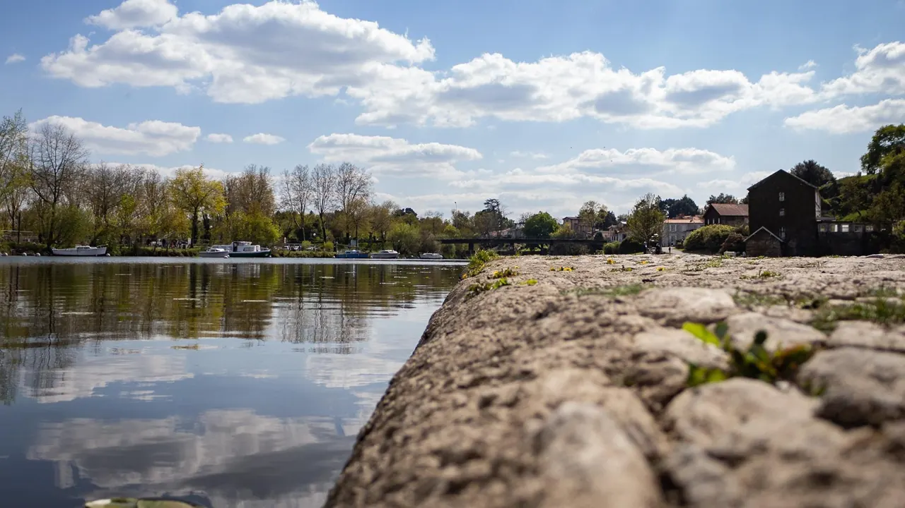

From Nantes to Clisson, this 37 km ride follows the Sèvre nantaise to Vertou, then winds through the Muscadet vineyards before arriving at the foot of Clisson castle. It suits cyclists who are used to riding for a whole day, and it ends gently: you come back by TER regional train. The ride starts from our shop, right in the centre of Nantes.

- **Distance:** 37 km one way
- **Duration:** a full day, breaks included
- **Level:** moderate
- **Elevation:** about 250 m of cumulative climbing, mostly in the vineyards
- **Start:** Bike'N Tour shop, 27 quai de Versailles, Nantes (tram line 2, Saint-Mihiel stop)
- **Finish:** Clisson
- **Return:** by TER from Clisson, bikes allowed on board

## The route

### From Nantes to Vertou: the Sèvre greenway

Leave the centre of Nantes along the banks of the Loire, signposted as EuroVelo 6 and EuroVelo 1, to reach Rezé. Take care as you cross the city: traffic is heavy and the signposting is hard to see in places. In Rezé, the route joins the Sèvre and its flood meadows. You then follow the river along the greenway to Vertou, on quiet, shady paths.

### From Vertou to Le Pallet: into the vineyards

After the Chaussée des Moines, the landscape changes. You leave the riverbanks for small roads and paths through the heart of the wine estates, via La Haie-Fouassière. The route briefly runs alongside the Sèvre between Pé de Sèvre and Le Pallet. This is the most demanding part: a few short but steep climbs around Le Pallet.

### From Le Pallet to Clisson: the Sèvre valley

You pass through Angreviers, with its ford and its mill, then cross the Sèvre for the first time at Gorges. The last river crossing is in Clisson, with the fortress in your sights.

Much of the route is on roads shared with cars, though they carry little traffic. The signposting along the Sèvre is not yet complete: we give you the GPX track when you set off from the shop.

## What to see along the way

- **The Chaussée des Moines in Vertou:** built by monks around the year 1000, this causeway held back the water for navigation, fishing and a mill. A lock was added in 1755. It's the ideal spot for a first break by the water.
- **The Muscadet estates:** between Vertou and Gorges, the road runs through the vineyards. Many estates offer tastings: a good reason to slow down.
- **The Angreviers mill:** a ford, a mill and manor houses perched above the Sèvre, in the commune of Gorges.
- **Clisson castle:** the medieval fortress of the lords of Clisson, enlarged in the 15th century by Francis II, Duke of Brittany. It has belonged to the Loire-Atlantique département since 1962 and is open to visitors.
- **The Garenne Lemot estate:** the sculptor François-Frédéric Lemot laid it out from 1808 onwards, inspired by Italy. The 13-hectare park on the banks of the Sèvre is free to enter all year round.

## Practical information

### Coming back by train

The TER links Clisson to Nantes in about twenty minutes and takes bikes, subject to available space. The line also serves Gorges, La Haie-Fouassière and Rezé Pont-Rousseau: handy for shortening the ride if you start to feel tired. In summer, bike spaces can be in high demand, so allow some leeway.

### Taking a break

You'll find bakeries and cafés in Vertou and Clisson, and wine estates all along the way. Clisson is worth a stay of a few hours: its narrow streets, its covered market and its Italian feel are best discovered on foot.

### When to go?

Our shop is open from April to October. Spring and early autumn are perfect: mild temperatures, and vines in leaf or at harvest time. In high summer, set off early, as the vineyard climbs have little shade.

## Which bike should you choose?

The [gravel bike](/fr/location-gravel-nantes) is the most enjoyable on the paths and small roads of the vineyards. If you're worried about the climbs around Le Pallet, the [e-bike](/fr/location-velo-electrique-voyage) makes them effortless. To turn it into a weekend loop, see our [Vignoble nantais](/fr/itineraires-velo-depart-nantes/vignoble-nantais) route.

## FAQ

### How long does it take to cycle from Nantes to Clisson?

Allow a full day, including breaks and a visit to Clisson. Riding time alone ranges from 2 hours 30 to 4 hours, depending on your pace.

### Is the Nantes – Clisson ride difficult?

It's a moderate ride. The first half, along the Sèvre, is flat. The second, through the vineyards, has a few short climbs, especially around Le Pallet.

### Can you do this ride with children?

Yes, with children who are used to cycling, or by stopping in Vertou after the easiest section. Part of the route is on shared roads: stay together.

To go further, read our article on [the Sèvre by bike](/post/la-sevre-a-velo) and our guide to the [Vignoble nantais](/post/le-vignoble-nantais).

[See the route on Google Maps](https://www.google.fr/maps/place/La+S%C3%A8vre+Nantaise/@47.1923134,-1.5503972,15z/data=!3m1!4b1!4m5!3m4!1s0x4805e94f12af4097:0x2534b8dbca382b16!8m2!3d47.1930753!4d-1.5414887)
