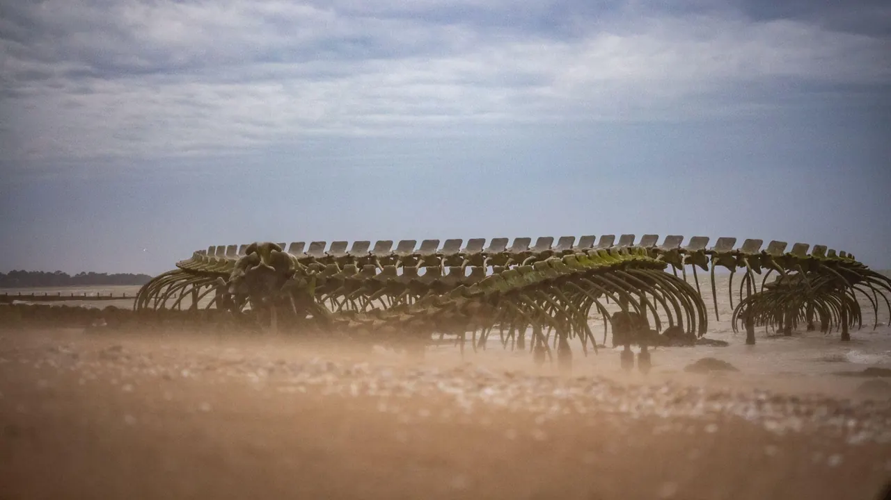

From our shop in the centre of Nantes to Saint-Brevin-les-Pins, it's about 63 km along the south bank of the Loire, on the route shared by the Loire à Vélo and the Vélodyssée. The terrain is very flat, but the distance makes it a long day: it suits regular cyclists, or anyone who splits it into two stages. At the end lie the ocean and the Serpent d'océan, the most spectacular artwork on the Estuaire trail.

- **Distance:** about 63 km one way
- **Duration:** one long day, or two days with a night in Paimbœuf or Corsept
- **Level:** moderate (very flat, but long)
- **Elevation:** almost none
- **Start:** Bike'N Tour shop, 27 quai de Versailles, Nantes (tram line 2, Saint-Mihiel stop)
- **Finish:** Saint-Brevin-les-Pins, Mindin beach
- **Return:** no railway station in Saint-Brevin; Aléop coach or shuttle to Saint-Nazaire then TER, or ride back

## The route

### From Nantes to Trentemoult

From the shop, head for the Île de Nantes and cross the southern arm of the Loire towards Rezé. Follow the Loire à Vélo and Vélodyssée signs (EuroVelo 6 and EuroVelo 1) towards Saint-Brevin. You pass through Trentemoult, the former fishing village with its colourful houses.

### From Bouguenais to Le Pellerin

The route then follows the south bank via Bouguenais (Port Lavigne), La Montagne and Saint-Jean-de-Boiseau, as far as Le Pellerin. This first section alternates between cycle paths and small shared roads. At Le Pellerin, don't take the ferry to Couëron: it would take you over to the other bank. Stay on the south bank.

### The Canal de la Martinière to Paimbœuf

After Le Pellerin, the route follows the Canal de la Martinière, a long ribbon of water between the Loire, the marshes and the hedged farmland. This is the most peaceful part of the ride, on small country roads. You then reach Paimbœuf, once the outer port of Nantes, on a cycle path. Take care when crossing the RD77 and RD77a roads.

### From Paimbœuf to Saint-Brevin-les-Pins

The last few kilometres go through Corsept, then a cycle path leads to Mindin, in Saint-Brevin-les-Pins. The river widens, the Saint-Nazaire bridge comes into view, and you finally arrive facing the ocean.

## What to see along the way

- **Le Pendule by Roman Signer (Trentemoult, Rezé):** a 7-metre pendulum hanging from a former concrete plant, on the riverbank.
- **The Settlers by Sarah Sze (Port Lavigne, Bouguenais):** sculptures of animals, a bear, a jaguar and monkeys, set in three trees.
- **Did I miss something by Jeppe Hein (Saint-Jean-de-Boiseau):** sit down on the bench and a 20-metre water jet shoots up.
- **Misconceivable by Erwin Wurm (Le Pellerin):** a sailing boat that bends over the Canal de la Martinière, as if drawn to the water.
- **Le Jardin étoilé by Kinya Maruyama (Paimbœuf):** a garden on the banks of the Loire, built from local materials following a constellation and the four cardinal points, ideal for gazing at the river.
- **Le Serpent d'océan by Huang Yong Ping (Saint-Brevin-les-Pins):** a 130-metre snake skeleton, installed in 2012 on the Pointe du Nez-de-Chien. At high tide, only the head and the vertebrae stick out of the water.

## Practical information

**Getting back to Nantes.** There is no railway station in Saint-Brevin-les-Pins. The simplest option is to cross the estuary to Saint-Nazaire, then take the TER Aléop train to Nantes, which takes bikes subject to available space. Cycling over the Saint-Nazaire bridge is very strongly discouraged. To get across:

- in summer, a paid minibus shuttle carries cyclists and their bikes from one bank to the other (book with the Saint-Brevin tourist office);
- all year round, the Aléop 317 coach line takes a few bikes, if you book by the day before at the latest.

Another option: carry on the next day along the Vélodyssée to Pornic and take the TER back from Pornic. You can also ride back, over two days.

**Taking a break.** Between Le Pellerin and Paimbœuf, services are scarce: set off with water and a picnic. Paimbœuf and Saint-Brevin have shops and accommodation, several with the Accueil Vélo label.

**When to go?** From May to September, for the long days. Check the tide times if you want to see the Serpent d'océan uncovered.

## Which bike should you choose?

For 63 km in one go, we recommend the [e-bike](/fr/location-velo-electrique-voyage): its battery can be recharged at your stopover if you spend the night on the way. Over two days with panniers, our [touring bike](/fr/location-velo-de-voyage) is perfect. This ride is also the first stage of [the Vélodyssée to Pornic and the Vendée](/fr/itineraires-velo-depart-nantes/velodyssee).

## FAQ

### Can you cycle from Nantes to Saint-Brevin in one day?

Yes, if you ride regularly: allow about 4 hours of pedalling for 63 km, plus breaks. Otherwise, split it in two with a night in Paimbœuf or Corsept.

### Is the route suitable for beginners?

The terrain is very flat, but a good part of it is on roads shared with cars, and the distance is long. For beginners, we recommend the e-bike or two days on the road.

### Can you cycle across the Saint-Nazaire bridge?

It is very strongly discouraged. Use the bike shuttle in summer, or the Aléop 317 coach, which you can book all year round.

To find out more about the artwork waiting for you at the finish, read our article on [the Serpent d'océan](/post/une-creature-mythique-aux-portes-de-lestuaire), then carry on with [Pornic by bike](/post/pornic-a-velo).
