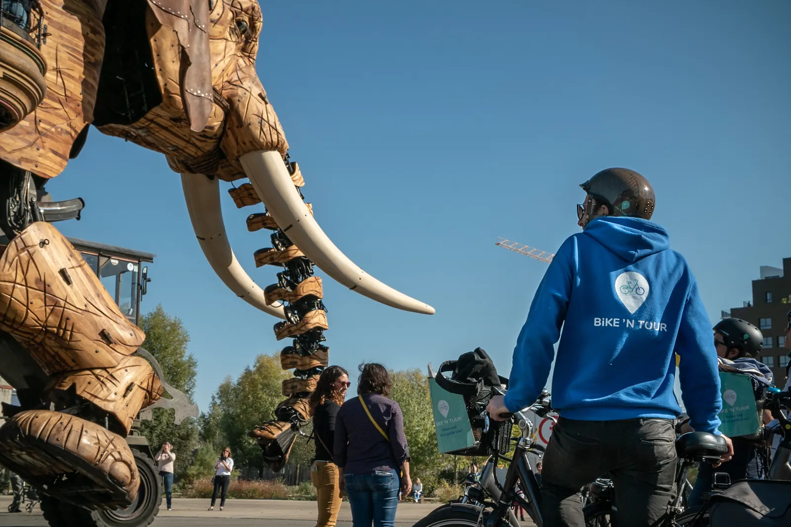
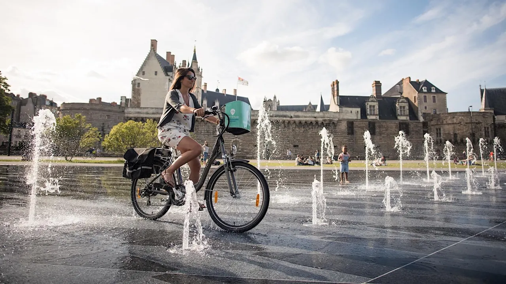

For a first cycling trip from Nantes, choose a flat, well-signposted route, plan stages of 40 to 60 km and travel light with two panniers. Nantes is an ideal starting point: several major long-distance cycle routes start from the city centre, and the train makes it easy to get back. Here is how we advise our customers before they set off.

## Choosing your route

For a first time, go for a flat route, largely on traffic-free paths, with railway stations along the way. From Nantes, here are our suggestions, from shortest to longest.

### For a weekend

- **The [Vignoble nantais](/fr/itineraires-velo-depart-nantes/vignoble-nantais)**: about 80 km loop over two days, via the Sèvre nantaise, Clisson and the Muscadet hillsides.
- **Nantes – Angers on the Loire à Vélo**: about 110 km in two stages, returning by TER regional train from Angers.
- **Nantes – Pornic on the Vélodyssée**: about 100 km over two days, with a night in Paimbœuf or Corsept, then the train from Pornic to Nantes.
- **The [Canal de Nantes à Brest](/fr/itineraires-velo-depart-nantes/canal-nantes-brest) to Redon**: two days on the towpaths, and the train to get back.

### For a few days or a week

- **The [Loire à Vélo](/fr/itineraires-velo-depart-nantes/loire-a-velo)** to Saumur: about 165 km in 3 to 4 days. It's our top recommendation for a first multi-day trip: flat, very well signposted, with châteaux and villages all along the way.
- **The [Vélodyssée](/fr/itineraires-velo-depart-nantes/velodyssee)** to Les Sables-d'Olonne: about 240 km in 4 to 5 days, from the estuary to the Vendée coast.
- **The [Régalante](/fr/itineraires-velo-depart-nantes/regalante)** to Mont-Saint-Michel: 275 km in 9 stages, mostly on greenways and with little climbing.

All our routes are detailed on the page [cycle routes from Nantes](/fr/itineraires-velo-depart-nantes).

## Pacing your stages

This is the most common mistake on a first trip: trying to ride too far. A few guidelines:

- **Adults of average fitness:** 40 to 60 km a day, on a flat route.
- **With children:** 20 to 30 km a day.
- **On an e-bike:** longer stages become comfortable, as long as you charge the battery every evening.

Leave time for sightseeing, breaks and the weather. A headwind can slow you down a lot, especially on exposed sections. For your nights, look for accommodation with the Accueil Vélo label: among other things, they offer shelter for your bikes.

## Packing

### The right gear

- **Two waterproof rear panniers**: they attach to the rack and keep the centre of gravity low. We rent pairs of Ortlieb panniers, 2 × 20 litres.
- **A handlebar bag**: for your phone, documents, sun cream and a snack.
- **No backpack**: it tires your back and makes you sweat.

### The basic list

- Rain gear, a warm layer and quick-drying clothes.
- Helmet, sunglasses, sun cream.
- Water bottle and snacks.
- Small toiletry bag and first-aid kit.
- Phone charger and power bank.

Weigh your load: two 20-litre panniers are plenty for a few days. At Bike'N Tour, a lock, puncture repair kit, pump, rack and lights are included with every rental.

## Choosing your bike

- **The [touring bike](/fr/location-velo-de-voyage)**: our most requested bike for the Loire à Vélo and the Vélodyssée. Upright position, 9 gears, hydraulic disc brakes and a rack for two panniers.
- **The [e-bike](/fr/location-velo-electrique-voyage)**: ideal for long stages, hilly routes and couples with different fitness levels. Around 100 km of range in eco mode.
- **The [gravel bike](/fr/location-gravel-nantes)**: for the Vignoble nantais or towpaths with a compacted gravel surface.

We adjust each bike to your size and give you our route advice before you set off. See our [prices and booking](/fr/nos-tarifs-reservation).

## Coming back by train

Most routes from Nantes are one-way. The train is the easiest way to get back:

- **TER Aléop (Pays de la Loire):** in season, booking a bike space is compulsory and charged on all lines (in 2026, from May to the end of September). Book when you buy your ticket.
- **TER BreizhGo (Brittany):** same principle in season, with compulsory, paid booking. Useful for coming back from Rennes or Saint-Malo.
- **TGV and Intercités:** your bike travels either in a booked, paid space or dismantled in a bag of 90 × 120 cm maximum.

The rules change every year: check them on veloabord.fr or with SNCF, the French railways, before you leave. Another option: on the main routes, we can arrange for the bikes to be collected at your destination, on quotation.

To warm up before the big trip, try one of our day [ride ideas](/fr/idees-de-balades), such as [the banks of the Loire to Mauves-sur-Loire](/post/les-bords-de-loire-mauves-sur-loire). And for a different way to travel, read our article on [slow tourism](/post/le-slow-tourisme-voyager-plus-pour-polluer-moins).

## FAQ

### Which route should I choose for a first cycling trip from Nantes?

The Loire à Vélo to Angers or Saumur: it's flat, very well signposted and served by trains for the return.

### How many kilometres a day on a first cycling trip?

Allow 40 to 60 km a day for adults, and 20 to 30 km with children. Leave time for breaks and sightseeing.

### Can I return the rental bike somewhere other than Nantes?

Yes, on request: we arrange collection of the bikes at your destination with our partners, on quotation. Otherwise, you can take the train back to Nantes with the bike.
