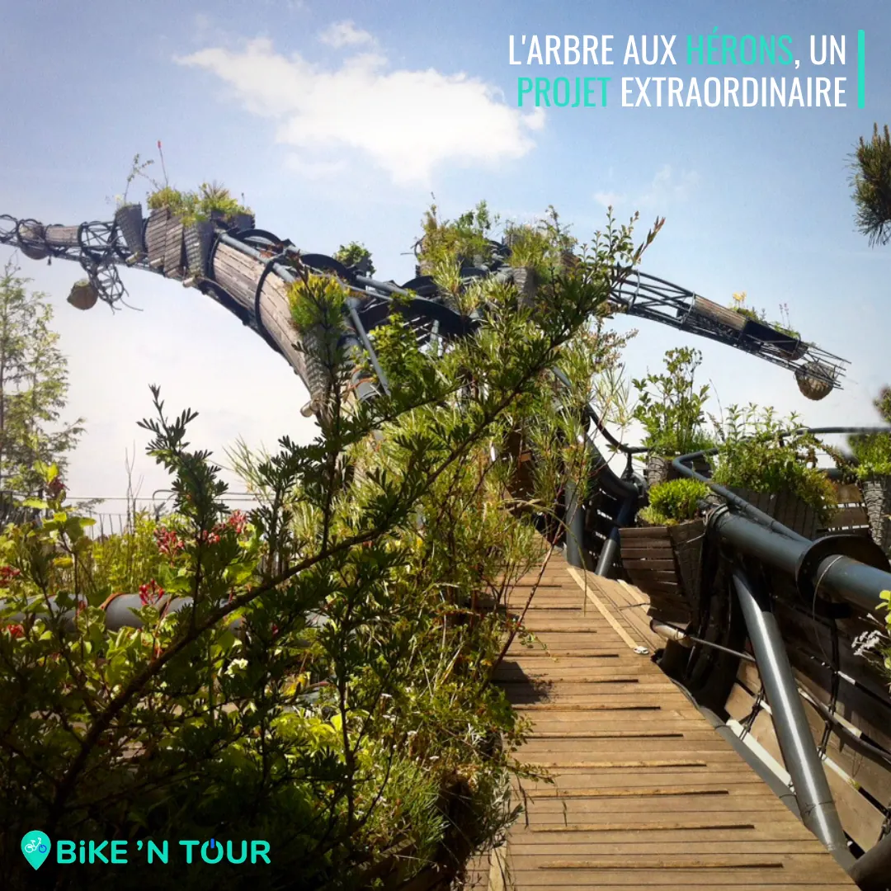

The bike ride around the Île de Nantes is a flat, easy 10.5 km loop that takes about an hour of pedalling. It follows both arms of the Loire and links the island's main landmarks: the Machines de l'île, the Titan cranes, the Hangar à Bananes and the Anneaux de Buren. It's the perfect ride for a first outing by bike in Nantes, on your own, as a couple or with the family.

- **Distance:** 10.5 km loop
- **Duration:** about 1 hour of riding, 2 to 3 hours with stops
- **Level:** beginner, flat terrain
- **Start:** the Machines de l'île, Parc des Chantiers
- **Finish:** back at the starting point
- **Access:** tram line 1, Chantiers navals stop, or about ten minutes by bike from our shop

## The route

The Île de Nantes is almost 5 km long. It is bordered to the north by the Madeleine arm of the Loire and to the south by the Pirmil arm. Our loop takes you all the way round, clockwise.

### From the Machines de l'île to the eastern tip

Start from the Parc des Chantiers, in front of the Nefs, the halls of the former shipyards that house the Machines de l'île. Then head east along the Madeleine arm. Across the river, on the opposite bank, you can see the historic centre. Carry on to the eastern tip of the island, on the Beaulieu side, a district built from the 1960s onwards.

### Back along the Pirmil arm

Turn back along the south side of the island and follow the Pirmil arm westwards. Opposite, on the south bank, lies Rezé. Ride to the end of the quai Wilson, at the western tip of the island.

### Finishing on the quai des Antilles

Finally, ride along the quai des Antilles beside the Loire. You pass the Hangar à Bananes and the Anneaux before arriving back at the Parc des Chantiers. On the quays, share the space with pedestrians and ride at walking pace at busy times.

## What to see along the way

### The Machines de l'île

Housed in the Nefs of the former shipyards, the Machines de l'île are the work of Pierre Orefice and François Delarozière. The 12-metre-tall Grand Éléphant strolls around with its passengers. The Carrousel des Mondes Marins and the Galerie des Machines complete the visit. Allow time if you want to go inside.

### The Titan cranes

Two giant cranes recall the island's industrial past. The grey one stands at the end of the quai Wilson. The yellow one, the older of the two, served the Dubigeon shipyards. We have written an article about them: [the Titans of Nantes](/post/les-titans-de-nantes).

### The Anneaux de Buren

On the quai des Antilles, near the Hangar à Bananes, eighteen rings by Daniel Buren and Patrick Bouchain frame the Loire. This permanent artwork lights up in red, blue and green at nightfall. It is on the green line of the [Voyage à Nantes](/post/le-voyage-a-nantes-2021-a-deja-commence).

### What about the Arbre aux Hérons?

You may have heard of it: a huge plant-covered structure, the Arbre aux Hérons (Heron Tree), was due to be built in the former Misery quarry, on the other bank. The project was abandoned by Nantes Métropole in September 2022 because of its rising cost. Its creators contested the decision. You can, however, see prototypes in the Galerie des Machines, including a one-fifth-scale model of the trunk and branches, and a heron with an 8-metre wingspan.

## Practical information

- **When to go:** the quays are quieter in the morning. At the end of the day, the light on the Loire is superb, and the Anneaux light up at nightfall.
- **Where to park:** there are bike racks near the sites. Remember to lock the frame, not just the wheel, with the lock provided.
- **To find out more:** the island's history is told in our article [an island full of history](/post/une-ile-remplie-dhistoire-ile-de-nantes).

From our shop at 27 quai de Versailles (tram line 2, Saint-Mihiel stop), it's about ten minutes by bike to the island: head south to the Loire along the cours des 50-Otages. The shop is open from April to October. Find all our advice in our [guide to bike rental in Nantes](/fr/guide-location-velo-nantes).

[See the route on Google Maps](https://www.google.fr/maps/place/%C3%8Ele+de+Nantes/@47.2041807,-1.5559768,15z/data=!3m1!4b1!4m5!3m4!1s0x4805eeb40b080c85:0xf0d37531cab1510!8m2!3d47.204167!4d-1.547222)

## Which bike should you choose?

The loop is flat, so all our bikes are suitable.

- **The [touring bike](/fr/location-velo-de-voyage)**: comfortable, with 9 gears and an upright position. It's more than enough for this route.
- **The [e-bike](/fr/location-velo-electrique-voyage)**: useful if you extend your ride to Trentemoult or along the Loire, or if you want to ride effortlessly.
- **The [electric cargo bike](/fr/location-velo-cargo)**: perfect for bringing the children and the picnic.

Daily, weekend and weekly prices are on our [prices and booking](/fr/nos-tarifs-reservation) page. Prefer to be guided? Our [Nantes panorama tour](/fr/tour/tour-du-panorama-nantais) takes in the Île de Nantes and the Elephant, by e-bike with a local guide. See also our other [ride ideas](/fr/idees-de-balades).

## FAQ

### How long does it take to ride around the Île de Nantes?

Allow about an hour for the 10.5 km without stopping. With breaks at the Machines, the Titans and the Anneaux, plan on two to three hours.

### Is the Île de Nantes bike loop suitable for children?

Yes: the route is flat and short. Stay alert on the quays shared with pedestrians. We rent children's bikes, baby seats and a cargo bike.

### Can you see the Arbre aux Hérons in Nantes?

No: the project was abandoned by Nantes Métropole in September 2022. Prototypes, including a model and a mechanical heron, are on display in the Galerie des Machines de l'île.
