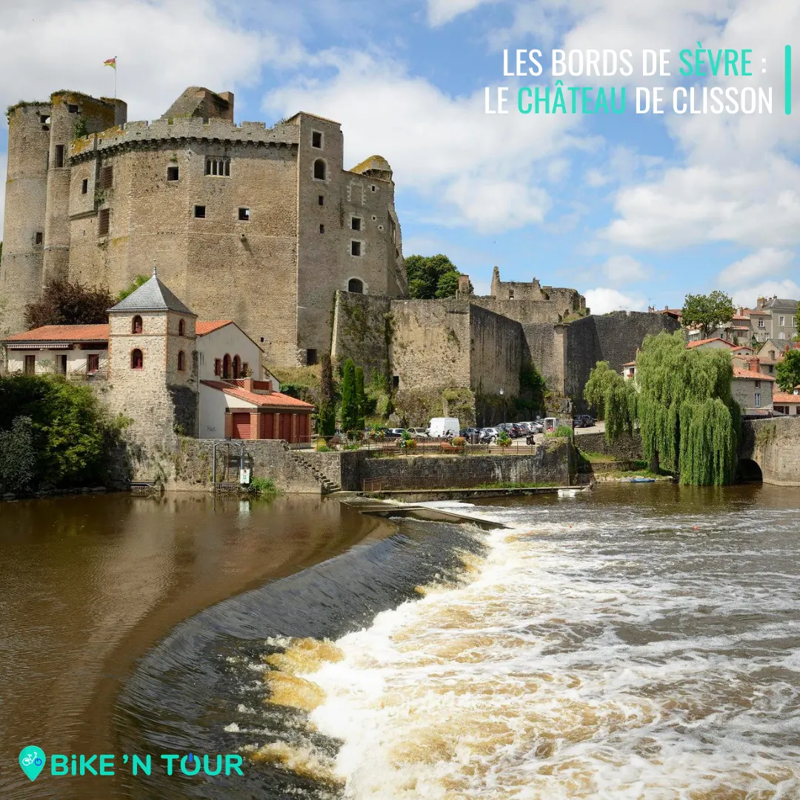
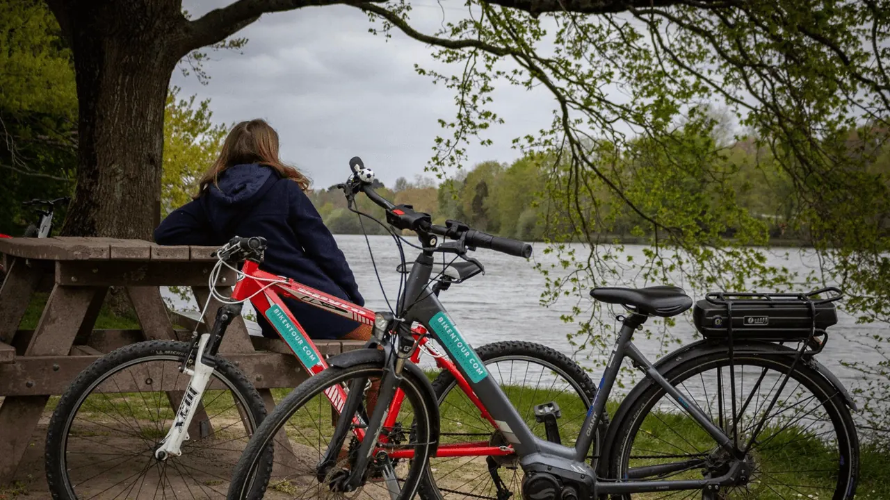
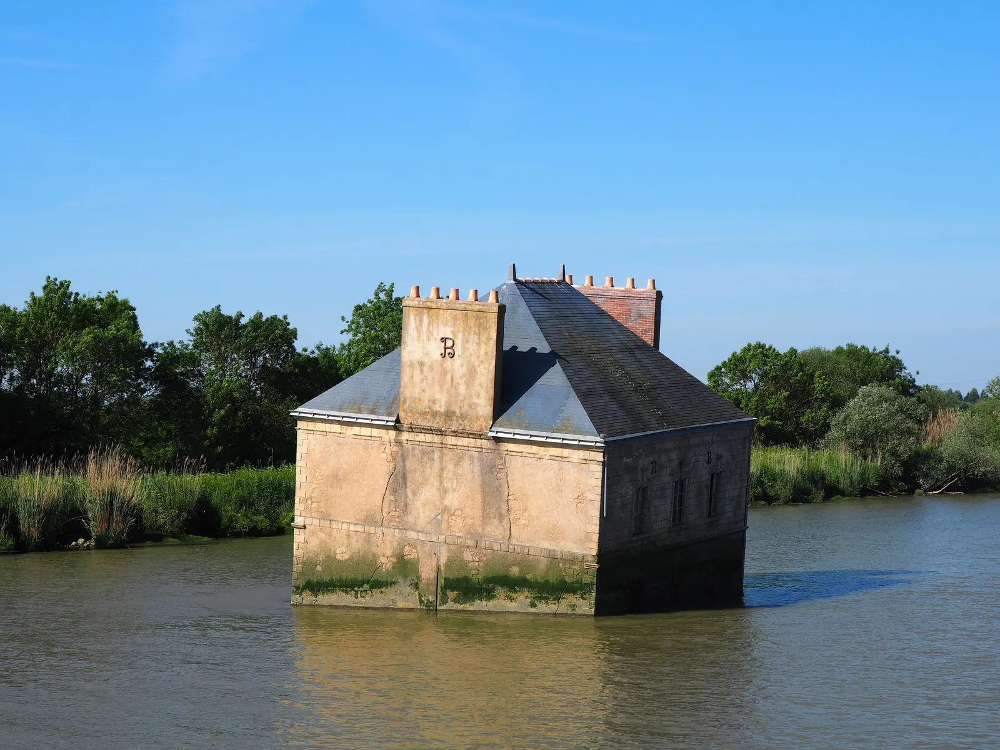
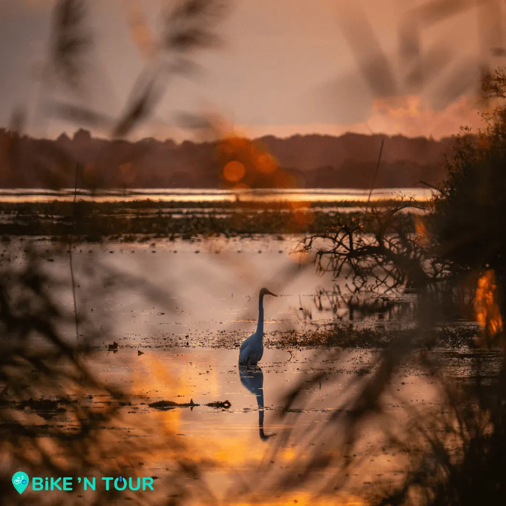

Here are our five favourite bike rides from our shop in the centre of Nantes, from a short loop around town to a full day out towards the estuary. They range from 10 to 46 km, all are very flat, and most let you come back by train. For each one, we give you the distance, the level and the best way to get back.

- **Distance:** 10 to 46 km depending on the ride
- **Duration:** from one hour to a full day
- **Level:** easy to moderate
- **Start:** Bike'N Tour shop, 27 quai de Versailles, Nantes (tram line 2, Saint-Mihiel stop)
- **Return:** by bike or by TER regional train, depending on the ride

## 1. The Sèvre nantaise to Clisson

This ride leaves Nantes heading south-east along the banks of the Sèvre nantaise river. You pass the Chaussée des Moines in Vertou, a popular waterside spot for a break, then ride into the Muscadet vineyards on quiet lanes. Arriving in Clisson is the highlight: the medieval castle towers over the Sèvre, and the Garenne Lemot park gives the town its Italian feel.

Taking the TER back from Clisson means you can enjoy the town without watching the clock. The full route is in our article [the Sèvre nantaise by bike](/post/balade-incontournable-la-sevre-nantaise), and the riverbanks in [the Sèvre by bike](/post/la-sevre-a-velo).

- **Distance:** 37 km one way
- **Duration:** a full day
- **Level:** moderate
- **Return:** TER train from Clisson (about 20 minutes to Nantes)

## 2. The Erdre to Sucé-sur-Erdre

The Erdre, nicknamed "the most beautiful river in France" after a phrase attributed to King Francis I, can be explored in two ways. In Nantes, a short loop follows both banks and crosses at the Jonelière bridge: ideal for an hour or two. To get out of town, ride up the river to Sucé-sur-Erdre, past châteaux, fine houses and guinguettes (open-air cafés) by the water.

In Sucé-sur-Erdre, the station is served by the tram-train to Nantes, handy if you only want to cycle one way. All our tips are in the article [the Erdre by bike](/post/balade-incontournable-lerdre-a-velo).

- **Distance:** 18 km one way to Sucé-sur-Erdre
- **Duration:** half a day
- **Level:** easy
- **Return:** by bike or by tram-train from Sucé-sur-Erdre

## 3. The Loire à Vélo to Cordemais

Heading west, this ride follows the Loire to its estuary on the Loire à Vélo cycle route. In Couëron, Jean-Luc Courcoult's Maison dans la Loire looks as if it is sinking into the river. You then cross the marshes on very quiet lanes, among reeds and birds, as far as Tatzu Nishi's Villa Cheminée in Cordemais, a house perched on top of a 15-metre tower.

The route is flat, but 46 km takes a proper day. In winter, the marsh roads can be flooded. All the details are in our article [Nantes – Cordemais by bike](/post/balade-incontournable-la-loire-a-velo-de-nantes-a-cordemais).

- **Distance:** 46 km one way
- **Duration:** a full day
- **Level:** moderate
- **Return:** TER train from Cordemais (station about 2.5 km from the village centre)

## 4. Around the Île de Nantes

The shortest ride in our selection, perfect with the family or at the end of the day. Start from the Machines de l'île, housed in the Nefs, the former shipyard halls, and first follow the Madeleine arm of the Loire on the north side. At the eastern tip of the island, at the Parc de Beaulieu, head back west along the Pirmil arm.

At the end of the quai Président-Wilson, on the south-western tip, you ride past the foot of the grey crane, one of the two listed Titan cranes that recall the island's port history. Finally, ride along the quai des Antilles and its Anneaux (rings) by Daniel Buren before returning to your starting point. Find the detailed route in [around the Île de Nantes by bike](/post/balade-incontournable-lile-de-nantes).

- **Distance:** about 10 km loop
- **Duration:** one to one and a half hours
- **Level:** easy
- **Return:** loop from central Nantes

## 5. Lac de Grand-Lieu

This ride starts from the Mémorial de l'abolition de l'esclavage (Memorial to the Abolition of Slavery) on the quai de la Fosse, then crosses the west of the Île de Nantes and its Anneaux. You then pass through the colourful lanes of [Trentemoult](/post/trentemoult-un-village-pittoresque) and by Roman Signer's Pendule, before reaching the Maison du lac de Grand-Lieu in Bouaye.

The lake itself is hard to reach: you can only see it from a few points. If you're feeling keen, carry on to Pierre-Aigüe in Saint-Aignan-Grandlieu, one of the few places where you can get close to the lake. You can come back by TER from Bouaye. More details in [Nantes – Lac de Grand-Lieu by bike](/post/balade-incontournable-de-nantes-au-lac-de-grand-lieu).

- **Distance:** 18 km one way to Bouaye
- **Duration:** a full day
- **Level:** easy
- **Return:** TER train from Bouaye

## Practical information

**Coming back by train.** Clisson, Cordemais and Bouaye are served by Aléop TER regional trains, and Sucé-sur-Erdre by the tram-train. Bikes are allowed on board subject to available space: in summer and at weekends, avoid peak times.

**Taking a break.** Every ride passes through villages with shops. On the Erdre and the Loire, guinguettes open in the warmer months. In the estuary marshes, however, there is nothing: bring water.

**When to go?** From April to October, during our opening season. Spring is ideal for the birds of Lac de Grand-Lieu and the estuary, summer for the guinguettes, and September for the vineyards at harvest time.

## Which bike should you choose?

For the Île de Nantes, the Erdre and Lac de Grand-Lieu, a [touring bike](/fr/location-velo-de-voyage) is all you need, with [children's bikes](/fr/location-velo-enfant) if you're travelling as a family. For Clisson and Cordemais, an [e-bike](/fr/location-velo-electrique-voyage) makes the day easier, and a [gravel bike](/fr/location-gravel-nantes) is in its element on the small roads of the [Vignoble nantais](/fr/itineraires-velo-depart-nantes/vignoble-nantais) wine country. More ideas are waiting on our [ride ideas](/fr/idees-de-balades) page.

## FAQ

### What is the easiest ride from Nantes?

The loop around the Île de Nantes, about 10 km and completely flat. To get out of town, the Erdre to Sucé-sur-Erdre is also very accessible.

### Can I come back by train with a rental bike?

Yes. By TER from Clisson, Cordemais and Bouaye, and by tram-train from Sucé-sur-Erdre, as long as bike spaces are available.

### Which ride is best with children?

The Île de Nantes and the Erdre are the most suitable. With children, allow 20 to 30 km a day at most, and think about a baby seat or a trailer for the youngest.

Fancy another ride along the water? Try [Nantes – Mauves-sur-Loire on the Loire à Vélo](/post/balade-incontournable-la-loire-a-velo-de-nantes-a-mauves-sur-loire) or the long route [from Nantes to Saint-Brevin along the estuary](/post/balade-incontournable-le-parcours-de-lestuaire-de-nantes-a-saint-brevin-les-pins).
