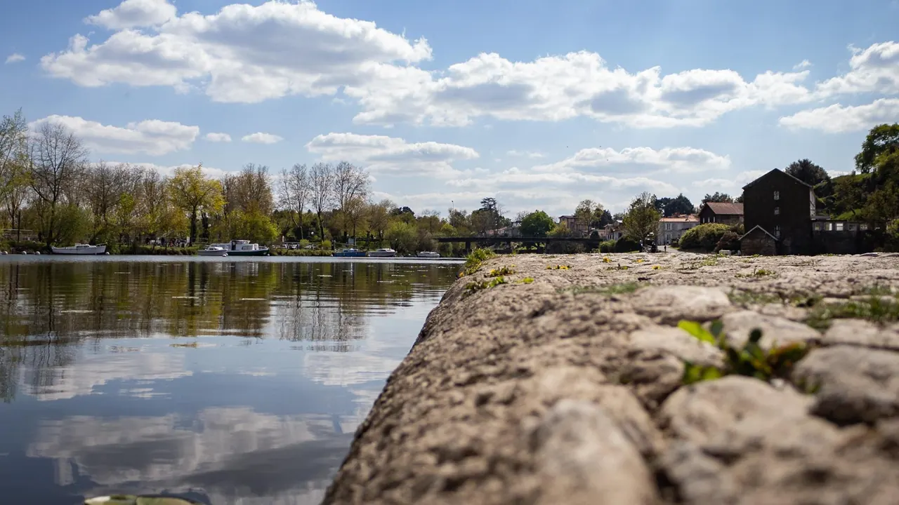

De Nantes a Clisson, esta ruta de 37 km sigue el río Sèvre nantaise hasta Vertou y luego serpentea entre los viñedos del Muscadet antes de llegar al pie del castillo de Clisson. Es adecuada para ciclistas acostumbrados a pedalear una jornada entera, y termina sin esfuerzo: el regreso se hace en TER (tren regional). Salida desde nuestra tienda, en pleno centro de Nantes.

- **Distancia:** 37 km solo ida
- **Duración:** una jornada, pausas incluidas
- **Nivel:** moderado
- **Desnivel:** unos 250 m de subida acumulada, sobre todo en los viñedos
- **Salida:** tienda Bike'N Tour, 27 quai de Versailles, Nantes (tranvía línea 2, parada Saint-Mihiel)
- **Llegada:** Clisson
- **Regreso:** en TER desde Clisson, se admiten bicicletas

## El recorrido

### De Nantes a Vertou: el corredor verde de la Sèvre

Se sale del centro de Nantes por las orillas del Loira, señalizadas como EuroVelo 6 y EuroVelo 1, para llegar a Rezé. Preste atención al atravesar la ciudad: el tráfico es denso y la señalización poco visible en algunos puntos. En Rezé, el itinerario se une a la Sèvre y sus praderas inundables. Después se sigue el río por el corredor verde hasta Vertou, por caminos tranquilos y con sombra.

### De Vertou a Le Pallet: la entrada en los viñedos

Pasada la Chaussée des Moines, el paisaje cambia. Se dejan las orillas por carreteras secundarias y caminos en el corazón de las fincas vinícolas, por La Haie-Fouassière. El trazado bordea brevemente la Sèvre entre Pé de Sèvre y Le Pallet. Es la parte más exigente: algunas cuestas cortas pero pronunciadas alrededor de Le Pallet.

### De Le Pallet a Clisson: el valle de la Sèvre

Se pasa por Angreviers, con su vado y su molino, y después se cruza por primera vez la Sèvre en Gorges. El último paso del río se hace en Clisson, con la fortaleza a la vista.

Gran parte del trayecto discurre por carreteras compartidas con los coches, poco transitadas. La señalización a lo largo de la Sèvre aún no está completa: le entregamos el track GPX al salir de la tienda.

## Qué ver por el camino

- **La Chaussée des Moines en Vertou:** construida por unos monjes hacia el año 1000, esta presa retenía el agua para la navegación, la pesca y un molino. En 1755 se le añadió una esclusa. Es la parada ideal para una primera pausa junto al agua.
- **Las fincas del Muscadet:** entre Vertou y Gorges, la carretera atraviesa los viñedos. Muchas fincas ofrecen degustaciones: una buena razón para ir más despacio.
- **El molino de Angreviers:** un vado, un molino y casas señoriales encaramadas sobre la Sèvre, en el municipio de Gorges.
- **El castillo de Clisson:** fortaleza medieval de los señores de Clisson, ampliada en el siglo XV por Francisco II, duque de Bretaña. Pertenece al Departamento de Loira Atlántico desde 1962 y se puede visitar.
- **La finca de la Garenne Lemot:** el escultor François-Frédéric Lemot la acondicionó a partir de 1808, inspirándose en Italia. El parque de 13 hectáreas a orillas de la Sèvre es de acceso libre todo el año.

## Información práctica

### Volver en tren

El TER une Clisson con Nantes en una veintena de minutos y admite bicicletas dentro del límite de plazas disponibles. La línea también para en Gorges, La Haie-Fouassière y Rezé Pont-Rousseau: práctico para acortar la ruta si se nota el cansancio. En verano, las plazas para bicicletas pueden estar muy solicitadas, así que prevea un poco de margen.

### Hacer una pausa

Encontrará panaderías y cafés en Vertou y en Clisson, y fincas vinícolas a lo largo de toda la carretera. Clisson merece que se quede unas horas: sus callejuelas, su mercado cubierto y su aire italiano se descubren muy bien a pie.

### ¿Cuándo ir?

Nuestra tienda abre de abril a octubre. La primavera y el principio del otoño son perfectos: temperaturas suaves, viñas con hojas o en vendimia. En pleno verano, salga temprano: las cuestas de los viñedos tienen poca sombra.

## ¿Qué bicicleta elegir?

La [bicicleta gravel](/fr/location-gravel-nantes) es la más agradable por los caminos y las carreteras secundarias de los viñedos. Si le preocupan las cuestas de Le Pallet, la [bicicleta eléctrica](/fr/location-velo-electrique-voyage) las hace desaparecer sin esfuerzo. Para convertirla en un fin de semana en circuito, vea nuestro itinerario [Le Vignoble nantais](/fr/itineraires-velo-depart-nantes/vignoble-nantais).

## Preguntas frecuentes

### ¿Cuánto se tarda en ir de Nantes a Clisson en bicicleta?

Calcule una jornada incluyendo las pausas y la visita de Clisson. El tiempo de pedaleo por sí solo varía de 2 h 30 a 4 horas según su ritmo.

### ¿Es difícil la ruta Nantes – Clisson?

Es de nivel moderado. La primera mitad, a lo largo de la Sèvre, es llana. La segunda, entre los viñedos, tiene algunas cuestas cortas, sobre todo alrededor de Le Pallet.

### ¿Se puede hacer esta ruta con niños?

Sí, con niños acostumbrados a pedalear, o deteniéndose en Vertou tras la parte más fácil. Parte del trayecto discurre por carreteras compartidas: manténganse en grupo.

Para saber más, lea nuestro artículo sobre [la Sèvre en bicicleta](/post/la-sevre-a-velo) y nuestra guía del [vignoble nantais](/post/le-vignoble-nantais).

[Ver la ruta en Google Maps](https://www.google.fr/maps/place/La+S%C3%A8vre+Nantaise/@47.1923134,-1.5503972,15z/data=!3m1!4b1!4m5!3m4!1s0x4805e94f12af4097:0x2534b8dbca382b16!8m2!3d47.1930753!4d-1.5414887)
