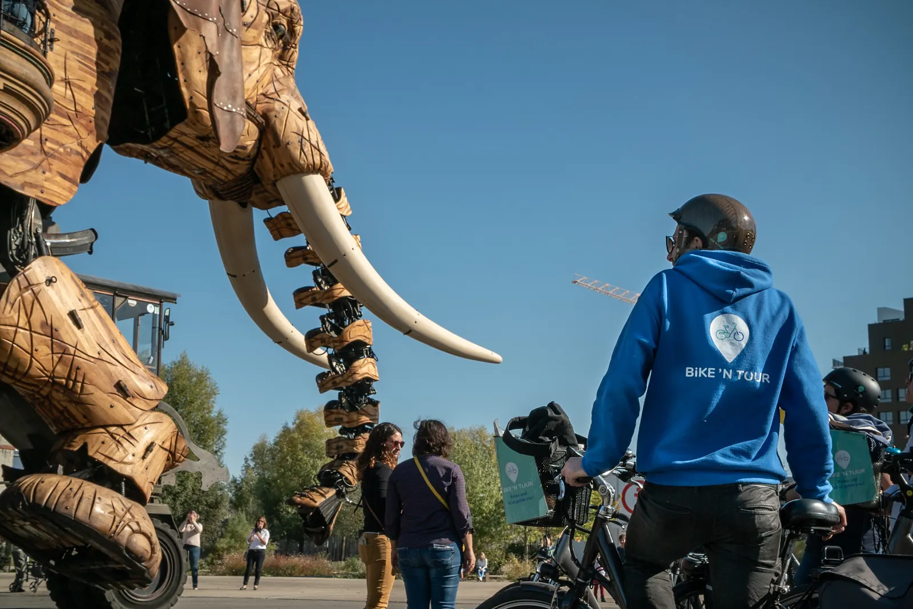
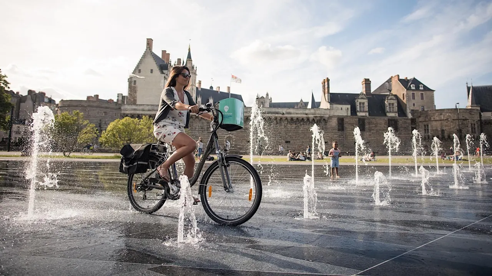

Para un primer viaje en bicicleta desde Nantes, elija un itinerario llano y bien señalizado, prevea etapas de 40 a 60 km y viaje ligero con dos alforjas. Nantes es un punto de partida ideal: varias grandes rutas cicloturistas salen del centro de la ciudad, y el tren permite volver con facilidad. Así es como aconsejamos a nuestros clientes antes de que se pongan en marcha.

## Elegir el itinerario

Para una primera vez, opte por un recorrido llano, en gran parte por vías reservadas a bicicletas, con estaciones de tren a lo largo del trayecto. Desde Nantes, estas son nuestras sugerencias, de la más corta a la más larga.

### Para un fin de semana

- **El [Vignoble nantais](/fr/itineraires-velo-depart-nantes/vignoble-nantais)**: unos 80 km en circuito en dos días, por la Sèvre nantaise, Clisson y las laderas del Muscadet.
- **Nantes – Angers por la Loire à Vélo** (la vía ciclista del Loira): unos 110 km en dos etapas, con regreso en TER (tren regional) desde Angers.
- **Nantes – Pornic por la Vélodyssée** (la ruta ciclista atlántica): unos 100 km en dos días, con una noche en Paimbœuf o Corsept, y luego el tren de Pornic a Nantes.
- **El [Canal de Nantes à Brest](/fr/itineraires-velo-depart-nantes/canal-nantes-brest) hasta Redon**: dos días por los caminos de sirga, y el tren para volver.

### Para unos días o una semana

- **La [Loire à Vélo](/fr/itineraires-velo-depart-nantes/loire-a-velo)** hasta Saumur: unos 165 km en 3 o 4 días. Es nuestra primera recomendación para un primer viaje itinerante: llana, muy bien señalizada, con castillos y pueblos a lo largo de todo el recorrido.
- **La [Vélodyssée](/fr/itineraires-velo-depart-nantes/velodyssee)** hasta Les Sables-d'Olonne: unos 240 km en 4 o 5 días, del estuario a la costa de la Vendée.
- **La [Régalante](/fr/itineraires-velo-depart-nantes/regalante)** hasta el Mont-Saint-Michel: 275 km en 9 etapas, sobre todo por vía verde y con poco desnivel.

Todos nuestros itinerarios se detallan en la página [itinerarios en bicicleta desde Nantes](/fr/itineraires-velo-depart-nantes).

## Dosificar las etapas

Es el error más frecuente en un primer viaje: querer recorrer demasiados kilómetros. Algunas referencias:

- **Adultos en forma media:** 40 a 60 km al día, por un recorrido llano.
- **Con niños:** 20 a 30 km al día.
- **En bicicleta eléctrica:** las etapas más largas resultan cómodas, siempre que recargue la batería cada noche.

Reserve tiempo para las visitas, las pausas y el tiempo meteorológico. El viento de cara puede frenarle mucho, sobre todo en los tramos expuestos. Para dormir, busque los alojamientos con el sello Accueil Vélo: ofrecen, entre otras cosas, un refugio para las bicicletas.

## Hacer el equipaje

### El equipo adecuado

- **Dos alforjas traseras impermeables**: se fijan en el portaequipajes y mantienen bajo el centro de gravedad. Alquilamos pares de alforjas Ortlieb de 2 × 20 litros.
- **Una bolsa de manillar**: para el teléfono, la documentación, la crema solar y un tentempié.
- **Nada de mochila**: cansa la espalda y hace sudar.

### La lista básica

- Ropa de lluvia, una capa de abrigo y prendas de secado rápido.
- Casco, gafas de sol, crema solar.
- Cantimplora y tentempiés.
- Pequeño neceser y botiquín.
- Cargador del teléfono y batería externa.

Pese su carga: dos alforjas de 20 litros bastan de sobra para unos días. En Bike'N Tour, el candado, el kit antipinchazos, la bomba, el portaequipajes y las luces están incluidos en cada alquiler.

## Elegir la bicicleta

- **La [bicicleta de viaje](/fr/location-velo-de-voyage)**: nuestra bicicleta más solicitada para la Loire à Vélo y la Vélodyssée. Posición erguida, 9 velocidades, frenos de disco hidráulicos y portaequipajes para dos alforjas.
- **La [bicicleta eléctrica](/fr/location-velo-electrique-voyage)**: ideal para las etapas largas, los itinerarios con cuestas y las parejas con niveles distintos. Unos 100 km de autonomía en modo eco.
- **La [gravel](/fr/location-gravel-nantes)**: para el Vignoble nantais o los caminos de sirga de tierra compactada.

Ajustamos cada bicicleta a su talla y le damos nuestros consejos de itinerario antes de salir. Consulte nuestras [tarifas y reservas](/fr/nos-tarifs-reservation).

## Volver en tren

La mayoría de los itinerarios desde Nantes se hacen solo de ida. El tren es la solución más sencilla para volver:

- **TER Aléop (Países del Loira):** en temporada, la reserva de una plaza para la bicicleta es obligatoria y de pago en todas las líneas (en 2026, de mayo a finales de septiembre). Reserve al comprar su billete.
- **TER BreizhGo (Bretaña):** el mismo principio en temporada, con reserva obligatoria y de pago. Resulta útil para volver desde Rennes o Saint-Malo.
- **TGV e Intercités:** la bicicleta viaja en una plaza reservada y de pago, o desmontada en una funda de 90 × 120 cm como máximo.

Las normas cambian cada año: compruébelas en veloabord.fr o con la SNCF antes de salir. Otra solución: bajo presupuesto, podemos organizar la recogida de las bicicletas a la llegada en los principales itinerarios.

Para entrenar las piernas antes de la gran salida, pruebe una de nuestras [ideas de rutas](/fr/idees-de-balades) de un día, como [las orillas del Loira hasta Mauves-sur-Loire](/post/les-bords-de-loire-mauves-sur-loire). Y para viajar de otra manera, lea nuestro artículo sobre [el turismo lento](/post/le-slow-tourisme-voyager-plus-pour-polluer-moins).

## Preguntas frecuentes

### ¿Qué itinerario elegir para un primer viaje en bicicleta desde Nantes?

La Loire à Vélo hacia Angers o Saumur: es llana, está muy bien señalizada y tiene servicio de tren para el regreso.

### ¿Cuántos kilómetros al día para un primer viaje en bicicleta?

Calcule 40 a 60 km al día para adultos, y 20 a 30 km con niños. Reserve tiempo para las pausas y las visitas.

### ¿Se puede devolver la bicicleta alquilada en otro lugar que no sea Nantes?

Sí, bajo petición: organizamos la recogida de las bicicletas a la llegada con nuestros socios, bajo presupuesto. Si no, el tren permite volver a Nantes con la bicicleta.
