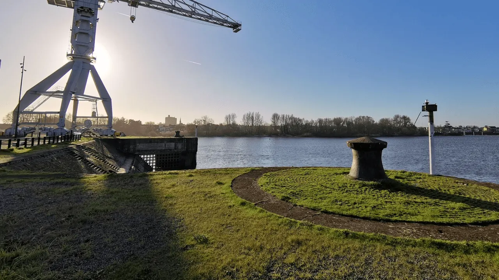
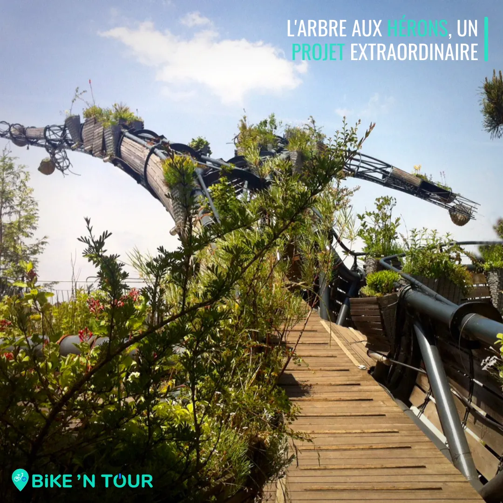

La vuelta a la isla de Nantes (Île de Nantes) en bicicleta es un circuito de 10,5 km, llano y fácil, que se completa en una hora de pedaleo. Recorre los dos brazos del Loira y une los grandes puntos de referencia de la isla: las Machines de l'île, las grúas Titan, el Hangar à Bananes y los Anneaux de Buren. Es la ruta ideal para una primera salida en bicicleta por Nantes, solo, en pareja o en familia.

- **Distancia:** 10,5 km en circuito
- **Duración:** alrededor de 1 h de pedaleo, de 2 a 3 h con las paradas
- **Nivel:** principiante, terreno llano
- **Salida:** las Machines de l'île, parque des Chantiers
- **Llegada:** regreso al punto de partida
- **Acceso:** tranvía línea 1, parada Chantiers navals, o unos diez minutos en bicicleta desde nuestra tienda

## El recorrido

La isla de Nantes tiene casi 5 km de largo. Está bordeada al norte por el brazo de la Madeleine y al sur por el brazo de Pirmil. Nuestro circuito le da la vuelta completa, en el sentido de las agujas del reloj.

### De las Machines de l'île a la punta este

Salga del parque des Chantiers, delante de las Nefs de los antiguos astilleros que albergan las Machines de l'île. Diríjase después hacia el este siguiendo el brazo de la Madeleine. Enfrente, en la otra orilla, verá el centro histórico. Continúe hasta la punta este de la isla, en el lado de Beaulieu, un barrio construido a partir de los años sesenta.

### Regreso por el brazo de Pirmil

Dé media vuelta por la orilla sur y recorra el brazo de Pirmil hacia el oeste. Enfrente, en la orilla sur, se extiende Rezé. Pedalee hasta el final del quai Wilson, en la punta oeste de la isla.

### El quai des Antilles para terminar

Por último, recorra el quai des Antilles, a lo largo del Loira. Pasará delante del Hangar à Bananes y los Anneaux antes de volver al parque des Chantiers. En los muelles, comparta el espacio con los peatones y circule al paso en las horas de mayor afluencia.

## Qué ver por el camino

### Las Machines de l'île

Instaladas en las Nefs de los antiguos astilleros, las Machines de l'île son obra de Pierre Orefice y François Delarozière. El Grand Éléphant, un elefante mecánico de 12 metros de altura, se pasea por allí con sus pasajeros. El Carrousel des Mondes Marins y la Galerie des Machines completan la visita. Reserve tiempo si desea entrar.

### Las grúas Titan

Dos grúas gigantes recuerdan el pasado industrial de la isla. La gris se alza al final del quai Wilson. La amarilla, más antigua, daba servicio a los astilleros Dubigeon. Les hemos dedicado un artículo: [los Titanes de Nantes](/post/les-titans-de-nantes).

### Los Anneaux de Buren

En el quai des Antilles, cerca del Hangar à Bananes, dieciocho anillos firmados por Daniel Buren y Patrick Bouchain enmarcan el Loira. Esta obra permanente se ilumina en rojo, azul y verde al caer la noche. Se encuentra en la línea verde del [Voyage à Nantes](/post/le-voyage-a-nantes-2021-a-deja-commence).

### ¿Y el Arbre aux Hérons?

Puede que haya oído hablar de él: una inmensa estructura vegetal, el Arbre aux Hérons (Árbol de las Garzas), iba a construirse en la antigua cantera Misery, en la otra orilla. Nantes Métropole abandonó el proyecto en septiembre de 2022 debido al aumento de su coste. Sus creadores impugnaron esta decisión. Sin embargo, puede ver algunos prototipos en la Galerie des Machines, entre ellos una maqueta a escala un quinto del tronco y las ramas, así como una garza de 8 metros de envergadura.

## Información práctica

- **Cuándo ir:** por la mañana, los muelles están más tranquilos. Al final del día, la luz sobre el Loira es magnífica, y los Anneaux se encienden al anochecer.
- **Dónde aparcar:** hay aparcabicis cerca de los lugares de interés. Recuerde atar el cuadro, no solo la rueda, con el candado que le proporcionamos.
- **Para saber más:** la historia de la isla se cuenta en nuestro artículo [una isla llena de historia](/post/une-ile-remplie-dhistoire-ile-de-nantes).

Desde nuestra tienda, en el 27 quai de Versailles (tranvía línea 2, parada Saint-Mihiel), calcule unos diez minutos en bicicleta hasta la isla, bajando hacia el Loira por el cours des 50-Otages. La tienda abre de abril a octubre. Encontrará todos nuestros consejos en nuestra [guía del alquiler de bicicletas en Nantes](/fr/guide-location-velo-nantes).

[Ver la ruta en Google Maps](https://www.google.fr/maps/place/%C3%8Ele+de+Nantes/@47.2041807,-1.5559768,15z/data=!3m1!4b1!4m5!3m4!1s0x4805eeb40b080c85:0xf0d37531cab1510!8m2!3d47.204167!4d-1.547222)

## ¿Qué bicicleta elegir?

El circuito es llano: todas nuestras bicicletas son adecuadas.

- **La [bicicleta de viaje](/fr/location-velo-de-voyage)**: cómoda, con 9 velocidades y una posición erguida. Es más que suficiente para este recorrido.
- **La [bicicleta eléctrica](/fr/location-velo-electrique-voyage)**: útil si prolonga la salida hacia Trentemoult o las orillas del Loira, o si quiere circular sin esfuerzo.
- **La [bicicleta de carga eléctrica](/fr/location-velo-cargo)**: perfecta para llevar a los niños y el pícnic.

Las tarifas por día, fin de semana o semana están en nuestra página [tarifas y reservas](/fr/nos-tarifs-reservation). ¿Prefiere ir con guía? Nuestro [tour del panorama de Nantes](/fr/tour/tour-du-panorama-nantais) pasa por la isla de Nantes y el Elefante, en bicicleta eléctrica y con un guía local. Descubra también nuestras otras [ideas de rutas](/fr/idees-de-balades).

## Preguntas frecuentes

### ¿Cuánto se tarda en dar la vuelta a la isla de Nantes en bicicleta?

Calcule alrededor de una hora para los 10,5 km sin paradas. Con una pausa en las Machines, los Titanes y los Anneaux, prevea más bien de dos a tres horas.

### ¿La vuelta a la isla de Nantes en bicicleta es adecuada para niños?

Sí: el recorrido es llano y corto. Esté atento en los muelles compartidos con los peatones. Alquilamos bicicletas infantiles, sillitas de bebé y una bicicleta de carga.

### ¿Se puede ver el Arbre aux Hérons en Nantes?

No: Nantes Métropole abandonó el proyecto en septiembre de 2022. En la Galerie des Machines de l'île se exponen prototipos, entre ellos una maqueta y una garza mecánica.
