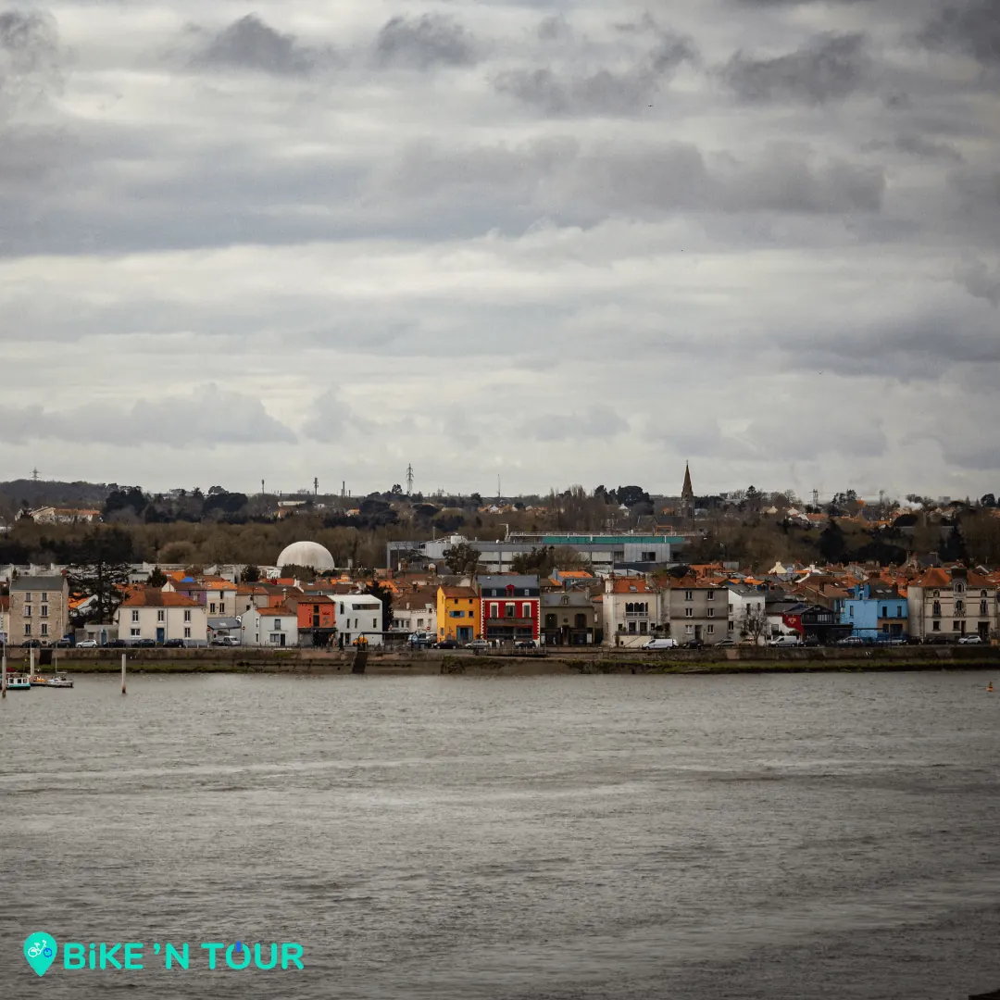

La butte Sainte-Anne est la colline qui domine la Loire à l'ouest du centre de Nantes, dans le quartier de Chantenay. On y monte pour la vue sur le fleuve et l'île de Nantes, pour le musée Jules Verne et pour le Jardin extraordinaire, creusé dans une ancienne carrière. Depuis notre boutique, comptez environ 3 km à vélo, avec une vraie montée à la fin.

- **Distance :** environ 3 km de la boutique à vol d'oiseau
- **Durée :** un quart d'heure à vélo, une demi-journée pour tout voir
- **Niveau :** modéré, la butte se gagne par une côte
- **Accès :** par la route à vélo, ou à pied par l'escalier de 121 marches depuis le quai de l'Aiguillon

## Ce qu'il faut voir sur la butte

### L'escalier, l'église et la statue de sainte Anne

Depuis le quai de l'Aiguillon, au bord de la Loire, un escalier de 121 marches grimpe vers le sommet de la butte. En haut, la statue de sainte Anne, inaugurée en 1871, bénit la Loire et ses marins en serrant contre elle la Vierge enfant. Juste à côté, l'église Sainte-Anne date du milieu du XIXe siècle. Sa tour-clocher mesure 46 mètres.

### Le musée Jules Verne et le planétarium

L'écrivain né à Nantes a son musée sur la butte, face à la Loire. Le planétarium de Nantes est installé tout près. Deux bonnes visites pour un jour de pluie.

### Le square Maurice-Schwob et le Lunar Tree

Le square Maurice-Schwob est un balcon sur la Loire et l'île de Nantes. De là, regardez la falaise de la butte : le Lunar Tree, du duo d'artistes Mrzyk & Moriceau, y a été installé pour Estuaire en 2012. On le voit aussi depuis la pointe ouest de l'île de Nantes.

### Le Belvédère de l'Hermitage

Cette passerelle en bois de l'artiste japonais Tadashi Kawamata offre une vue large sur la Loire et l'île de Nantes. C'est une œuvre pérenne du Voyage à Nantes.

## Le Jardin extraordinaire

Creusée dans le flanc de la butte, l'ancienne carrière Miséry a été exploitée pour son granite du XVe siècle à 1915. Elle abrite aujourd'hui le Jardin extraordinaire. Sa première partie a ouvert le 27 septembre 2019, avec une cascade de 25 mètres et des escaliers accrochés à la falaise. Une promenade de sept belvédères longe le haut de la carrière, de la rue de l'Hermitage à l'escalier Lusançay.

L'extension du jardin a ouvert les 11 et 12 octobre 2025. Elle ajoute 1,6 hectare à l'est, avec un bassin, un marais de plantes carnivores et des voies d'escalade sur les parois de la carrière. L'accès au jardin est gratuit.

Vous avez peut-être entendu parler de l'Arbre aux Hérons, qui devait s'élever dans cette carrière. Le projet a été abandonné par Nantes Métropole en septembre 2022. Nous en parlons dans notre balade sur [l'île de Nantes](/post/balade-incontournable-lile-de-nantes).

## Y aller à vélo depuis la boutique

Depuis notre boutique, descendez vers les quais de la Loire par le cours des 50-Otages, puis suivez le fleuve vers l'ouest jusqu'au quai de l'Aiguillon. La montée finale vers le sommet est raide : c'est là qu'un vélo électrique fait toute la différence. L'escalier de 121 marches, lui, se fait à pied, vélo attaché en bas.

Le quartier de Chantenay se prête bien à une boucle : lisez notre article sur [Chantenay-sur-Loire](/post/chantenay-sur-loire). Et pour voir la butte depuis l'autre rive, traversez vers [Trentemoult](/post/trentemoult-un-village-pittoresque), dont les maisons colorées font face au quartier.

## Infos pratiques

- **Quand y aller :** en fin de journée, la lumière sur la Loire est superbe depuis les belvédères.
- **Horaires :** le Jardin extraordinaire et les musées ont leurs propres horaires, qui changent selon la saison. Vérifiez-les avant de partir.
- **Stationnement :** les belvédères et le jardin se découvrent à pied. Attachez le cadre de votre vélo.
- **Saison :** notre boutique est ouverte d'avril à octobre.

[Voir le parcours sur Google Maps](https://www.google.fr/maps/place/%C3%A9glise+Sainte-Anne/@47.2028801,-1.5817445,17z/data=!3m1!4b1!4m5!3m4!1s0x4805ebf550e7df1f:0x5bccf4b4f1d124d3!8m2!3d47.2028532!4d-1.5795191)

## Quel vélo choisir ?

La butte se mérite : le [vélo électrique](/fr/location-velo-electrique-voyage) est le choix le plus confortable. Les sportifs s'en sortiront avec un [vélo de voyage](/fr/location-velo-de-voyage) et ses 9 vitesses. Les prix sont sur notre page [tarifs et réservation](/fr/nos-tarifs-reservation). Envie d'un regard différent sur l'ouest de la ville ? Notre tour [Culture urbaine](/fr/tour/tour-a-velo-electrique-culture-urbaine-a-nantes) explore le quartier Chantenay et les bords de Loire, à vélo électrique.

## Questions fréquentes

### Combien de marches compte l'escalier de la butte Sainte-Anne ?

L'escalier compte 121 marches, depuis le quai de l'Aiguillon jusqu'au haut de la butte.

### Le Jardin extraordinaire est-il gratuit ?

Oui, l'accès est gratuit. Ses horaires varient selon la saison.

### Peut-on monter sur la butte Sainte-Anne à vélo ?

Oui, par la route. La montée est courte mais raide : un vélo électrique la rend facile.

[À lire aussi : Suivre la ligne verte du Voyage à Nantes à vélo](/post/le-voyage-a-nantes-2021-a-deja-commence) et [Trentemoult, un village pittoresque](/post/trentemoult-un-village-pittoresque).
