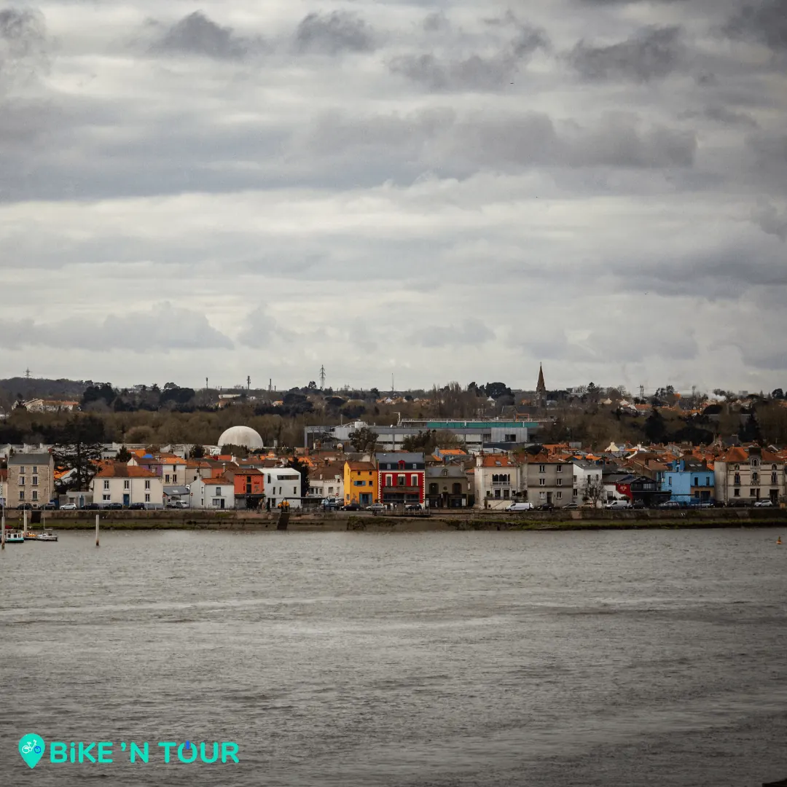

Ce quartier incontournable de Nantes domine la ville, pour y accéder vous avez le choix entre la route ou les 121 marches qui vont mèneront en haut de la butte Saint-Anne face à l’église du même nom.

Dans ce quartier vous découvrirez un grand nombre de lieux incontournables de Nantes. On y retrouve entre autres le musée Jules Verne ainsi que le planétarium. Certaines œuvres d’art y prennent également place tel que le Lunar tree ou encore depuis moins longtemps le Belvédère de l’Hermitage. Bien plus qu’une simple œuvre d'art, ce dernier vous permettra d’avoir une vue imprenable sur la ville et sur la Loire.

Creusée dans la butte Saint-Anne et laissée à l’abandon depuis, la Carrière Miséry verra apparaître d’ici quelques années au côté du jardin extraordinaire [L’arbre aux hérons](/post/balade-incontournable-lile-de-nantes). Cette œuvre exceptionnelle qui a pour objectif de devenir une des principales attractions de la ville sera entre autres visible depuis les différents belvédères situés sur la Butte Saint-Anne au bord des falaises formées par la carrière.

Si vous souhaitez découvrir la ville et vous aventurer sur la butte Saint-Anne, le vélo électrique est le moyen idéal pour cela. Alors réservez-en un directement sur bikentour.com.

[Découvrez aussi la balade incontournable à vélo sur l'île de Nantes !](/post/balade-incontournable-lile-de-nantes)

[Voir ici toutes nos balades à vélo et articles de blog](/fr/blog)

[Voir le parcours sur Google Maps](https://www.google.fr/maps/place/%C3%A9glise+Sainte-Anne/@47.2028801,-1.5817445,17z/data=!3m1!4b1!4m5!3m4!1s0x4805ebf550e7df1f:0x5bccf4b4f1d124d3!8m2!3d47.2028532!4d-1.5795191)
