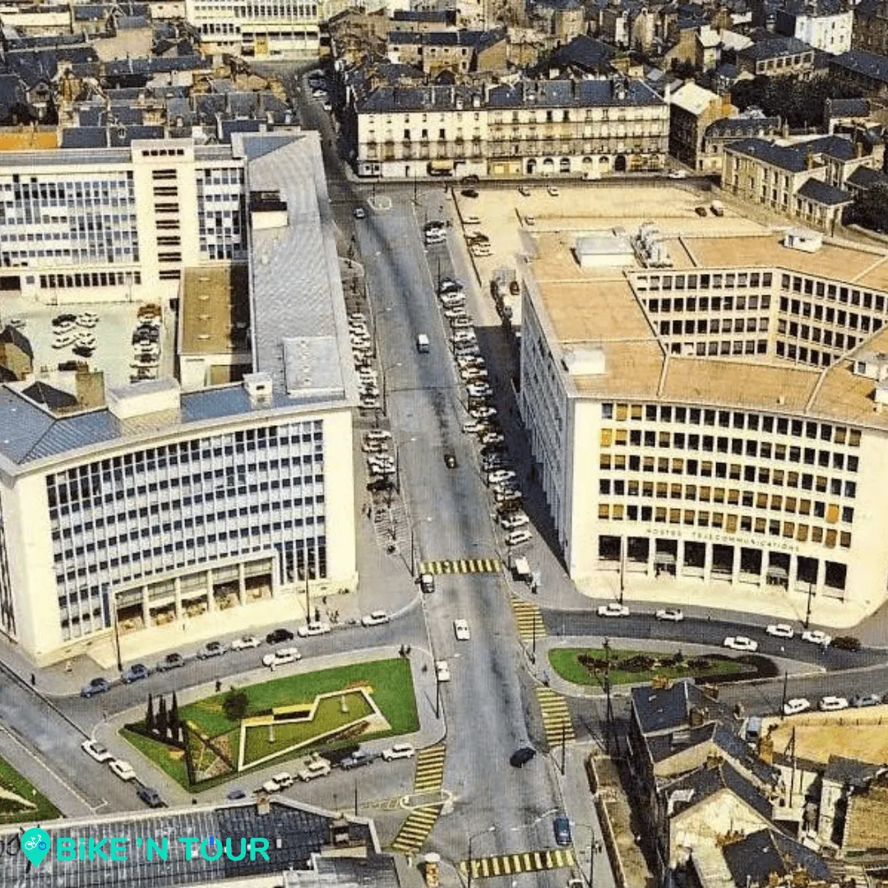

La place de Bretagne est une grande place du centre de Nantes, au pied de la Tour Bretagne. Ancien champ de foire, puis quartier populaire, elle a été entièrement redessinée après la Seconde Guerre mondiale. Depuis notre boutique du quai de Versailles, vous y êtes en une dizaine de minutes à vélo.

- **Distance :** environ 1 km depuis la boutique
- **Durée :** une dizaine de minutes à vélo, une courte halte sur place
- **Niveau :** facile
- **Accès :** tram ligne 3, arrêt Bretagne, ou à vélo depuis notre boutique, 27 quai de Versailles (tram ligne 2, arrêt Saint-Mihiel)

## Un peu d'histoire

### De la motte Saint-Nicolas au champ de foire

La place occupe l'emplacement de l'ancienne motte Saint-Nicolas. Elle borde le Marchix, un vieux quartier de la paroisse Saint-Similien, qui tenait un marché dès le XVe siècle et lui doit sans doute son nom. Vers 1752, la Ville y transfère une partie des foires aux bestiaux. La place est alors peu bâtie. En devenant plus urbaine, elle accueille jongleurs, bateleurs et forains.

### Un quartier pauvre, puis bombardé

Au XIXe siècle, le Marchix abrite une population très pauvre, dans des logements exigus. Pour aérer le centre, de nouvelles rues sont percées entre 1830 et 1850, dont la rue des Arts, l'actuelle rue Jean-Jaurès. En 1935, une enquête du bureau municipal d'hygiène estime qu'environ un tiers des immeubles du quartier devrait disparaître.

La Seconde Guerre mondiale accélère tout. Les bombardements alliés, notamment ceux de septembre 1943, endommagent fortement le quartier de la place de Bretagne.

### La place de la reconstruction

Après la guerre, la place est repensée par l'architecte Michel Roux-Spitz et agrandie. Elle accueille l'hôtel des Postes, la Trésorerie générale et la Caisse primaire d'assurance maladie. L'immeuble de la Poste, achevé en 1963, a été construit en même temps que son voisin, ce qui donne à la place ses deux grands immeubles qui se répondent.

Au sud, il restait une parcelle étroite de 1 800 m². C'est là qu'est née l'idée d'une tour. Le chantier de la Tour Bretagne commence en septembre 1971 et la tour est inaugurée le 18 novembre 1976.

## Ce qu'il faut regarder

- **La Tour Bretagne :** 144 mètres antenne comprise, le grand repère de la place. Fermée depuis 2020, elle est en travaux de transformation. Nous lui consacrons un article : [la Tour Bretagne](/post/la-tour-bretagne-plus-grande-tour-de-louest).
- **Les immeubles de la reconstruction :** l'architecture de l'après-guerre, sobre et monumentale, encadre la place.
- **La rue Cassegrain :** cette voie, ouverte en 1960, relie la place de Bretagne à la place Saint-Similien, à travers l'ancien Marchix.

## Nos visites guidées

Nos trois visites guidées à vélo électrique donnent rendez-vous à notre boutique, 27 quai de Versailles, au bord de l'Erdre. Le [tour du panorama nantais](/fr/tour/tour-du-panorama-nantais) y commence par le réglage des vélos, puis file le long de l'Erdre vers le quartier médiéval, le château des ducs, l'île de Nantes et le quartier Graslin, avant de revenir à la boutique. Le [Wine & Bike Tour](/fr/tour/tour-surprenantes) et le tour [Culture urbaine](/fr/tour/tour-a-velo-electrique-culture-urbaine-a-nantes) partent du même endroit. Toutes nos visites sont sur la page [visites guidées de Nantes](/fr/visites-guidees-nantes).

## Infos pratiques

- **Travaux :** le chantier de transformation de la Tour Bretagne a commencé en 2025. Attendez-vous à des aménagements de chantier au pied de la tour.
- **Transports :** tram ligne 3, arrêt Bretagne. Notre boutique est desservie par le tram ligne 2, arrêt Saint-Mihiel.
- **Saison :** notre boutique est ouverte d'avril à octobre.

[Voir le parcours sur Google Maps](https://www.google.fr:443/maps/place/Pl.+de+Bretagne,+44036+Nantes/@47.2177723,-1.5614748,17z/data=!3m1!4b1!4m5!3m4!1s0x4805eea747dbccd3:0x4ab8d07600d61f1a!8m2!3d47.2177687!4d-1.5592861)

## Quel vélo choisir ?

La place se rejoint facilement depuis la boutique. En ville, le [vélo de voyage](/fr/location-velo-de-voyage) suffit. Pour les côtes de la butte Sainte-Anne ou une longue journée, prenez un [vélo électrique](/fr/location-velo-electrique-voyage). En famille, pensez au [vélo cargo](/fr/location-velo-cargo). Les prix sont sur notre page [tarifs et réservation](/fr/nos-tarifs-reservation).

## Questions fréquentes

### Pourquoi la place de Bretagne a-t-elle été reconstruite ?

Le quartier, jugé insalubre avant-guerre, a été fortement endommagé par les bombardements de septembre 1943. La place a ensuite été repensée et agrandie par l'architecte Michel Roux-Spitz.

### Où se retrouve-t-on pour les visites guidées Bike'N Tour ?

À notre boutique, 27 quai de Versailles, au bord de l'Erdre, face à l'île de Versailles (tram ligne 2, arrêt Saint-Mihiel).

### Quel tram dessert la place de Bretagne ?

La ligne 3 du tram, arrêt Bretagne.

[À lire aussi : Suivre la ligne verte du Voyage à Nantes à vélo](/post/le-voyage-a-nantes-2021-a-deja-commence) et [le monument aux 50 Otages](/post/monument-aux-50-otages).
