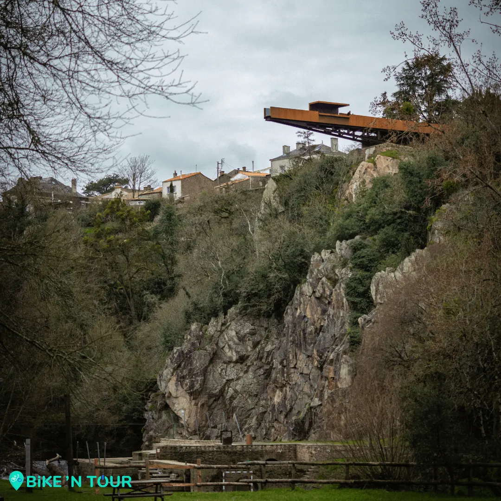

Situé derrière la mairie de Château-Thébaud, ce belvédère en acier surplombe la Maine à 40 mètres d’altitude. Plus long de 20 mètres que l’ancien belvédère, le porte-vue offre aux visiteurs une vue incroyable sur la vallée.

Conçu par l’architecte savoyard Emmanuel Ritz, le porte-vue a été inauguré en octobre 2020 soit six ans après que le maire Jean-Paul Loyer a convaincu les responsables du Voyage à Nantes de mettre en valeur le panorama.

Le porte-vue est aujourd’hui une des onze étapes du voyage dans le vignoble, aux côtés de la chaussée des moines et de la garenne Lemot par exemple. Ce belvédère impressionnant a permis et permettra encore de faire découvrir aux visiteurs la petite ville de Château-Thébaud et ces paysages impressionnants.

Une balade vélo, c’est le moyen idéal pour parcourir le vignoble. Alors si vous aussi vous souhaitez découvrir le porte-vue et les autres étapes du vignoble, réserver votre vélo sur [bikentour.com](/).

[Voir ici toutes nos balades à vélo et articles de blog](/fr/blog)

[Voir le parcours sur Google Maps](https://www.google.fr/maps/place/Le+porte-vue/@47.1241196,-1.4204151,16.79z/data=!4m5!3m4!1s0x4805dd6d50183c1b:0x5771b734c17c8c3e!8m2!3d47.1240734!4d-1.4179364)
