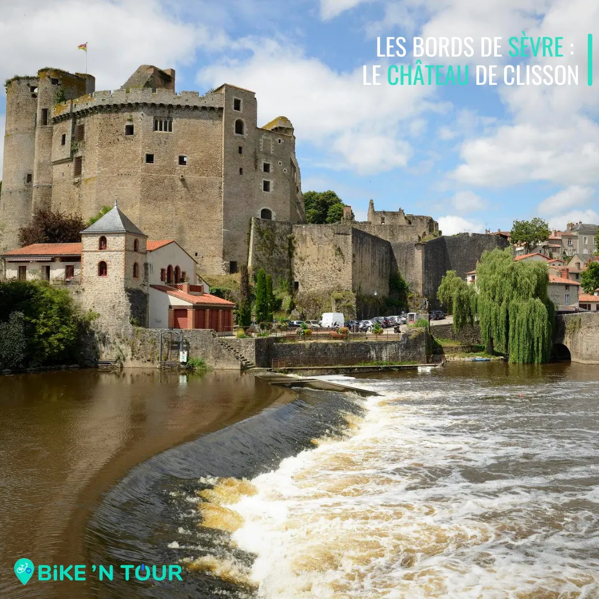
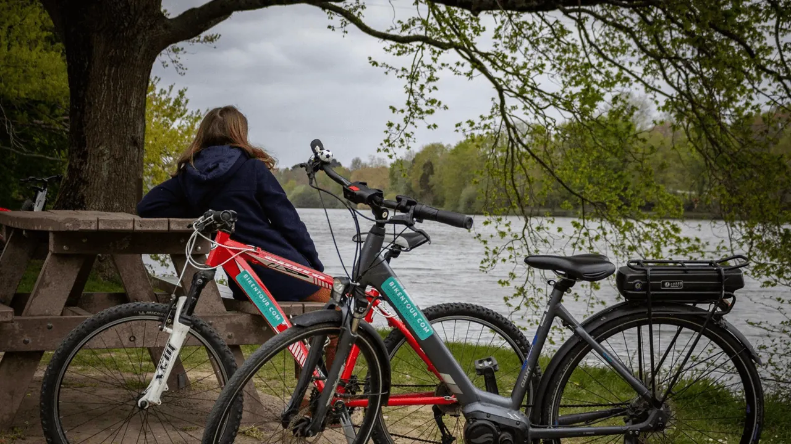
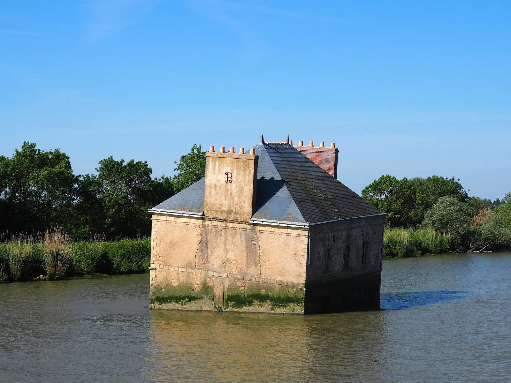
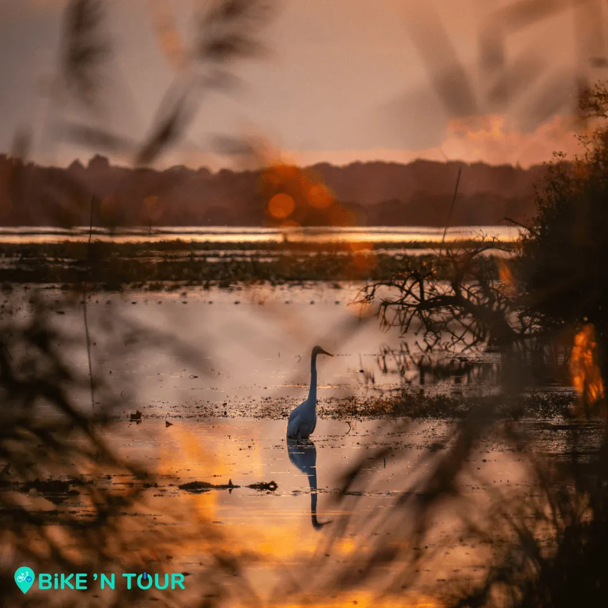

Voici nos cinq balades à vélo préférées au départ de notre boutique, au centre de Nantes, de la courte boucle en ville à la grande journée vers l'estuaire. Elles font de 10 à 46 km, sont toutes très peu vallonnées, et la plupart permettent de rentrer en train. Pour chacune, nous vous donnons la distance, le niveau et la meilleure façon de revenir.

- **Distance :** de 10 à 46 km selon la balade
- **Durée :** d'une heure à une journée
- **Niveau :** facile à modéré
- **Départ :** boutique Bike'N Tour, 27 quai de Versailles, Nantes (tram ligne 2, arrêt Saint-Mihiel)
- **Retour :** à vélo ou en TER selon la balade

## 1. La Sèvre nantaise jusqu'à Clisson

Cette balade quitte Nantes vers le sud-est en suivant les bords de la Sèvre nantaise. Vous passez par la Chaussée des Moines à Vertou, un lieu de pause apprécié au bord de l'eau, puis vous entrez dans le vignoble du Muscadet par de petites routes. L'arrivée à Clisson est le grand moment : le château médiéval domine la Sèvre, et la Garenne Lemot donne à la ville ses airs d'Italie.

Le retour en TER depuis Clisson permet de profiter de la ville sans regarder la montre. Le détail du parcours est dans notre article [la Sèvre nantaise à vélo](/post/balade-incontournable-la-sevre-nantaise), et les bords de rivière dans [la Sèvre à vélo](/post/la-sevre-a-velo).

- **Distance :** 37 km aller
- **Durée :** une journée
- **Niveau :** modéré
- **Retour :** en TER depuis Clisson (environ 20 minutes jusqu'à Nantes)

## 2. L'Erdre jusqu'à Sucé-sur-Erdre

L'Erdre, que l'on surnomme « la plus belle rivière de France » d'après une formule attribuée à François Ier, se découvre de deux façons. Dans Nantes, une boucle courte longe les deux rives et traverse au pont de la Jonelière : idéal pour une heure ou deux. Pour sortir de la ville, remontez la rivière jusqu'à Sucé-sur-Erdre : châteaux, belles demeures et guinguettes au bord de l'eau.

À Sucé-sur-Erdre, la gare est desservie par le tram-train vers Nantes, pratique pour ne faire que l'aller à vélo. Tous nos conseils sont dans l'article [l'Erdre à vélo](/post/balade-incontournable-lerdre-a-velo).

- **Distance :** 18 km aller jusqu'à Sucé-sur-Erdre
- **Durée :** une demi-journée
- **Niveau :** facile
- **Retour :** à vélo ou en tram-train depuis Sucé-sur-Erdre

## 3. La Loire à Vélo jusqu'à Cordemais

Vers l'ouest, cette balade suit la Loire jusqu'à l'estuaire. À Couëron, la Maison dans la Loire de Jean-Luc Courcoult semble enlisée dans le fleuve. Vous traversez ensuite les marais par de petites routes très calmes, au milieu des roseaux et des oiseaux, jusqu'à la Villa Cheminée de Tatzu Nishi à Cordemais, une maison perchée sur une tour de 15 mètres.

Le parcours est plat, mais 46 km demandent une vraie journée. En hiver, les routes des marais peuvent être inondées. Tous les détails sont dans notre article [Nantes – Cordemais à vélo](/post/balade-incontournable-la-loire-a-velo-de-nantes-a-cordemais).

- **Distance :** 46 km aller
- **Durée :** une journée
- **Niveau :** modéré
- **Retour :** en TER depuis Cordemais (gare à environ 2,5 km du bourg)

## 4. Le tour de l'île de Nantes

La plus courte de la sélection, à faire en famille ou en fin de journée. Partez des Machines de l'île, installées dans les anciennes Nefs des chantiers navals, et longez d'abord le bras de la Madeleine, au nord. À la pointe est de l'île, au parc de Beaulieu, revenez vers l'ouest le long du bras de Pirmil.

Au bout du quai Président-Wilson, à la pointe sud-ouest, vous passez au pied de la grue grise, l'une des deux grues Titan classées qui rappellent le passé portuaire de l'île. Remontez enfin le quai des Antilles et ses Anneaux de Daniel Buren avant de revenir au point de départ. Retrouvez le circuit détaillé dans [le tour de l'île de Nantes à vélo](/post/balade-incontournable-lile-de-nantes).

- **Distance :** une dizaine de kilomètres en boucle
- **Durée :** une heure à une heure et demie
- **Niveau :** facile
- **Retour :** boucle au départ du centre de Nantes

## 5. Le lac de Grand-Lieu

Cette balade part du Mémorial de l'abolition de l'esclavage, quai de la Fosse, puis traverse l'ouest de l'île de Nantes et ses Anneaux. Vous passez ensuite par les ruelles colorées de [Trentemoult](/post/trentemoult-un-village-pittoresque) et devant le Pendule de Roman Signer, avant de rejoindre la Maison du lac de Grand-Lieu à Bouaye.

Le lac lui-même est difficile d'accès : il n'est visible qu'en quelques points. Les plus motivés poursuivront jusqu'à Pierre-Aigüe, à Saint-Aignan-Grandlieu, l'un des rares endroits d'où l'on approche le lac. Retour possible en TER depuis Bouaye. Plus de détails dans [Nantes – lac de Grand-Lieu à vélo](/post/balade-incontournable-de-nantes-au-lac-de-grand-lieu).

- **Distance :** 18 km aller jusqu'à Bouaye
- **Durée :** une journée
- **Niveau :** facile
- **Retour :** en TER depuis Bouaye

## Infos pratiques

**Rentrer en train.** Clisson, Cordemais et Bouaye sont desservies par le TER Aléop, Sucé-sur-Erdre par le tram-train. Les vélos sont acceptés à bord selon les places disponibles : en été et le week-end, évitez les heures de pointe.

**Faire une pause.** Chaque balade passe par des bourgs avec commerces. Sur l'Erdre et la Loire, des guinguettes ouvrent à la belle saison. Dans les marais de l'estuaire, en revanche, il n'y a rien : partez avec de l'eau.

**Quand partir ?** D'avril à octobre, pendant notre saison d'ouverture. Le printemps est idéal pour les oiseaux du lac de Grand-Lieu et de l'estuaire, l'été pour les guinguettes, et septembre pour le vignoble au moment des vendanges.

## Quel vélo choisir ?

Pour l'île de Nantes, l'Erdre et le lac de Grand-Lieu, un [vélo de voyage](/fr/location-velo-de-voyage) suffit, avec des [vélos enfant](/fr/location-velo-enfant) si vous partez en famille. Pour Clisson et Cordemais, le [vélo électrique](/fr/location-velo-electrique-voyage) rend la journée plus légère, et le [gravel](/fr/location-gravel-nantes) se plaît sur les petites routes du [Vignoble nantais](/fr/itineraires-velo-depart-nantes/vignoble-nantais). D'autres idées vous attendent sur notre page [idées de balades](/fr/idees-de-balades).

## Questions fréquentes

### Quelle est la balade la plus facile au départ de Nantes ?

Le tour de l'île de Nantes, une dizaine de kilomètres en boucle, sans relief. Pour sortir de la ville, l'Erdre jusqu'à Sucé-sur-Erdre est aussi très accessible.

### Peut-on rentrer en train avec un vélo de location ?

Oui. Depuis Clisson, Cordemais et Bouaye en TER, et depuis Sucé-sur-Erdre en tram-train, dans la limite des places vélo disponibles.

### Quelle balade choisir avec des enfants ?

L'île de Nantes et l'Erdre sont les plus adaptées. Avec des enfants, comptez 20 à 30 km par jour au maximum, et pensez au siège bébé ou à la remorque pour les plus petits.

Envie d'une autre sortie au fil de l'eau ? Essayez [Nantes – Mauves-sur-Loire par la Loire à Vélo](/post/balade-incontournable-la-loire-a-velo-de-nantes-a-mauves-sur-loire) ou le grand parcours [de Nantes à Saint-Brevin par l'estuaire](/post/balade-incontournable-le-parcours-de-lestuaire-de-nantes-a-saint-brevin-les-pins).
