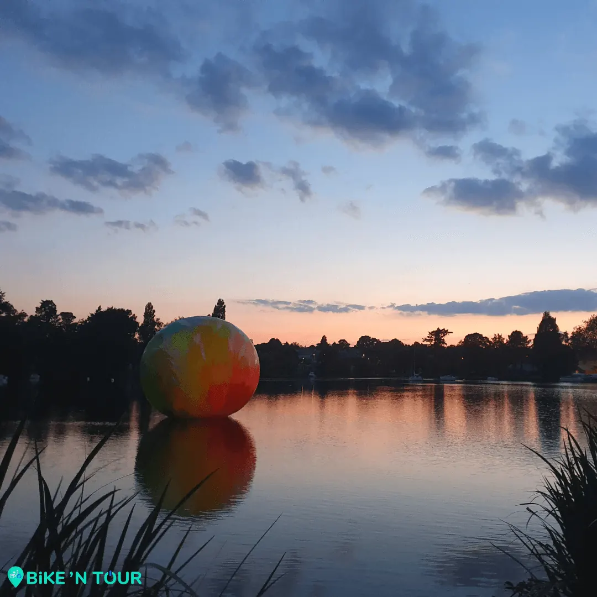

À une semaine du début officiel de la 10ème édition du voyage à Nantes, plusieurs œuvres du parcours estival sont déjà visibles.

C’est le cas de cette œuvre hors du commun, “Otto II”. Inaugurée le 9 juin à Sucé-sur-Erdre. Cet OFNI paré de couleurs vibrantes est la création de l’artiste @elsatomkowiak. Proposée par la @villedesucesurerdre cette œuvre fait partie du parcours 2021 mis en place par @levoyageanantes, « Les RDV Art de la Métropole ». Cette œuvre est visible depuis le port, la plage Marguerite ou même du pont de Sucé-sur-Erdre, jusqu’au 15 septembre.

Alors si vous souhaitez découvrir cette œuvre, n'hésitez pas à nous réserver un vélo sur [bikentour.com](/) pour réaliser l’itinéraire Nantes - Sucé-sur-Erdre. Vous pourrez ainsi profiter d’une balade agréable le long de [l’Erdre](/post/balade-incontournable-lerdre-a-velo) qui se terminera par la découverte de cette œuvre colorée.

[Découvrez la balade à vélo sur les bords de l'Erdre](/post/balade-incontournable-lerdre-a-velo)

[Voir ici toutes nos balades à vélo et articles de blog](/fr/blog)

