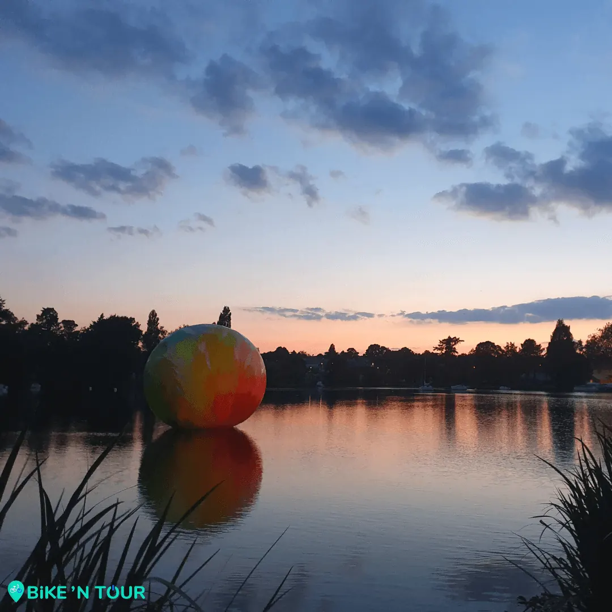

Oui, on peut suivre la ligne verte du Voyage à Nantes à vélo, toute l'année. Tracée au sol sur une vingtaine de kilomètres, elle relie les monuments, les jardins et les œuvres d'art de la ville. À vélo, une boucle adaptée d'environ 18 km permet de la suivre en une demi-journée, avec quelques passages à faire à pied.

- **Distance :** environ 18 km en boucle (tracé adapté au vélo)
- **Durée :** environ 1 h de roulage, une demi-journée avec les arrêts
- **Niveau :** débutant, en famille
- **Départ :** office de tourisme, face au château des ducs de Bretagne
- **Arrivée :** retour au château
- **Accès :** à quelques minutes à vélo de notre boutique, 27 quai de Versailles (tram ligne 2, arrêt Saint-Mihiel)

## Le Voyage à Nantes, c'est quoi ?

Le Voyage à Nantes désigne à la fois l'agence touristique de la ville et le grand parcours artistique qu'elle anime. Depuis 2012, chaque été, une nouvelle édition installe pendant environ deux mois des œuvres éphémères dans l'espace public. Une partie de ces œuvres reste ensuite en place : elles forment le parcours permanent, visible toute l'année.

La ligne verte, peinte au sol, guide les promeneurs d'une étape à l'autre. Elle a été pensée pour les piétons. À vélo, il faut donc parfois s'en écarter, pour éviter un escalier ou une rue à sens unique.

## Le parcours

France Vélo Tourisme propose un tracé « Le Voyage à Nantes à vélo » d'un peu plus de 18 km. Il part de l'office de tourisme, face au château, et se parcourt dans le sens inverse des aiguilles d'une montre. Il emprunte des pistes cyclables, des liaisons et des rues partagées.

### Du château au jardin des Plantes

Départ au pied du château des ducs de Bretagne et de son miroir d'eau. Le parcours rejoint le Lieu Unique, l'ancienne biscuiterie LU devenue scène culturelle, puis le jardin des Plantes, face à la gare. Dans le jardin, descendez de vélo : on le traverse à pied.

### Du centre historique aux quais

La ligne passe ensuite par la cathédrale, la chapelle de l'Oratoire, le passage Pommeraye, la brasserie La Cigale et le théâtre Graslin. Après le cours Cambronne, elle rejoint la Loire et le Mémorial de l'abolition de l'esclavage, sur le quai de la Fosse.

### L'île de Nantes

Le tracé traverse enfin la Loire vers l'île de Nantes : le Carrousel des Mondes Marins, les Anneaux sur le quai des Antilles, la Station Prouvé et les Machines de l'île. Le retour vers le château se fait par les ponts. Pour explorer l'île plus en détail, suivez notre [balade de l'île de Nantes à vélo](/post/balade-incontournable-lile-de-nantes).

## Les œuvres pérennes à ne pas manquer

Voici quelques œuvres du parcours permanent, visibles toute l'année depuis la ligne verte ou à proximité :

- **Les Anneaux**, de Daniel Buren et Patrick Bouchain : dix-huit anneaux face à la Loire, quai des Antilles, illuminés à la nuit tombée.
- **Les Machines de l'île**, de Pierre Orefice et François Delarozière : le Grand Éléphant et le Carrousel des Mondes Marins, sous les Nefs des anciens chantiers navals.
- **Le Belvédère de l'Hermitage**, de Tadashi Kawamata : une passerelle en bois de 36 mètres sur la butte Sainte-Anne, avec une vue large sur la Loire. Notre article sur [la butte Sainte-Anne](/post/la-butte-saint-anne) vous en dit plus sur le quartier.
- **Éloge du pas de côté**, de Philippe Ramette : une statue étonnante place du Bouffay. Une seconde allégorie du même artiste se trouve cours Cambronne.
- **De l'art des enseignes** : dans le centre-ville, des enseignes de commerces réinventées par des artistes.

Le parcours permanent compte une cinquantaine d'œuvres et s'enrichit au fil des éditions. Le plan à jour est disponible à l'office de tourisme.

## Infos pratiques

- **Passages à pied :** prévoyez de marcher à côté du vélo dans le jardin des Plantes, cours Cambronne, sur le quai des Antilles, la passerelle Schœlcher, dans le souterrain de la gare et l'escalier du canal Saint-Félix.
- **Pavés et zones piétonnes :** roulez au pas, les piétons sont prioritaires.
- **La ligne au sol :** elle est parfois effacée ou peinte sur des garde-corps. Gardez un œil sur le plan.
- **En été :** l'édition estivale ajoute des œuvres éphémères et attire du monde. Partez tôt le matin pour rouler plus tranquillement.

## Quel vélo choisir ?

Le parcours est plat, avec beaucoup d'arrêts. Un vélo maniable et confortable suffit.

- **Le [vélo de voyage](/fr/location-velo-de-voyage)** : position droite et porte-bagages, parfait pour une demi-journée en ville.
- **Le [vélo électrique](/fr/location-velo-electrique-voyage)** : pour enchaîner le parcours avec une sortie vers l'Erdre ou les bords de Loire sans vous fatiguer.

Consultez nos [tarifs et réservation](/fr/nos-tarifs-reservation). Vous préférez qu'on vous raconte la ville ? Notre [tour du panorama nantais](/fr/tour/tour-du-panorama-nantais) suit les grandes étapes du Voyage à Nantes, à vélo électrique, avec un guide. Découvrez aussi toutes nos [visites guidées](/fr/visites-guidees-nantes) et nos [idées de balades](/fr/idees-de-balades).

## Questions fréquentes

### Peut-on suivre la ligne verte du Voyage à Nantes à vélo ?

Oui, toute l'année. La ligne est pensée pour les piétons : à vélo, suivez un tracé adapté d'environ 18 km et faites quelques passages à pied.

### Les œuvres du Voyage à Nantes sont-elles visibles en dehors de l'été ?

Oui pour les œuvres pérennes, comme les Anneaux ou le Belvédère de l'Hermitage. Les œuvres éphémères ne sont présentes que pendant l'édition estivale.

### Combien de temps faut-il pour faire le Voyage à Nantes à vélo ?

Comptez environ une heure de roulage. Avec les visites et les pauses, prévoyez une demi-journée.
