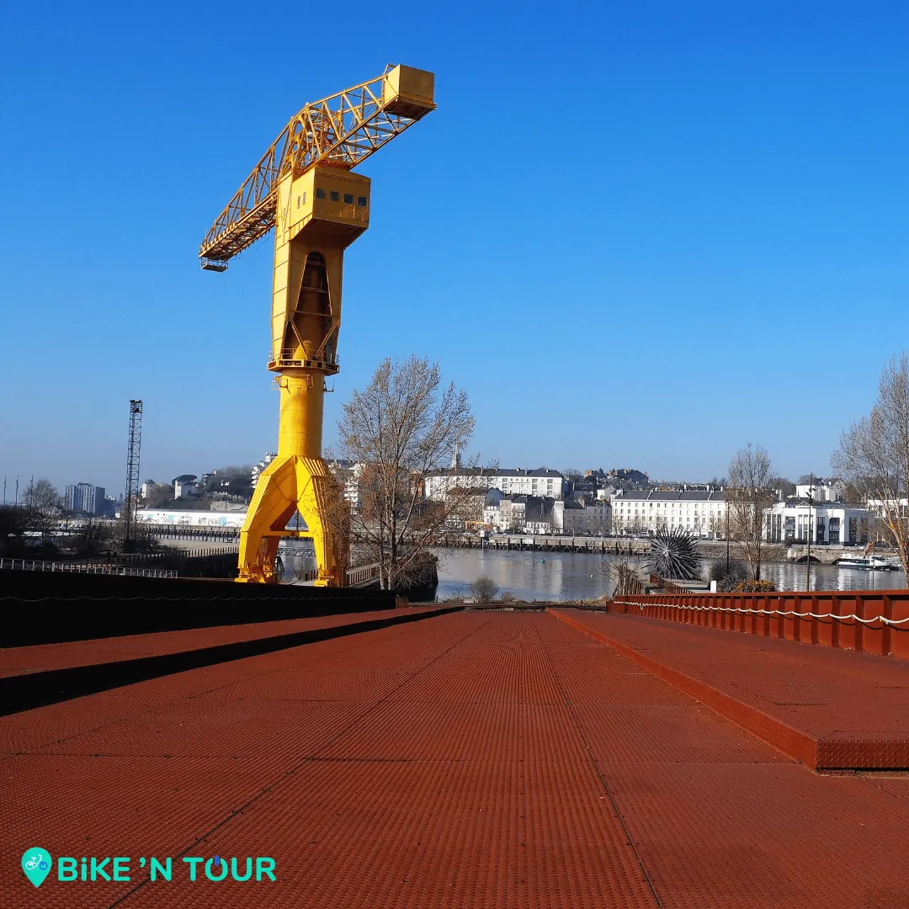

Les grues Titan sont deux grues géantes, l'une jaune, l'autre grise, dressées à l'ouest de l'île de Nantes. Elles sont les derniers témoins visibles du port et des chantiers navals qui ont fait vivre l'île pendant plus d'un siècle. Depuis notre boutique, elles sont à un quart d'heure environ à vélo, sur la boucle de l'île de Nantes.

- **Distance :** environ 3 km depuis la boutique
- **Durée :** un quart d'heure environ à vélo, une demi-heure sur place
- **Niveau :** facile, terrain plat
- **Accès :** parc des Chantiers et quai Wilson, ouest de l'île de Nantes ; tram ligne 1, arrêt Chantiers navals

## Deux grues, deux histoires

### La grue jaune, mémoire des chantiers navals

La grue jaune se dresse dans le parc des Chantiers, au bord du bras de la Madeleine. Installée au milieu des années 1950 sur le site des chantiers navals, elle servait à soulever des éléments de navires préfabriqués, assemblés ensuite sur la cale. Haute de 43 mètres, elle n'est jaune que depuis la fin des années 1970.

Les chantiers navals de l'île ferment en 1987. Le dernier jour des chantiers Dubigeon, le 3 juillet 1987, reste un moment fort de la mémoire ouvrière nantaise. La grue, elle, est restée. Elle est devenue le symbole de la construction navale à Nantes et elle est protégée au titre des monuments historiques depuis 2018.

En octobre 2023, un morceau de métal et de peinture s'est détaché de la grue et a légèrement blessé un passant. La Ville a alors installé un périmètre de sécurité et lancé un diagnostic complet de la structure.

### La grue grise, figure de proue de l'île

La grue grise se trouve au bout du quai Wilson, à la pointe ouest de l'île, face à la Loire. Construite en 1966, c'est une grue portuaire, utilisée pour décharger les navires. Elle mesure 47 mètres et pouvait soulever 60 tonnes. Menacée de démolition, elle a été rachetée par la ville pour un euro symbolique en 2005, l'année même de son classement au titre des monuments historiques.

### Et la grue noire ?

Sur l'autre rive, dans le Bas-Chantenay, une troisième grue rappelle le même passé : la grue noire des anciens chantiers Dubigeon, où fut construit le Belem. Démontée, restaurée puis remontée, elle a été inaugurée de nouveau en septembre 2023.

## Ce qu'il faut voir autour

Les grues ne se visitent pas, mais tout le quartier raconte leur histoire.

- **Le parc des Chantiers :** les anciennes cales de lancement ont été conservées. On y marche, on y pique-nique, on y regarde la Loire.
- **Les Machines de l'île :** installées dans les Nefs, les anciennes halles des chantiers, elles abritent le Grand Éléphant, haut de 12 mètres.
- **La Maison des hommes et des techniques :** dans l'ancien bâtiment des Ateliers et Chantiers de Nantes, une exposition permanente retrace l'histoire de la construction navale nantaise.
- **Le Hangar à Bananes et les Anneaux de Buren :** sur le quai des Antilles, entre les deux grues.

Pour l'histoire complète de l'île, des prairies aux chantiers, lisez notre article [une île remplie d'histoire](/post/une-ile-remplie-dhistoire-ile-de-nantes).

## Y aller à vélo depuis la boutique

Depuis notre boutique du quai de Versailles, descendez vers la Loire par le cours des 50-Otages et franchissez le bras de la Madeleine pour rejoindre l'île de Nantes. La grue jaune est à deux pas des Machines. Longez ensuite le quai des Antilles jusqu'à la grue grise, au bout du quai Wilson. Les deux grues sont sur notre boucle de [l'île de Nantes à vélo](/post/balade-incontournable-lile-de-nantes), 10,5 km à plat.

## Infos pratiques

- **Quand y aller :** en fin de journée, la lumière sur la Loire et les grues est superbe. Le matin, les quais sont plus calmes.
- **Où se garer :** une station de vélos en libre-service, baptisée « Grue jaune », se trouve mail des Chantiers. Attachez le cadre de votre vélo à un point fixe.
- **Pause :** pique-nique sur les cales du parc des Chantiers, ou café sur le quai des Antilles.
- **Prudence :** sur les quais, partagez l'espace avec les piétons et roulez au pas aux heures d'affluence.

[Voir le parcours sur Google Maps](https://www.google.fr/maps/place/Grue+Titan+Jaune,+44200+Nantes/@47.2050972,-1.5719289,17z/data=!3m1!4b1!4m5!3m4!1s0x4805ec07d94311c9:0xef1142ac55244a47!8m2!3d47.2050936!4d-1.5697402)

## Quel vélo choisir ?

L'île est plate : notre [vélo de voyage](/fr/location-velo-de-voyage) suffit largement. En famille, le [siège bébé ou la remorque enfant](/fr/location-accessoires-velo) permettent d'embarquer les plus petits et le pique-nique. Les prix sont sur notre page [tarifs et réservation](/fr/nos-tarifs-reservation).

Vous voulez qu'on vous raconte l'histoire sur place ? Notre [tour du panorama nantais](/fr/tour/tour-du-panorama-nantais) passe par l'île de Nantes et ses anciens chantiers navals, à vélo électrique et avec un guide local. Notre [tour « Culture urbaine »](/fr/tour/tour-a-velo-electrique-culture-urbaine-a-nantes) passe par Chantenay et par l'île de Nantes.

## Questions fréquentes

### Quelle est la différence entre la grue jaune et la grue grise ?

La jaune, installée dans les années 1950, servait aux chantiers navals. La grise, construite en 1966, déchargeait les navires du port. Quelques centaines de mètres les séparent, le long du quai.

### Peut-on monter dans les grues Titan ?

Non, les grues ne se visitent pas. On les admire depuis le parc des Chantiers et le quai Wilson.

### Les grues Titan sont-elles classées monuments historiques ?

Oui. La grise est classée depuis 2005, et la jaune est protégée au titre des monuments historiques depuis 2018.

[À lire aussi : La balade à vélo sur l'île de Nantes](/post/balade-incontournable-lile-de-nantes)
