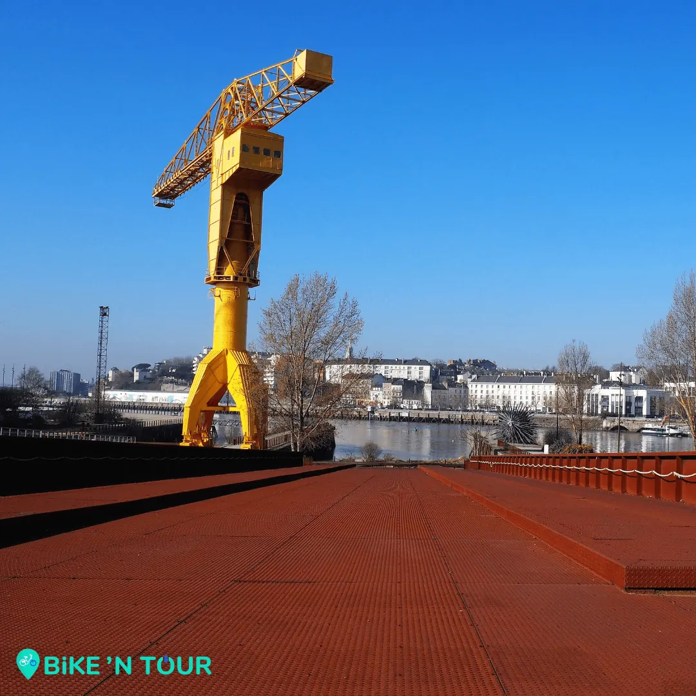

Présentes sur l'[Île de Nantes](/post/balade-incontournable-lile-de-nantes) ses deux grues témoignent du passé industriel du lieu et sont aujourd’hui un symbole de l’île et de la ville. Les grues portent le nom “Titan” car c’est le nom du modèle choisi par la société nantaise Joseph Paris qui a construit ses mastodontes d'acier lourd de plus de 400 tonnes.

La plus récente des 2 grues, la grise présente au bout du quai Wilson fait office de figure de proue pour l’île de Nantes. Elle a été achetée à l’origine par le port autonome de Nantes Saint Nazaire en 1966 pour débarquer les marchandises destinées à la société Pum Chaillous. Désaffectée en 2003 et destinée à la ferraille, elle fut finalement rachetée par la ville pour l’euro symbolique.

La grue Jaune quant à elle a été achetée en 1954 par les anciens chantiers navals Dubigeon. Haute de 43 m et avec une puissance de levage de 80 tonnes ce titan a été utilisé pour porter des éléments préfabriqués pour la construction de bateau. Elle cesse son activité en 1987 lors de la fermeture des chantiers puis est rachetée deux ans plus tard par la ville. Rénové à 2 reprises, c’est en 2006 que plus d’une tonne de peinture jaune sera appliqué sur la grue. Elle est classée monument historique en 2018.

En 2013 la grue fut la scène d’une manifestation pas comme les autres quand le 15 février Serge Charnay, un père de famille privé de tous droits envers son fils, décide de l'escalader. Il y tient un siège pendant 3 jours pour faire entendre ses revendications, il souhaite que les droits des enfants à voir leurs deux parents soient mieux pris en compte lors des séparations. Son action deviendra vite un symbole pour cette cause et d’autres manifestations du même type ont suivi dans d’autres grandes villes de France.

Pour découvrir les titans et en apprendre plus sur la ville de Nantes et son d’histoire d’une manière unique, inscrivez-vous à une de nos visites guidées sur bikentour.com.

[Découvrez la balade à vélo sur l'île de Nantes](/post/balade-incontournable-lile-de-nantes)

[Voir ici toutes nos balades à vélo et articles de blog](/fr/blog)

[Voir le parcours sur Google Maps](https://www.google.fr/maps/place/Grue+Titan+Jaune,+44200+Nantes/@47.2050972,-1.5719289,17z/data=!3m1!4b1!4m5!3m4!1s0x4805ec07d94311c9:0xef1142ac55244a47!8m2!3d47.2050936!4d-1.5697402)
