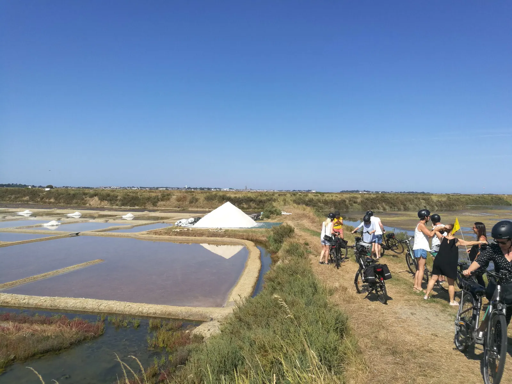

Cet itinéraire unique vous permettra de parcourir une partie des 3 plus grandes voies cyclables des Pays de la Loire.  
  
Au départ de Nantes vous pouvez commencer votre périple en suivant le tracé de la [Loire à vélo](/post/balade-incontournable-la-loire-a-velo-de-nantes-a-cordemais), qui est ici commune avec le tracé de la Vélodyssé. Cette première étape de 63 km vous permettra de rejoindre l’océan Atlantique en longeant la Loire. Pendant cette première étape vous pourrez découvrir de nombreuses œuvres de l’estuaire telles que Misconceivable, le Jardin étoilé ou encore [le serpent de l’océan](/post/une-creature-mythique-aux-portes-de-lestuaire). Cette étape vous marquera par ses paysages et les découvertes que vous y ferez au fil de la Loire et du canal de la Basse Loire.  
  
Une fois arrivé à [Saint-Brévin-les-Pins](/post/balade-incontournable-le-parcours-de-lestuaire-de-nantes-a-saint-brevin-les-pins) vous devrez quitter le parcours de la Vélodyssé pour traverser le pont de Saint-Nazaire ou vous entamerez alors une nouvelle étape. Pour rejoindre la Baule vous suivrez l’itinéraire de la Vélocéan sur une trentaine de km. Cette dernière étape commencera avec les paysages urbains de Saint-Nazaire mais après être passé à côté de l’étang du bois Jolland le parcours passera par la campagne et les bois où vous pourrez découvrir le tumulus de Dissignac.  
  
Votre périple prendra fin dans la ville côtière de La Baule-Escoublac ou vous aurez encore beaucoup de choses à découvrir. Une fois à La Baule, vous pourrez apprécier la presqu'île de Guérande et ses marais salants (voir une photo ci-dessous).

‍  
Alors si vous souhaitez parcourir cet itinéraire au départ de Nantes, réserver directement votre vélo sur bikentour.com et pour en apprendre plus sur La Baule et ses environs ainsi que sur la région, abonnez-vous à nos réseaux.

[Découvrez la balade à vélo jusqu'à Cordemais](/post/balade-incontournable-la-loire-a-velo-de-nantes-a-cordemais) et [Découvrez la balade à vélo jusqu'à Indre](/post/balade-incontournable-la-loire-a-velo-de-nantes-a-indre)

[En savoir plus sur le serpent de l'océan](/post/une-creature-mythique-aux-portes-de-lestuaire)

[Découvrez la balade à vélo jusqu'à Saint-Brevin-les-Pins](/post/balade-incontournable-le-parcours-de-lestuaire-de-nantes-a-saint-brevin-les-pins)

[Voir ici toutes nos balades à vélo et articles de blog](/fr/blog)

[Voir le parcours sur Google Maps](https://www.google.fr/maps/dir/Nantes/La+Baule/@47.2684252,-2.2523241,10z/data=!3m2!4b1!5s0x4805eb8f72f54e5f:0xef8b1514202f0e7b!4m14!4m13!1m5!1m1!1s0x4805ee81f0a8aead:0x40d37521e0ded30!2m2!1d-1.553621!2d47.218371!1m5!1m1!1s0x48055d195853e105:0x40d37521e0df090!2m2!1d-2.3913777!2d47.2869183!3e1)
