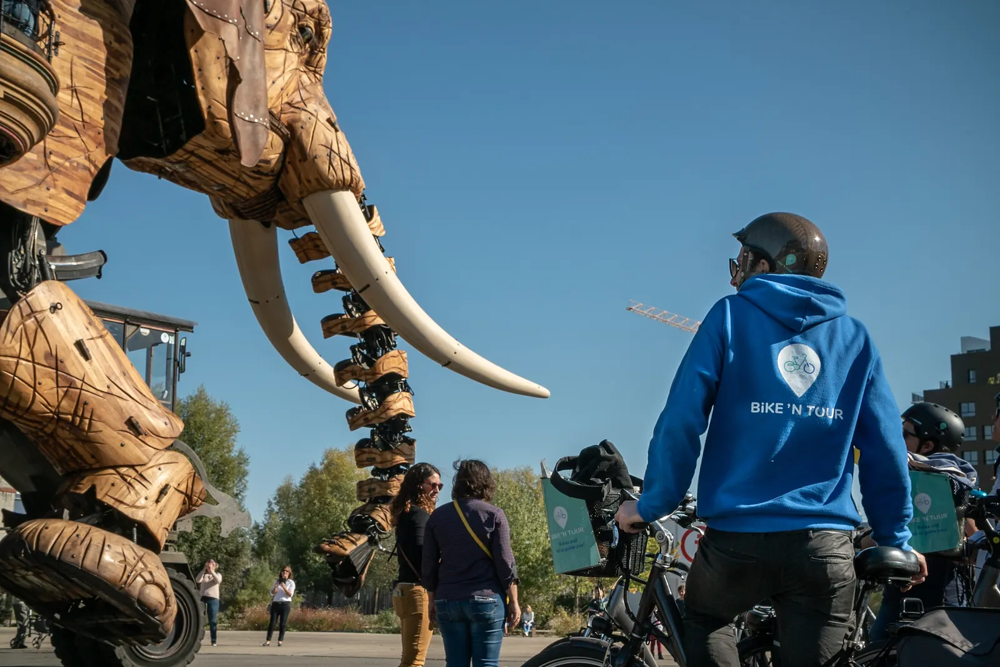
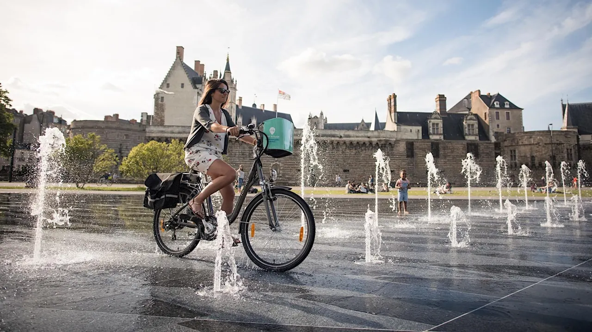

Kies voor een eerste fietsreis vanuit Nantes een vlakke, goed bewegwijzerde route, plan etappes van 40 tot 60 km en reis licht met twee fietstassen. Nantes is een ideaal vertrekpunt: verschillende grote fietsroutes beginnen in het centrum, en met de trein komt u makkelijk terug. Zo adviseren wij onze klanten voor hun vertrek.

## Uw route kiezen

Kies voor een eerste keer een vlak parcours, grotendeels over vrijliggende fietspaden, met stations onderweg. Dit zijn onze suggesties vanuit Nantes, van kort naar lang.

### Voor een weekend

- **De [Vignoble nantais](/fr/itineraires-velo-depart-nantes/vignoble-nantais)**: een lus van ongeveer 80 km in twee dagen, via de Sèvre nantaise, Clisson en de hellingen van de Muscadet.
- **Nantes – Angers over de Loire à Vélo**: ongeveer 110 km in twee etappes, terug met de TER (regionale trein) vanuit Angers.
- **Nantes – Pornic over de Vélodyssée**: ongeveer 100 km in twee dagen, met een overnachting in Paimbœuf of Corsept, daarna de trein van Pornic naar Nantes.
- **Het [Canal de Nantes à Brest](/fr/itineraires-velo-depart-nantes/canal-nantes-brest) tot Redon**: twee dagen over de jaagpaden, en de trein voor de terugweg.

### Voor een paar dagen of een week

- **De [Loire à Vélo](/fr/itineraires-velo-depart-nantes/loire-a-velo)** tot Saumur: ongeveer 165 km in 3 tot 4 dagen. Dit is ons eerste advies voor een eerste meerdaagse tocht: vlak, heel goed bewegwijzerd, met kastelen en dorpen langs de hele route.
- **De [Vélodyssée](/fr/itineraires-velo-depart-nantes/velodyssee)** tot Les Sables-d'Olonne: ongeveer 240 km in 4 tot 5 dagen, van het estuarium naar de kust van de Vendée.
- **De [Régalante](/fr/itineraires-velo-depart-nantes/regalante)** tot de Mont-Saint-Michel: 275 km in 9 etappes, vooral over vrijliggende paden en met weinig hoogteverschil.

Al onze routes worden uitgebreid beschreven op de pagina [fietsroutes vanuit Nantes](/fr/itineraires-velo-depart-nantes).

## Uw etappes doseren

Dit is de meest gemaakte fout bij een eerste reis: te ver willen fietsen. Enkele richtlijnen:

- **Volwassenen met een gemiddelde conditie:** 40 tot 60 km per dag, op een vlak parcours.
- **Met kinderen:** 20 tot 30 km per dag.
- **Op een elektrische fiets:** langere etappes worden comfortabel, als u de accu elke avond oplaadt.

Houd tijd over voor bezienswaardigheden, pauzes en het weer. Tegenwind kan u flink vertragen, vooral op open stukken. Zoek voor uw overnachtingen accommodaties met het label Accueil Vélo: die bieden onder meer een beschutte stalling voor de fietsen.

## Bagage inpakken

### De juiste uitrusting

- **Twee waterdichte achtertassen**: ze worden aan de bagagedrager bevestigd en houden het zwaartepunt laag. Wij verhuren paren Ortlieb-fietstassen van 2 × 20 liter.
- **Een stuurtas**: voor telefoon, papieren, zonnebrandcrème en een tussendoortje.
- **Geen rugzak**: die is vermoeiend voor de rug en laat u zweten.

### De basislijst

- Regenkleding, een warme laag en sneldrogende kleding.
- Helm, zonnebril, zonnebrandcrème.
- Bidon en tussendoortjes.
- Kleine toilettas en EHBO-set.
- Telefoonoplader en powerbank.

Weeg uw bagage: twee tassen van 20 liter zijn ruim voldoende voor een paar dagen. Bij Bike'N Tour zijn slot, bandenreparatieset, pomp, bagagedrager en verlichting bij elke huur inbegrepen.

## Uw fiets kiezen

- **De [toerfiets](/fr/location-velo-de-voyage)**: onze meest gevraagde fiets voor de Loire à Vélo en de Vélodyssée. Rechtop zittend, 9 versnellingen, hydraulische schijfremmen en een bagagedrager voor twee fietstassen.
- **De [elektrische fiets](/fr/location-velo-electrique-voyage)**: ideaal voor lange etappes, heuvelachtige routes en stellen met een verschillend niveau. Ongeveer 100 km actieradius in de eco-stand.
- **De [gravelbike](/fr/location-gravel-nantes)**: voor de Vignoble nantais of jaagpaden met halfverharding.

We stellen elke fiets af op uw maat en geven u ons routeadvies voor vertrek. Bekijk onze [tarieven en reserveren](/fr/nos-tarifs-reservation).

## Met de trein terug

De meeste routes vanuit Nantes fietst u enkele reis. De trein is de eenvoudigste manier om terug te komen:

- **TER Aléop (Pays de la Loire):** in het seizoen is het reserveren van een fietsplaats verplicht en betaald op alle lijnen (in 2026 van mei tot eind september). Reserveer meteen bij aankoop van uw kaartje.
- **TER BreizhGo (Bretagne):** hetzelfde principe in het seizoen, met verplichte en betaalde reservering. Handig voor een terugreis vanuit Rennes of Saint-Malo.
- **TGV en Intercités:** de fiets reist mee op een gereserveerde, betaalde plaats of gedemonteerd in een hoes van maximaal 90 × 120 cm.

De regels veranderen elk jaar: controleer ze voor vertrek op veloabord.fr of bij de SNCF, de Franse spoorwegen. Een andere oplossing: op de belangrijkste routes kunnen wij op offerte het ophalen van de fietsen bij aankomst regelen.

Wilt u vooraf wat kilometers maken? Probeer dan een van onze [ideeën voor fietstochten](/fr/idees-de-balades) voor een dag, zoals [de oevers van de Loire tot Mauves-sur-Loire](/post/les-bords-de-loire-mauves-sur-loire). En wilt u anders reizen, lees dan ons artikel over [slow tourism](/post/le-slow-tourisme-voyager-plus-pour-polluer-moins).

## Veelgestelde vragen

### Welke route kies ik voor een eerste fietsreis vanuit Nantes?

De Loire à Vélo naar Angers of Saumur: vlak, heel goed bewegwijzerd en met de trein bereikbaar voor de terugreis.

### Hoeveel kilometer per dag voor een eerste fietsreis?

Reken op 40 tot 60 km per dag voor volwassenen, en 20 tot 30 km met kinderen. Houd tijd over voor pauzes en bezienswaardigheden.

### Kan ik de huurfiets ergens anders dan in Nantes inleveren?

Ja, op aanvraag: wij regelen met onze partners het ophalen van de fietsen bij aankomst, op offerte. Anders kunt u met de fiets met de trein terug naar Nantes.
