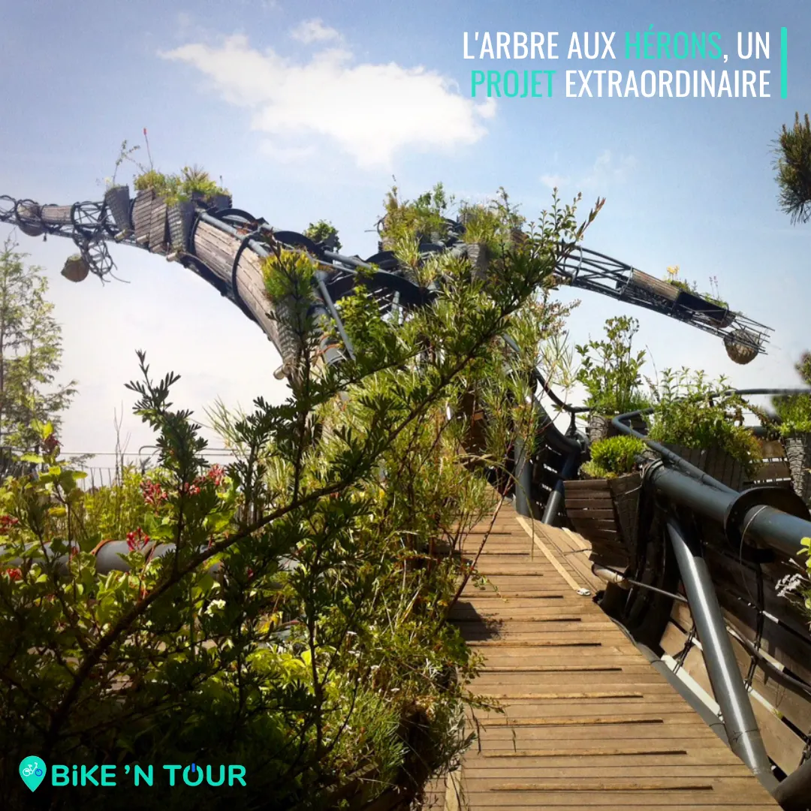

Het rondje Île de Nantes per fiets is een vlakke, makkelijke lus van 10,5 km, die u in een uur fietsen aflegt. De route volgt beide armen van de Loire en verbindt de belangrijkste herkenningspunten van het eiland: de Machines de l'île, de Titan-kranen, de Hangar à Bananes en de Anneaux van Buren. Het is de ideale tocht voor een eerste fietsuitstap in Nantes, alleen, met z'n tweeën of met het gezin.

- **Afstand:** lus van 10,5 km
- **Duur:** ongeveer 1 uur fietsen, 2 tot 3 uur met stops
- **Niveau:** beginner, vlak terrein
- **Start:** de Machines de l'île, Parc des Chantiers
- **Aankomst:** terug bij het startpunt
- **Toegang:** tramlijn 1, halte Chantiers navals, of een minuut of tien fietsen vanaf onze winkel

## De route

Het Île de Nantes is bijna 5 km lang. Het wordt in het noorden begrensd door de Madeleine-arm van de Loire en in het zuiden door de Pirmil-arm. Onze lus gaat helemaal rond, met de klok mee.

### Van de Machines de l'île naar de oostpunt

Vertrek in het Parc des Chantiers, voor de Nefs, de hallen van de voormalige scheepswerven waarin de Machines de l'île zijn ondergebracht. Fiets daarna naar het oosten langs de Madeleine-arm. Aan de overkant ziet u het historische centrum. Fiets door tot de oostpunt van het eiland, aan de kant van Beaulieu, een wijk die vanaf de jaren 1960 is gebouwd.

### Terug langs de Pirmil-arm

Keer om via de zuidkant van het eiland en volg de Pirmil-arm naar het westen. Aan de overkant, op de zuidoever, ligt Rezé. Fiets tot het eind van de quai Wilson, op de westpunt van het eiland.

### Tot slot de quai des Antilles

Rijd ten slotte over de quai des Antilles, langs de Loire. U komt langs de Hangar à Bananes en de Anneaux voordat u weer bij het Parc des Chantiers bent. Deel op de kades de ruimte met voetgangers en rijd stapvoets wanneer het druk is.

## Onderweg te zien

### De Machines de l'île

De Machines de l'île, ondergebracht in de Nefs van de voormalige scheepswerven, zijn het werk van Pierre Orefice en François Delarozière. De 12 meter hoge Grand Éléphant wandelt er rond met zijn passagiers. De Carrousel des Mondes Marins en de Galerie des Machines maken het bezoek compleet. Trek er tijd voor uit als u naar binnen wilt.

### De Titan-kranen

Twee reusachtige kranen herinneren aan het industriële verleden van het eiland. De grijze staat aan het eind van de quai Wilson. De gele, de oudste van de twee, werd gebruikt door de scheepswerven van Dubigeon. We schreven er een artikel over: [de Titans van Nantes](/post/les-titans-de-nantes).

### De Anneaux van Buren

Aan de quai des Antilles, bij de Hangar à Bananes, omlijsten achttien ringen van Daniel Buren en Patrick Bouchain de Loire. Dit permanente kunstwerk licht bij het vallen van de avond rood, blauw en groen op. Het ligt aan de groene lijn van de [Voyage à Nantes](/post/le-voyage-a-nantes-2021-a-deja-commence).

### En de Arbre aux Hérons?

Misschien hebt u ervan gehoord: in de voormalige steengroeve Misery, op de andere oever, zou een enorme begroeide constructie verrijzen, de Arbre aux Hérons (reigerboom). Nantes Métropole heeft het project in september 2022 geschrapt vanwege de stijgende kosten. De makers hebben dat besluit aangevochten. U kunt wel prototypes zien in de Galerie des Machines, waaronder een maquette op een vijfde van de ware grootte van de stam en de takken, en een reiger met een spanwijdte van 8 meter.

## Praktische informatie

- **Wanneer gaan:** 's ochtends zijn de kades rustiger. Aan het eind van de dag is het licht op de Loire prachtig, en bij het vallen van de avond gaan de Anneaux aan.
- **Waar parkeren:** bij de bezienswaardigheden staan fietsbeugels. Maak met het meegeleverde slot het frame vast, niet alleen het wiel.
- **Meer weten:** de geschiedenis van het eiland leest u in ons artikel [een eiland vol geschiedenis](/post/une-ile-remplie-dhistoire-ile-de-nantes).

Vanaf onze winkel, op quai de Versailles 27 (tram lijn 2, halte Saint-Mihiel), bent u in een minuut of tien fietsen op het eiland: rijd via de cours des 50-Otages zuidwaarts naar de Loire. De winkel is open van april tot oktober. Al onze tips vindt u in onze [gids voor fietsverhuur in Nantes](/fr/guide-location-velo-nantes).

[Bekijk de route op Google Maps](https://www.google.fr/maps/place/%C3%8Ele+de+Nantes/@47.2041807,-1.5559768,15z/data=!3m1!4b1!4m5!3m4!1s0x4805eeb40b080c85:0xf0d37531cab1510!8m2!3d47.204167!4d-1.547222)

## Welke fiets kiest u?

De lus is vlak: al onze fietsen zijn geschikt.

- **De [toerfiets](/fr/location-velo-de-voyage)**: comfortabel, met 9 versnellingen en een rechtopzittende houding. Ruim voldoende voor deze route.
- **De [elektrische fiets](/fr/location-velo-electrique-voyage)**: handig als u de tocht verlengt naar Trentemoult of langs de Loire, of als u zonder moeite wilt fietsen.
- **De [elektrische bakfiets](/fr/location-velo-cargo)**: perfect om de kinderen en de picknick mee te nemen.

De tarieven per dag, weekend of week staan op onze pagina [tarieven en reserveren](/fr/nos-tarifs-reservation). Liever met een gids? Onze [panoramatour door Nantes](/fr/tour/tour-du-panorama-nantais) komt langs het Île de Nantes en de Olifant, op een elektrische fiets en met een lokale gids. Bekijk ook onze andere [ideeën voor fietstochten](/fr/idees-de-balades).

## Veelgestelde vragen

### Hoe lang duurt het rondje Île de Nantes per fiets?

Reken op ongeveer een uur voor de 10,5 km zonder te stoppen. Met een pauze bij de Machines, de Titans en de Anneaux trekt u beter twee tot drie uur uit.

### Is het rondje Île de Nantes per fiets geschikt voor kinderen?

Ja: de route is vlak en kort. Let goed op op de kades die u deelt met voetgangers. Wij verhuren kinderfietsen, kinderzitjes en een bakfiets.

### Is de Arbre aux Hérons in Nantes te zien?

Nee: Nantes Métropole heeft het project in september 2022 geschrapt. Prototypes, waaronder een maquette en een mechanische reiger, zijn te zien in de Galerie des Machines de l'île.
