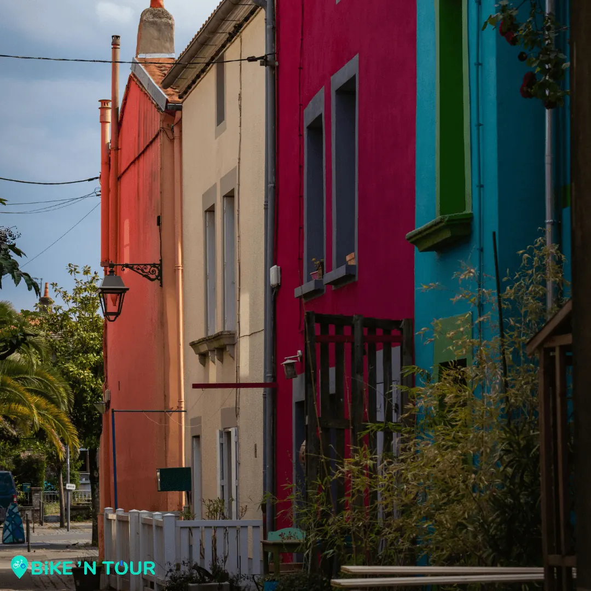

Situé à quelques pas de Nantes, ce petit village coloré et chaleureux est le lieu idéal pour s’évader le temps d’une balade. Bien que [Trentmoult](/post/balade-incontournable-de-nantes-au-lac-de-grand-lieu) soit aujourd’hui un lieu de promenades et de détentes pour les touristes et pour les habitants du coin, le village reste surtout un lieu chargé d’histoire.

A commencé par le nom du village, selon la tradition le nom [Trentemoult](/post/balade-incontournable-de-nantes-au-lac-de-grand-lieu) aurait été choisi en hommage aux trente hommes qui y auraient combattu les normands lors du siège de Nantes au IXème siècle. Une autre théorie, un peu moins épique associerai le nom de « Trentemoult » à « trente moux », c’est-à-dire trente tertres, les tertres étant des petites élévations de terre isolées.

Peu importe l’origine de son nom, une chose est sûre, les trentemousins vivaient à l’origine presque tous de la pêche jusqu’au début du XIXe siècle. La position géographique idéale de [Trentmoult](/post/balade-incontournable-la-loire-a-velo-de-nantes-a-indre) à favoriser la pêche sur la Loire ainsi qu’en pleine mer. Les pêcheurs de [Trentemoult](/post/balade-incontournable-la-loire-a-velo-de-nantes-a-indre) utilisaient à l’époque des petites barques à fond plat, ils y embarquaient à deux pour la pêche en Loire et à trois pour celle en mer.

Au début du XIXe siècle la pêche n’est plus l’activité principale du village, les habitants se tournent alors vers le commerce maritime. À la fin du siècle, la population résidante travaille essentiellement pour les chantiers navals de Nantes et le village devient au même moment un lieu de détente très prisé par les Nantais.

Si vous aussi vous souhaitez découvrir ce village et ses environs, le vélo est le moyen idéal pour le faire, alors n’hésitez pas à nous en réserver un directement sur [bikentour.com](/).

[Découvrez la balade à vélo jusqu'au Lac de Grand-Lieu](/post/balade-incontournable-de-nantes-au-lac-de-grand-lieu) et [Découvrez la balade à vélo jusqu'à Indre](/post/balade-incontournable-la-loire-a-velo-de-nantes-a-indre)

[Voir ici toutes nos balades à vélo et articles de blog](/fr/blog)

[Voir le parcours sur Google Maps](https://www.google.fr/maps/place/Trentemoult,+Rez%C3%A9/@47.1941776,-1.5889441,15z/data=!3m1!4b1!4m5!3m4!1s0x4805eb8d386dc4b5:0x9751b8bbd8d73f81!8m2!3d47.1939627!4d-1.5815987)
