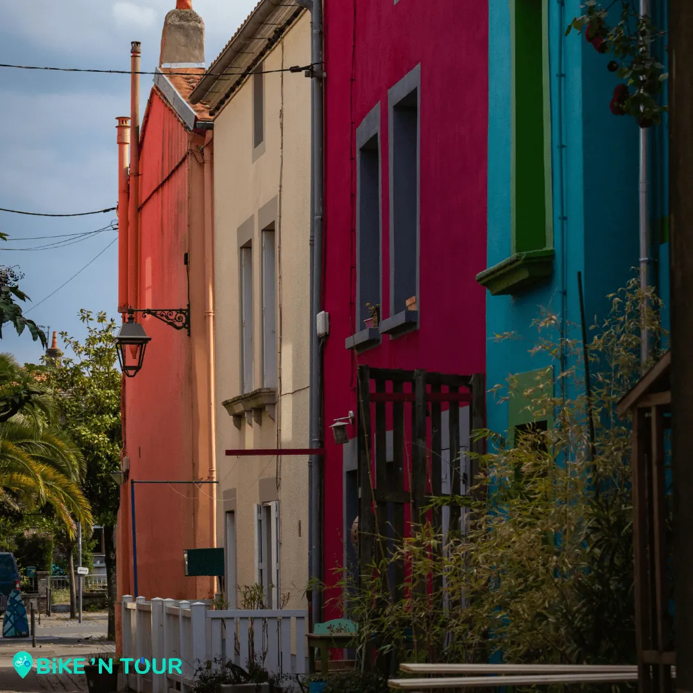

Trentemoult est un ancien village de pêcheurs et de marins au long cours, sur la rive sud de la Loire, à Rezé. Ses maisons colorées, ses ruelles étroites et ses quais au bord du fleuve en font un but de promenade très apprécié des Nantais. Depuis notre boutique, vous y êtes en une vingtaine de minutes à vélo en traversant l'île de Nantes, ou en quelques minutes de Navibus depuis la Gare maritime.

- **Distance :** environ 6 km depuis la boutique
- **Durée :** une vingtaine de minutes à vélo, une à deux heures sur place
- **Niveau :** facile, terrain plat
- **Accès :** à vélo par l'île de Nantes, ou en Navibus N1 depuis la Gare maritime
- **Retour :** à vélo par le même chemin, ou en Navibus vers la rive nord

## Un peu d'histoire

### Un village de pêcheurs

Trentemoult a longtemps vécu de la Loire. Ses habitants étaient pour beaucoup des pêcheurs, installés au bord du fleuve, face à Nantes. Le village a gardé de cette époque son plan serré : des maisons collées les unes aux autres, des venelles où l'on se faufile à pied et des quais tournés vers l'eau.

### Le village des cap-horniers

Trentemoult est aussi un village de marins au long cours. Beaucoup de ses habitants ont navigué sur les grands voiliers, jusqu'à doubler le cap Horn : on les appelait les cap-horniers. Autour du centre du village, on peut encore voir les belles demeures construites pour ces capitaines. Les palmiers et les plantes exotiques des jardins auraient été rapportés de leurs voyages.

### Des maisons aux couleurs des bateaux

Ce qui frappe d'abord, ce sont les couleurs. Selon la tradition, les pêcheurs peignaient leurs maisons avec les restes de peinture destinée à la coque de leurs bateaux. Rouge, rose, bleu, vert : la tradition s'est maintenue, et les façades vives font aujourd'hui la réputation du village. Ouvrez l'œil : sur une façade, une ancienne publicité peinte pour le Petit Beurre LU rappelle l'histoire de la biscuiterie nantaise.

## Ce qu'il faut voir

- **Les ruelles colorées :** laissez le vélo à l'entrée du village et perdez-vous à pied dans les venelles. Elles se découvrent mieux à pied.
- **Les quais :** bordés de cafés et de restaurants, ils offrent une large vue sur la Loire et sur la rive nord.
- **Le Pendule de Roman Signer :** cette œuvre du parcours Estuaire est suspendue à une ancienne centrale à béton, au bord du fleuve.
- **Rezé :** si vous aimez l'architecture, poussez jusqu'à la Maison radieuse de Le Corbusier, à Rezé.

## Y aller à vélo depuis la boutique

### Par l'île de Nantes

Depuis notre boutique du quai de Versailles, descendez vers la Loire par le cours des 50-Otages, puis traversez l'île de Nantes. Franchissez ensuite le bras sud de la Loire pour rejoindre Rezé, puis longez le fleuve vers l'ouest jusqu'à Trentemoult. Le trajet est plat.

### En Navibus

Le Navibus N1 relie la Gare maritime, sur la rive nord, à Trentemoult en quelques minutes. Les vélos sont acceptés à bord selon l'affluence et avec l'accord de l'équipage. Depuis novembre 2025, l'embarcadère de Trentemoult se trouve sur le site des anciennes sablières, et la ligne N2 le relie aussi au Bas-Chantenay et au Hangar à Bananes. Une belle façon de faire l'aller à vélo et le retour en bateau.

### Pour aller plus loin

Trentemoult est sur l'itinéraire commun de la Loire à Vélo et de la Vélodyssée. Vous pouvez continuer vers le [lac de Grand-Lieu](/post/balade-incontournable-de-nantes-au-lac-de-grand-lieu), à 18 km de Nantes, ou vers l'estuaire et [Saint-Brevin-les-Pins](/post/balade-incontournable-le-parcours-de-lestuaire-de-nantes-a-saint-brevin-les-pins). La boucle par [Indre](/post/balade-incontournable-la-loire-a-velo-de-nantes-a-indre) revient elle aussi par Trentemoult.

## Infos pratiques

- **Quand y aller :** le week-end, les quais sont très animés. En semaine ou le matin, le village est plus calme.
- **Pause :** cafés et restaurants sur les quais, ou pique-nique au bord de la Loire.
- **Stationnement :** attachez votre vélo par le cadre à l'entrée du village, avant les ruelles.
- **Respect des lieux :** Trentemoult est un village habité. Restez discret dans les venelles.

[Voir le parcours sur Google Maps](https://www.google.fr/maps/place/Trentemoult,+Rez%C3%A9/@47.1941776,-1.5889441,15z/data=!3m1!4b1!4m5!3m4!1s0x4805eb8d386dc4b5:0x9751b8bbd8d73f81!8m2!3d47.1939627!4d-1.5815987)

## Quel vélo choisir ?

Le trajet est plat : notre [vélo de voyage](/fr/location-velo-de-voyage) est parfait. Si vous prolongez vers Grand-Lieu ou l'estuaire, le [vélo électrique](/fr/location-velo-electrique-voyage) rend la journée plus légère. En famille, pensez au [vélo cargo électrique](/fr/location-velo-cargo). Les prix sont sur notre page [tarifs et réservation](/fr/nos-tarifs-reservation). Retrouvez aussi nos [idées de balades](/fr/idees-de-balades).

## Questions fréquentes

### Comment aller à Trentemoult depuis le centre de Nantes ?

À vélo, en une vingtaine de minutes par l'île de Nantes. Ou en Navibus N1 depuis la Gare maritime, une traversée de quelques minutes.

### Peut-on prendre le Navibus avec un vélo ?

Oui, selon l'affluence et avec l'accord de l'équipage. Aux heures chargées, prévoyez de rentrer à vélo par le pont.

### Pourquoi les maisons de Trentemoult sont-elles colorées ?

Selon la tradition, les pêcheurs utilisaient les restes de peinture de leurs bateaux pour peindre leurs façades. La coutume s'est maintenue.

[Découvrez la balade à vélo jusqu'au Lac de Grand-Lieu](/post/balade-incontournable-de-nantes-au-lac-de-grand-lieu) et [Découvrez la balade à vélo jusqu'à Indre](/post/balade-incontournable-la-loire-a-velo-de-nantes-a-indre)

[À lire aussi : La balade à vélo sur l'île de Nantes](/post/balade-incontournable-lile-de-nantes)
